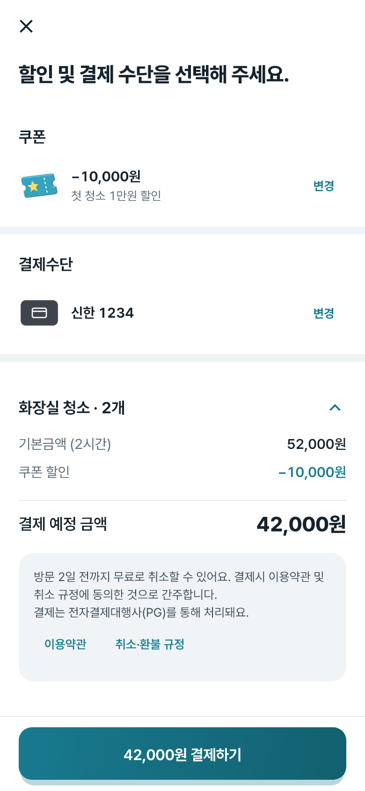
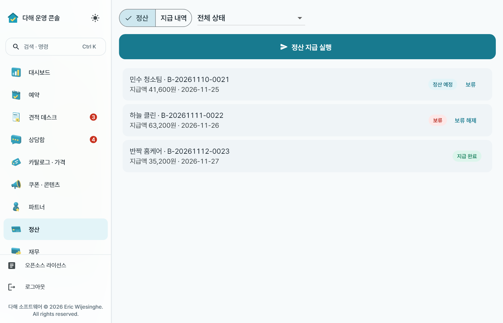
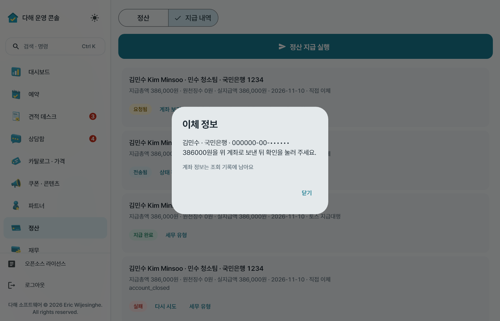
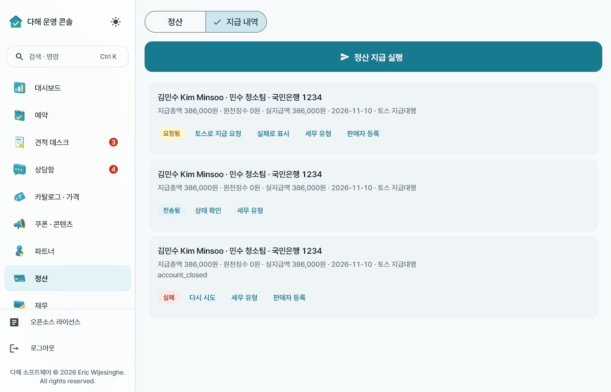
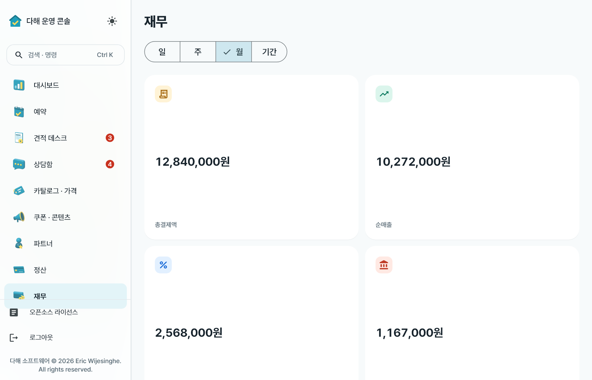
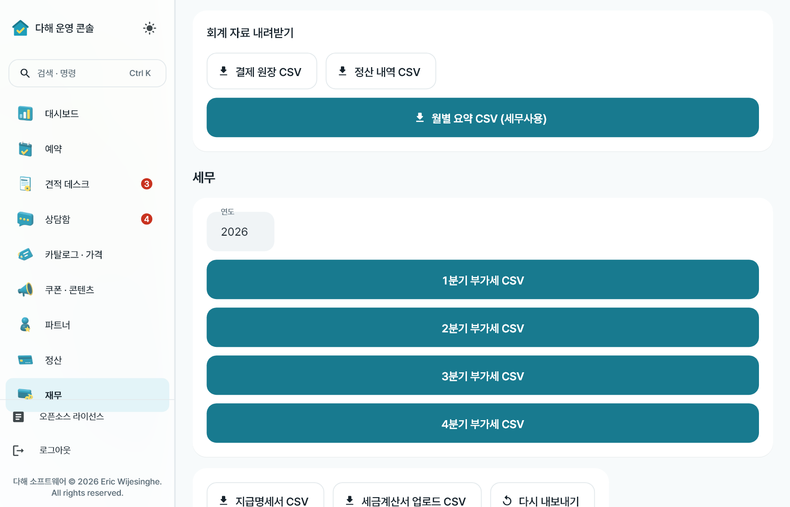
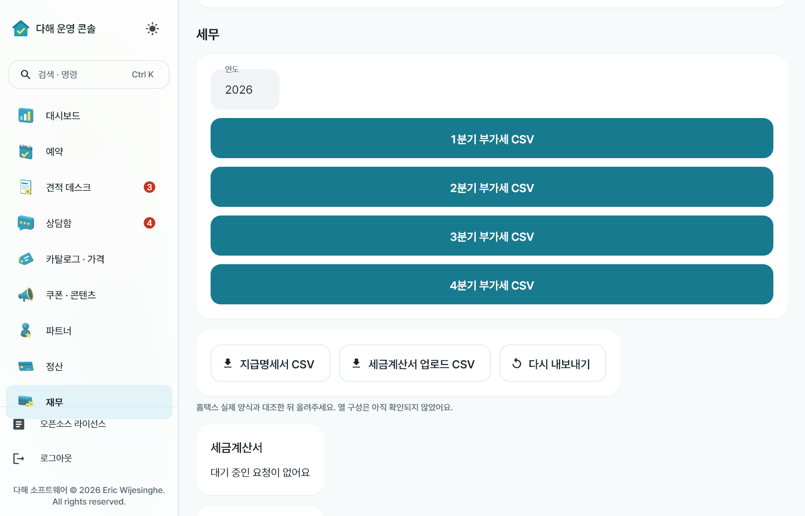

# 21. 결제, 환불, 정산, 재무

**이 장에서 할 일:** 고객 돈이 어떻게 들어오고 나가는지 알아봐요. 파트너에게 줄 돈(정산)을 확인하고 지급해요. 재무 화면에서 매출을 보고, 세무사에게 줄 파일을 내려받아요.

> **준비물**
> - **관리자** 계정 (정산 버튼과 **[재무]** 메뉴는 관리자에게만 보여요)
> - 휴대폰 인증 앱 (6자리 코드) — 지급, 계좌 보기, 파일 내려받기에 필요해요
> - 결제 설정이 끝난 상태 ([11장](11-setup-portone.md) 또는 [12장](12-setup-toss-payments.md))
> - 파트너 지급 방식 설정 ([13장](13-setup-payout.md)) — 직접 이체인지 토스 지급대행인지
> - 직접 이체라면: 회사 은행 앱
> - CSV 파일을 내려받으려면: PC의 웹 브라우저로 연 콘솔

> **팁**
> 민감한 작업을 하면 **인증 앱 코드로 한 번 더 확인** 창이 떠요. 인증 앱의 6자리 코드를 **인증 앱의 6자리 코드** 칸에 적고 **[확인하고 계속]** 을 눌러요. 한 번 확인하면 5분 동안은 다시 묻지 않아요([8장](08-console-tour.md)).

## 21.1 고객 결제는 이렇게 흘러가요

| 상품 종류 | 고객이 내는 때 | 예약 상세 **결제** 카드에 보이는 이름 |
|---|---|---|
| 정해진 가격 상품 | 예약할 때 전액 | **결제 금액** |
| 견적 상품 (이사·입주 청소) | 견적을 받은 뒤 예약금, 작업이 끝난 뒤 잔금 | **예약금**, **잔금** |

예약금 비율은 **[견적 산정식]** 화면 아래에 보여요. 처음 설치 값은 10%예요([18.6](18-catalog-prices.md#186-이사입주-청소-견적-공식-견적-산정식)).

### 고객 앱 결제 화면

1. 고객이 예약 마지막 단계에서 **할인 및 결제 수단을 선택해 주세요.** 화면을 봐요.
2. **쿠폰** 과 **포인트** 를 골라요. 포인트는 결제할 때 한 번에 쓸 수 있는 한도가 있고, 전액을 포인트로 낼 수는 없어요.
3. 금액 칸에 **기본금액**, **주말·공휴일·저녁 할증**, **첫 예약 할인**, **쿠폰 할인** 이 해당될 때만 보이고, 마지막에 **결제 예정 금액** 이 보여요.
4. **결제수단** 을 고르고 **[(금액) 결제하기]** 를 눌러요.

- 고를 수 있는 결제수단(카드, 간편결제, 계좌이체, 가상계좌)은 결제 설정에 따라 달라요([10장](10-setup-business.md), [11장](11-setup-portone.md)).
- **가상계좌** 를 고르면 고객 앱에 **입금 계좌가 준비됐어요** 화면이 나와요. **은행**, **계좌번호**, **예금주**, **입금 금액**, 입금 기한이 보여요. 기한 안에 입금하면 자동으로 확인되고 예약이 확정돼요.
- 결제 직후 확인이 늦어지면 고객 앱에 **결제 확인 중** 이 보여요. 고객에게 "다시 결제하지 마세요" 라고 안내해 주세요. 확인이 끝나면 예약 내역에 나타나요.

> **주의**
> 결제 화면 아래 **방문 2일 전까지 무료로 취소할 수 있어요...** 문구는 고정 문구예요. 취소 정책을 바꿔도 따라 바뀌지 않아요. 정책을 바꿨다면 개발사에 문구 수정을 요청하세요([18.10](18-catalog-prices.md#1810-취소-수수료-취소-정책)).

## 21.2 환불

환불은 두 곳에서 해요.

- **예약 취소와 함께:** 예약 상세의 **[취소 · 환불]** ([19.2](19-bookings-quotes-inbox.md#192-예약-찾고-처리하기))
- **사건(분쟁) 처리 중:** [22장](22-marketing-growth.md)

환불할 때 알아 둘 것:

1. 돈은 고객이 결제한 곳(PortOne 또는 토스페이먼츠)으로 돌아가요. 결제사를 바꾼 뒤에도 예전 결제는 예전 결제사로 환불돼요. 그래서 예전 결제사 설정 카드를 지우면 안 돼요([12장](12-setup-toss-payments.md)).
2. 예약을 취소하면 그 예약의 파트너 정산이 **보류** 로 바뀌어요.
3. 전액 환불하면 아직 내보내지 않은 세금계산서 요청은 자동으로 취소돼요. 이미 내보냈거나 홈택스에서 발행한 건은 홈택스에서 수정세금계산서로 직접 취소하세요. 부분 환불이면 요청이 그대로 남아요.
4. 현금영수증은 전액 환불할 때 자동으로 취소돼요. 부분 환불일 때 처리 방법은 세무사와 **확인 필요** 예요.

> **주의**
> 결제사 쪽에서 환불이 실패하면 **[시스템 상태]** 에 **결제 확인 필요** 가 떠요. 그때는 결제사 관리자 화면에서 그 결제를 찾아 직접 환불해 주세요([26장](26-system-status-updates.md)).

## 21.3 파트너 정산과 지급

### 정산은 이렇게 만들어져요

1. 파트너가 파트너 앱에서 작업을 완료하면 예약마다 **정산** 이 하나 만들어져요.
2. 정산 금액 = 작업 금액 − 플랫폼 수수료(파트너의 **수수료율 %**). 화면에는 **지급액** 으로 보여요.
   - 작업 금액: 정해진 가격 상품은 할인 전 가격, 견적 상품은 최종 견적 금액이에요. 쿠폰·첫 예약 할인은 파트너 몫에서 빼지 않아요(플랫폼이 부담).
3. 정산 상태는 이렇게 바뀌어요.

| 상태 | 뜻 |
|---|---|
| **잔금 대기** | 견적 상품이라 고객 잔금을 기다려요 |
| **정산 예정** | 지급할 수 있어요. 지급일은 작업 완료 다음 수요일이에요(수요일에 끝나면 그다음 주 수요일) |
| **지급 완료** | 파트너에게 돈이 나갔어요 |
| **보류** | 사장님이 멈췄거나, 예약이 취소됐어요 |

### 정산 목록 보기

1. 왼쪽 메뉴에서 **[정산]** 을 눌러요.
2. 위의 **[정산]** 과 **[지급 내역]** 중 **[정산]** 이 선택된 상태예요.
3. **전체 상태** 를 눌러 상태로 거를 수 있어요.
4. 줄마다 `팀 이름 · 예약번호`, **지급액**, 지급일, 상태가 보여요.

### 정산 멈추기 (보류)

분쟁이 있는 작업은 지급 전에 멈춰 둬요.

1. **정산 예정** 줄의 **[보류]** 를 눌러요.

이렇게 보이면 성공: **처리했어요** 가 뜨고 상태가 **보류** 로 바뀌어요. 다시 풀려면 **[보류 해제]** 를 눌러요.

> **주의**
> 이미 지급 요청에 들어간 정산은 보류할 수 없어요. **[보류]** 를 누르면 **지금은 정산 상태를 바꿀 수 없어요.** 가 떠요. 그때는 **[지급 내역]** 에서 처리해요.

### 지급 요청 만들기 (정산 지급 실행)

1. **[정산]** 화면 위의 **[정산 지급 실행]** 을 눌러요.
2. **지급 기준일** 달력이 열려요. **오늘이나 그 전 날짜** 를 골라요. 이 날짜까지 지급일이 된 **정산 예정** 건이 모두 들어가요.
3. **인증 앱 코드로 한 번 더 확인** 창이 뜨면 코드를 적고 **[확인하고 계속]** 을 눌러요.

이렇게 보이면 성공: **지급 요청 (숫자)건을 만들었어요** 가 뜨고, 화면이 **[지급 내역]** 으로 바뀌어요. 파트너마다 지급 한 건씩 **요청됨** 으로 생겨요.

> **주의**
> - 앞으로의 날짜를 고르면 만들어지지 않아요(**문제가 생겼어요. 잠시 후 다시 시도해 주세요.** 가 떠요). 오늘이나 지난 날짜를 골라요.
> - **확인된 정산 계좌** 가 있는 파트너만 지급 요청이 만들어져요. 파트너가 앱에서 계좌를 등록하거나 바꾸면 확인 전 상태가 돼요. 이 버전의 콘솔에는 계좌를 "확인됨" 으로 바꾸는 화면이 없어요(**확인 필요**, 개발사에 문의). 그래서 0건이 나올 수 있어요.
> - 같은 버튼을 두 번 눌러도 같은 정산이 두 번 들어가지 않아요.

### 지급 내역 읽기

1. **[지급 내역]** 을 눌러요.
2. 지급 한 건마다 카드가 보여요.
   - 첫 줄: `파트너 이름 · 팀 이름 · 은행 계좌 끝 4자리`
   - 둘째 줄: **지급총액**, **원천징수**, **실지급액**, 지급일, 지급 방식(**직접 이체** 또는 **토스 지급대행**). 실패 사유가 있으면 그 아래 줄에 보여요.
   - 상태: **요청됨**, **전송됨**, **지급 완료**, **실패**
3. 아직 없으면 **지급 내역이 없어요** 가 보여요.

> **팁**
> 파트너에게 실제로 보내는 돈은 **실지급액** 이에요(지급총액에서 원천징수를 뺀 금액).

### 방법 A: 직접 이체 (처음 설치 방식)

1. **[지급 내역]** 에서 **요청됨** 카드의 **[계좌 보기]** 를 눌러요.
2. 인증 앱 코드를 물어보면 적고 **[확인하고 계속]** 을 눌러요.
3. **이체 정보** 창에 `예금주 · 은행 · 계좌번호` 와 보낼 금액이 보여요. 아래에 **계좌 정보는 조회 기록에 남아요** 가 보여요.
4. 회사 은행 앱을 열어 그 계좌로 그 금액을 보내요.
5. 콘솔로 돌아와 **[닫기]** 를 눌러요.
6. 같은 카드의 **[이체 완료로 표시]** 를 눌러요.

이렇게 보이면 성공: **처리했어요** 가 뜨고, 카드가 **지급 완료** 로 바뀌어요. 그 정산들도 **지급 완료** 가 돼요.

> **주의**
> 은행 이체가 끝난 것을 확인한 뒤에만 **[이체 완료로 표시]** 를 눌러요. 계좌를 볼 때마다 활동 기록에 남아요.

**이체를 못 했을 때 (실패로 표시)**

1. **요청됨** 카드의 **[실패로 표시]** 를 눌러요.
2. **실패 사유** 창에 이유를 적어요(예: `계좌 오류, 이체 취소`). 꼭 적어야 해요.
3. **[실패로 표시]** 를 눌러요.

이렇게 보이면 성공: 카드가 **실패** 로 바뀌고 사유가 보여요. 문제를 고친 뒤 **[다시 시도]** 를 누르면 다시 **요청됨** 이 돼요.

### 방법 B: 토스 지급대행

[13장](13-setup-payout.md)에서 파트너 지급을 토스 지급대행으로 설정했을 때만 써요.

**처음 한 번: 파트너를 토스 판매자로 등록**

1. 그 파트너의 **요청됨** (또는 **실패**) 카드에서 **[판매자 등록]** 을 눌러요.
2. **토스 판매자 등록** 창에서 **개인** 또는 **사업자** 를 골라요. 안내: **이 파트너의 확인된 정산 계좌로 등록해요. 사업자 정보만 입력해 주세요.**
3. 칸을 채워요: **이름**, **정산 이메일**, **연락처**(숫자 10~11자리). **사업자** 를 골랐다면 **대표자명** 과 **사업자등록번호 (숫자 10자리)** 도 채워요. 칸이 비었거나 형식이 틀리면 칸 아래에 **필수** 가 떠요.
4. **[등록하기]** 를 눌러요.

이렇게 보이면 성공: **판매자 상태: (상태)** 가 떠요. 파트너가 계좌를 바꿨다면 다시 등록해도 괜찮아요.

**지급 보내기**

1. **요청됨** 카드의 **[토스로 지급 요청]** 을 눌러요.
2. 인증 앱 코드를 물어보면 적고 **[확인하고 계속]** 을 눌러요.
3. 카드가 **전송됨** 으로 바뀌어요.
4. 잠시 뒤 **[상태 확인]** 을 눌러요. 토스가 끝났다고 알려 주면 **지급 완료** 가 돼요.
5. **실패** 가 되면 사유를 확인하고 고친 뒤 **[다시 시도]** 를 눌러요.

**토스에서 답이 없을 때 (Toss에서 확인하기)**

토스에 보냈는데 응답을 못 받으면, 돈이 나갔는지 알 수 없어요. 이때 카드에 **[Toss에서 확인하기]** 가 보여요.

1. **[Toss에서 확인하기]** 를 눌러요.
2. 토스가 답하면 상태가 바로 바뀌어요.
3. **토스 기록에서 이 송금을 찾지 못했어요. 몇 분 뒤 다시 확인하거나, 토스 상점관리자를 직접 확인해 주세요.** 가 뜨거나 토스에 연결되지 않으면, 카드에 **[송금되지 않았음을 확인]** 이 생겨요. 먼저 몇 분 기다렸다 **[Toss에서 확인하기]** 를 다시 눌러 봐요.
4. 그래도 같으면, **[송금되지 않았음을 확인]** 을 누르기 전에 토스페이먼츠 상점관리자에 로그인해서 지급대행 내역에서 그 파트너와 금액을 찾아요.
   - 내역이 없거나 **실패**·**취소** 로 보이면: 5번으로 가요.
   - **요청됨**, **처리 중**, **완료** 로 보이면: 돈이 나갔거나 나가는 중이에요. 아무것도 누르지 말고 나중에 **[Toss에서 확인하기]** 를 다시 눌러요.
5. **[송금되지 않았음을 확인]** 을 눌러요. **정말 송금되지 않았나요?** 창이 열려요.
6. **토스 상점관리자에서 직접 확인했어요** 에 체크해요.
7. **[송금되지 않음으로 표시]** 를 눌러요.

이렇게 보이면 성공: **실패로 표시했어요. 이제 다시 시도할 수 있어요.** 가 떠요. **[다시 시도]** 로 다시 보내요. 이 지급에 묶인 예약은 다시 보낸 결과를 토스가 알려 줄 때까지 취소할 수 없어요.

> **주의**
> **잘못 확인하면 같은 정산이 파트너에게 두 번 지급될 수 있어요.** 토스 상점관리자에서 꼭 직접 확인한 뒤에 눌러 주세요.

### 파트너 세무 유형 (원천징수)

1. **[지급 내역]** 의 아무 카드에서 그 파트너의 **[세무 유형]** 을 눌러요.
2. 하나를 골라요.
   - **프리랜서 (원천징수)**: 지급할 때 사업소득 원천징수(소득세 3% + 지방소득세는 소득세의 10%)를 빼요.
   - **사업자 등록 (원천징수 없음)**: 원천징수를 빼지 않아요.

이렇게 보이면 성공: 다음에 만들어지는 지급부터 새 유형이 적용돼요. 이미 만든 지급은 바뀌지 않아요.

> **주의**
> - 유형을 정하지 않은 파트너는 안전하게 원천징수를 빼요.
> - 원천징수 기준 금액(수수료를 뺀 금액인지), 세율, 끝수 처리는 세무사와 **확인 필요** 예요.

## 21.4 재무 화면

1. 왼쪽 메뉴에서 **[재무]** 를 눌러요(관리자만 보여요).
2. 맨 위에서 기간을 골라요.
   - **[일]**: 오늘
   - **[주]**: 이번 주 (월요일~일요일)
   - **[월]**: 이번 달
   - **[기간]**: 달력에서 시작일과 끝날을 골라요 (800일 미만, 약 2년)
3. 숫자 카드를 읽어요.

| 카드 | 뜻 |
|---|---|
| **총결제액** | 고객이 결제한 금액 합계 |
| **순매출** | 총결제액에서 환불을 뺀 금액 |
| **플랫폼 수수료** | 파트너 정산에서 뺀 수수료 합계 |
| **부가세 추정** | 플랫폼 수수료의 10%로 계산한 추정치 |
| **파트너 지급 완료** | 이미 파트너에게 나간 돈 |
| **지급 예정** | 앞으로 나갈 돈 |
| **평균 주문액** | 예약 1건 평균 금액 |
| **취소율** | 취소된 예약 비율 |
| **월 반복 매출 (MRR)** | 정기 청소로 매달 들어오는 매출 |
| **해지율** | 정기 청소 해지 비율 |
| **이용 중 구독** | 지금 이용 중인 정기 청소 수 |
| **기간 인식 매출** | 고른 기간에 인식된 매출 |

4. 카드 아래 안내: **플랫폼 수수료의 10%로 계산한 추정치예요. 세무사와 확인하세요.**
5. 아래로 내리면 차례로 보여요.
   - **추이**: 그래프. **[최근 30일]**, **[최근 90일]**, **[주]**, **[월]** 로 단위를 바꿔요.
   - **결제수단**: 결제수단별 비율
   - **파트너별 정산**: **파트너**, **건수**, **정산 총액**, **수수료**, **지급액**
   - **서비스별 매출**
6. 기록이 없는 기간이면 **이 기간에 기록이 없어요** 가 보여요.

> **팁**
> 불러오지 못하면 **재무 자료를 불러오지 못했어요** 와 **[다시 시도]** 가 보여요. 화면을 아래로 당겨도 새로고침돼요.

### 회계 자료 내려받기 (CSV)

1. **[재무]** 에서 원하는 기간을 먼저 골라요. 파일은 그 기간으로 만들어져요.
2. **회계 자료 내려받기** 카드로 내려가요.
3. 필요한 버튼을 눌러요.
   - **[결제 원장 CSV]**: 결제·환불 한 건 한 건
   - **[정산 내역 CSV]**: 파트너 정산 한 건 한 건
   - **[월별 요약 CSV (세무사용)]**: 세무사에게 줄 월별 요약
4. 인증 앱 코드를 물어보면 적고 **[확인하고 계속]** 을 눌러요.

이렇게 보이면 성공: 브라우저가 CSV 파일을 내려받아요(예: `dahae-ledger.csv`). 엑셀로 열면 한글이 깨지지 않아요.

> **주의**
> 파일 내려받기는 **웹 브라우저로 연 콘솔** 에서만 돼요. 다른 곳에서는 **CSV 내려받기는 웹 콘솔에서 할 수 있어요** 가 떠요. 실패하면 **내려받지 못했어요** 가 떠요.

## 21.5 세무 (세금계산서, 현금영수증, 원천징수, 부가세)

**[재무]** 화면 맨 아래 **세무** 에 있어요.

> **주의**
> 세무 기능은 아직 실제 세무 서식·결제사 테스트로 다 확인되지 않았어요. 화면에도 **홈택스 실제 양식과 대조한 뒤 올려주세요. 열 구성은 아직 확인되지 않았어요.** 라고 적혀 있어요. 신고 전에 반드시 세무사와 확인하세요.

### 분기 부가세 자료

1. **연도** 칸에 연도를 적어요(처음에는 올해).
2. **[1분기 부가세 CSV]** ~ **[4분기 부가세 CSV]** 중 필요한 분기를 눌러요.
3. 인증 앱 코드를 물어보면 적어요.

이렇게 보이면 성공: `dahae-vat-2026-Q1.csv` 같은 파일이 내려받아져요. 위의 기간 선택과 상관없이 고른 분기로 만들어져요.

### 지급명세서 자료 (원천징수)

1. 위에서 기간을 골라요.
2. **[지급명세서 CSV]** 를 눌러요.

이렇게 보이면 성공: 그 기간에 지급 완료된 원천징수 대상 파트너 지급이 담긴 파일이 내려받아져요.

### 세금계산서

사업자 고객이 결제할 때 세금계산서를 요청하면 아래 **세금계산서** 목록에 쌓여요. 요청이 없으면 **대기 중인 요청이 없어요** 가 보여요.

1. **[세금계산서 업로드 CSV]** 를 눌러요. 아직 내보내지 않은 요청만 파일로 받아요.
2. 홈택스에서 그 파일로 세금계산서를 발행해요.
3. 콘솔로 돌아와 **세금계산서** 목록에서 발행한 줄(`상호 · 사업자번호`)의 **[발행 완료 표시]** 를 눌러요.
4. **승인번호** 칸에 홈택스 승인번호를 적어요.
5. **발행일** 을 눌러 날짜를 골라요.
6. **[발행 완료 표시]** 를 눌러요.

> **주의**
> - 한 번 내려받은 요청은 다음 내보내기에 다시 나오지 않아요(같은 기간을 다시 받으면 비어 있어요).
> - 파일을 잃어버렸거나 망가졌을 때만 **[다시 내보내기]** 를 눌러요. 확인 창에서 **[다시 내보내기]** 를 한 번 더 눌러야 해요. 이미 받은 요청을 같은 내용으로 다시 받아요.

### 현금영수증

**현금영수증** 목록에 고객이 요청한 현금영수증이 보여요. 줄마다 용도, 번호 끝 4자리, 상태(**대기**, **발급 완료**, **발급 실패**, **취소됨**)가 보여요.

1. **발급 실패** 줄이 있으면 **[재발급]** 을 눌러요.

> **팁**
> 현금영수증은 PortOne 카드의 **현금영수증 발급** 스위치를 켜야 발급돼요. 처음에는 꺼져 있어요. 켜기 전에 결제사 테스트 환경에서 먼저 확인하세요([11장](11-setup-portone.md)).

## 21.6 결제 맞춰 보기 (시스템 상태)

결제가 앱 기록과 결제사 기록에서 똑같은지 매일 자동으로 맞춰 봐요. 문제가 있으면 **[시스템 상태]** 에 보여요.

- **결제 확인 필요**: 결제는 됐는데 자동 처리가 실패한 건이 있어요. 결제사 관리자 화면에서 확인하고 필요하면 직접 환불해요.
- **결제 알림 (웹훅)**: 결제사 알림의 확인이 실패했어요. 결제 설정 카드의 웹훅 시크릿을 다시 확인해요.
- **결제사(PortOne/토스페이먼츠) 내역 불일치** 알림: 금액이 다르거나 한쪽에만 있는 결제가 있어요.

자세한 내용과 알림 설정은 [26장](26-system-status-updates.md)을 보세요.

## 자주 생기는 문제

| 이런 일이 생기면 | 이렇게 해 보세요 |
|---|---|
| **[정산]** 목록이 불러와지지 않거나 버튼이 없어요, **[재무]** 메뉴가 없어요 | 상담원 계정이에요. 관리자 계정으로 로그인해요 |
| **[정산 지급 실행]** 후 **지급 요청 0건을 만들었어요** | 지급일이 된 **정산 예정** 건이 없거나, 파트너 계좌가 확인되지 않았어요(위 주의 상자). **지급 기준일** 을 오늘로 다시 해 봐요 |
| **[정산 지급 실행]** 이 **문제가 생겼어요. 잠시 후 다시 시도해 주세요.** 로 끝나요 | 앞으로의 날짜를 골랐을 수 있어요. 오늘이나 지난 날짜를 골라요 |
| **이 작업은 인증 앱 코드로 한 번 더 확인해야 해요.** | 인증 앱 코드를 다시 적어요. 5분이 지나면 다시 물어봐요 |
| **정산 상태가 바뀌었어요. 새로고침 후 다시 확인해 주세요.** | 다른 사람이 먼저 처리했어요. 새로고침해요 |
| **이 정산은 이미 송금되었을 수 있어 지금 바꿀 수 없어요. 상태를 확인해 주세요.** | **[Toss에서 확인하기]** 로 상태를 먼저 확인해요 |
| **이 지급 방식은 지금 쓸 수 없어요.** | [13장](13-setup-payout.md)의 파트너 지급 카드를 확인해요 |
| **확인된 정산 계좌가 없어요. 먼저 계좌를 확인해 주세요.** | 파트너가 앱에서 정산 계좌를 등록했는지 확인해요. 계좌 확인 방법은 **확인 필요** (개발사에 문의) |
| **서비스에 연결할 수 없어요. 잠시 후 다시 시도해 주세요.** | 토스에 연결이 안 돼요. 잠시 뒤 다시 하거나 토스 상점관리자에서 직접 확인해요 |
| CSV가 안 받아져요 | PC 웹 브라우저로 콘솔을 열어 다시 해요 |
| 세금계산서 파일이 비어 있어요 | 이미 내려받은 요청이에요. 파일을 잃어버렸으면 **[다시 내보내기]** 를 써요 |
