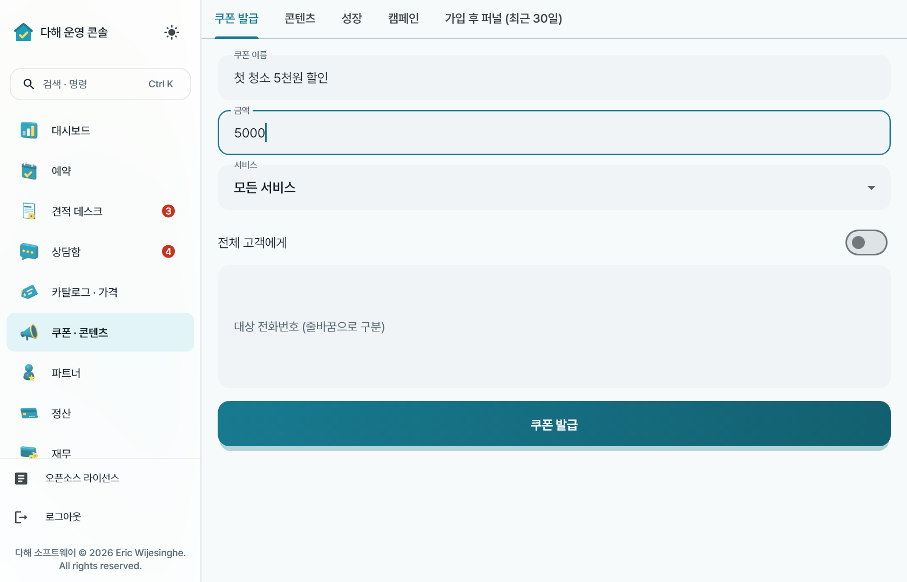
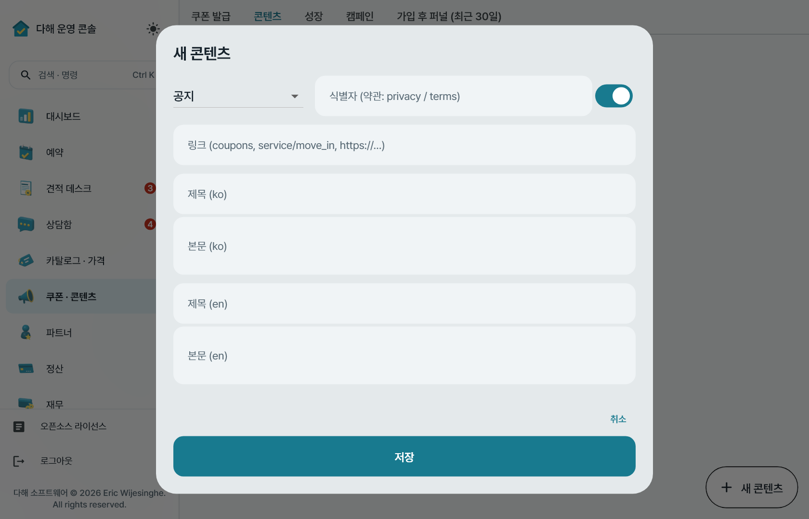
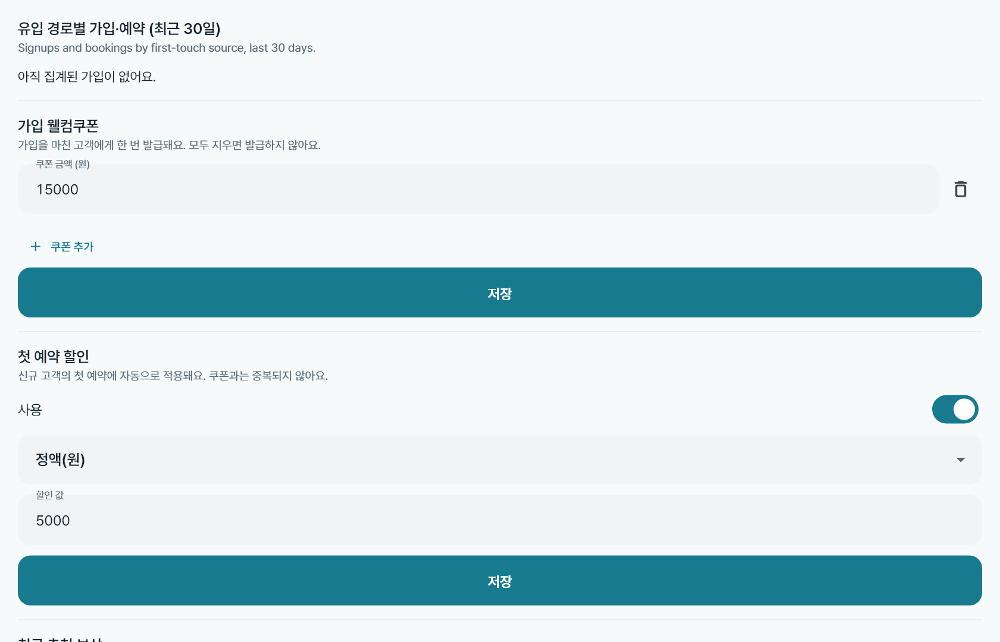
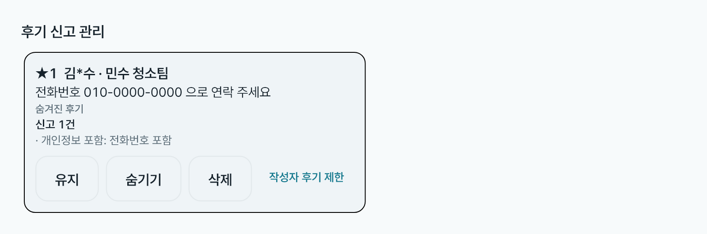
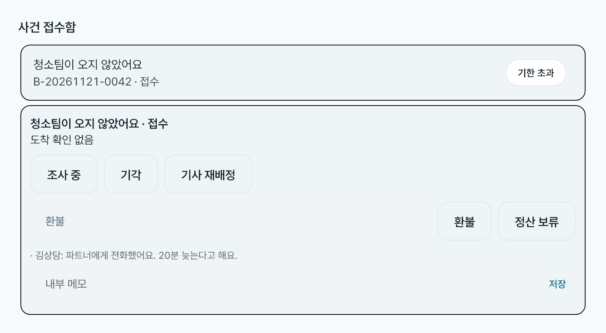
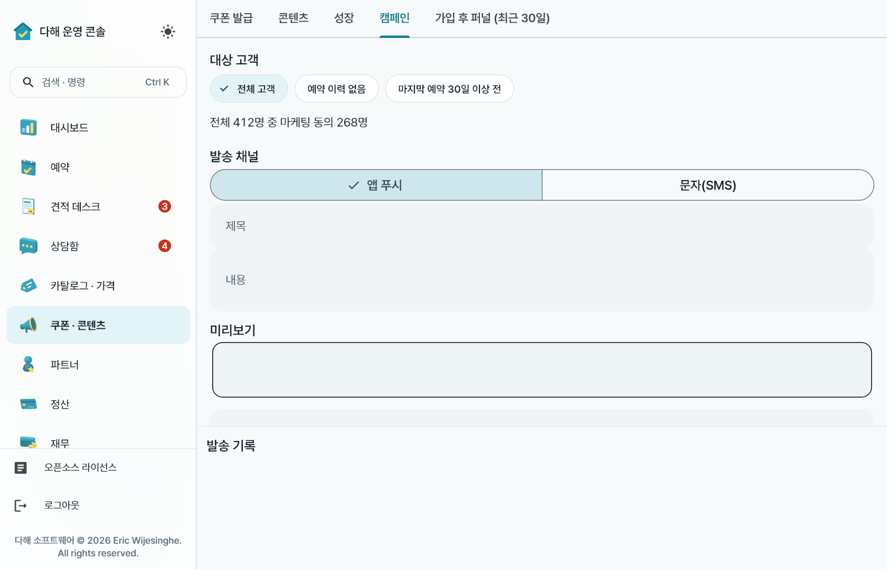
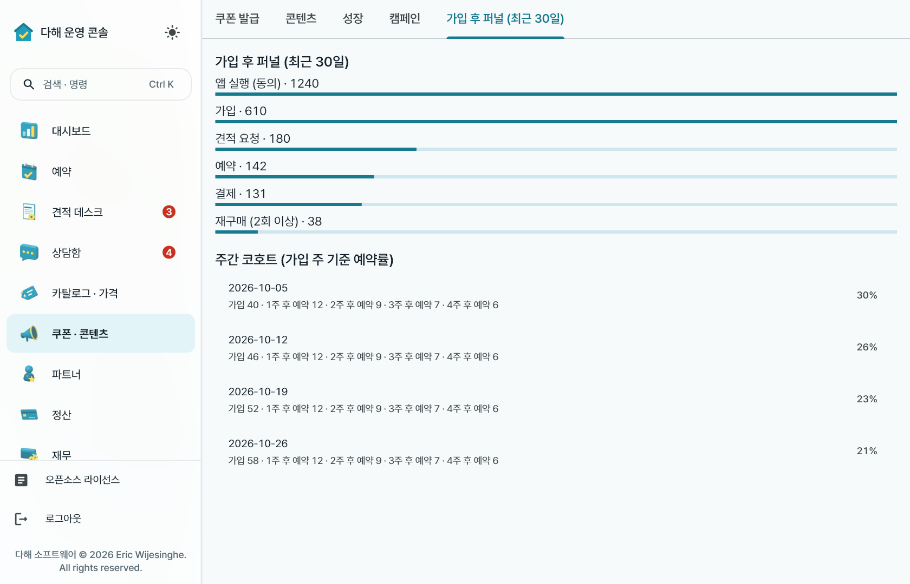

# 22. 쿠폰, 콘텐츠, 성장, 캠페인, 사건

**이 장에서 할 일:** 고객에게 쿠폰을 주고, 앱 첫 화면의 공지·배너·자주 묻는 질문을 고치고, 신규 고객 혜택과 친구 추천 보상을 정해요.
후기 신고와 사건(파손, 노쇼 같은 문제)을 처리하고, 광고 캠페인을 보내고, 가입 후 퍼널을 보는 방법도 알아봐요.

> **준비물**
> - 콘솔에 **관리자** 계정으로 로그인할 수 있어야 해요 (6장). **상담원** 계정은 쿠폰 발급, 콘텐츠 저장, 캠페인 발송, 사건 환불을 할 수 없어요.
> - 문자 캠페인을 보내려면: 문자 서비스(Solapi) 연결(14장)과 **080 수신거부 번호**
> - 앱 푸시 캠페인을 보내려면: 앱 푸시 연결(16장)
> - 테스트 문자를 받으려면: **[시스템 상태]** → **알림 설정** 의 **알림 받을 휴대폰** 에 사장님 번호가 저장돼 있어야 해요 (26장)

---

## 22.1 화면 찾기

1. 콘솔 왼쪽 메뉴에서 **[쿠폰 · 콘텐츠]** 를 눌러요.
2. 화면 맨 위에 탭 다섯 개가 보여요: **쿠폰 발급**, **콘텐츠**, **성장**, **캠페인**, **가입 후 퍼널 (최근 30일)**.
3. 탭 이름을 누르면 그 화면으로 바뀌어요. 휴대폰처럼 좁은 화면에서는 탭 줄을 옆으로 밀면 나머지 탭이 보여요.

**이렇게 보이면 성공:** 맨 위에 탭 다섯 개가 있고, 처음에는 **쿠폰 발급** 탭이 열려 있어요.

---

## 22.2 쿠폰 발급

특정 고객이나 모든 고객에게 쿠폰을 바로 넣어 주는 곳이에요.

1. **쿠폰 발급** 탭을 눌러요.
2. **쿠폰 이름** 칸에 고객 앱에 보일 이름을 적어요. 예: `가을 감사 쿠폰`
3. **금액** 칸에 깎아 줄 금액을 숫자로만 적어요. 예: `10000` (원 단위, 쉼표 없이)
4. **서비스** 칸을 눌러 쿠폰을 쓸 수 있는 서비스를 골라요.
   - **모든 서비스** 를 고르면 어떤 서비스에도 쓸 수 있어요.
   - 서비스 하나를 고르면 그 서비스 예약에만 쓸 수 있어요.
5. 받을 사람을 정해요.
   - 모든 고객에게 주려면 **전체 고객에게** 스위치를 켜요.
   - 몇 명에게만 주려면 스위치를 끈 채로 **대상 전화번호 (줄바꿈으로 구분)** 칸에 고객 휴대폰 번호를 한 줄에 하나씩 적어요.
6. 아래쪽 **[쿠폰 발급]** 버튼을 눌러요.

**이렇게 보이면 성공:** 화면 아래에 **N장 발급했어요** 가 잠깐 떠요. N 은 실제로 쿠폰을 받은 고객 수예요.

> **주의** 쿠폰은 **발급한 날부터 14일** 동안만 쓸 수 있어요 (서버에 정해진 기간이에요. 콘솔에서 바꿀 수 없어요).

> **팁** 적은 번호 중 가입한 고객이 없는 번호는 조용히 건너뛰어요. **N장** 이 적은 번호 수보다 적으면 번호를 다시 확인하세요.

> **주의** **전체 고객에게** 를 켜고 누르면 탈퇴하지 않은 모든 고객에게 한 번에 들어가요. 되돌리는 버튼은 없어요. 금액을 꼭 다시 보고 누르세요.

---

## 22.3 콘텐츠 (공지, 소식, 팁, 자주 묻는 질문, 배너, 약관)

고객 앱의 공지사항, 소식, 팁, 자주 묻는 질문, 홈 배너, 이용약관·개인정보 처리방침 글을 여기서 만들고 고쳐요.

### 새 글 만들기

1. **콘텐츠** 탭을 눌러요. 지금까지 만든 글 목록이 보여요.
2. 오른쪽 아래 **[새 콘텐츠]** 버튼(＋ 표시)을 눌러요. **새 콘텐츠** 창이 열려요.
3. 맨 위 왼쪽 상자에서 글 종류를 골라요.

   | 종류 | 어디에 보여요 |
   |---|---|
   | **공지** | 고객 앱 **더보기** → **공지사항**, 홈의 **다해 소식** 줄 |
   | **소식** | 홈의 **다해 소식** 줄 |
   | **팁** | 고객 앱 **더보기** → **다해 팁**, 홈의 **다해 소식** 줄 |
   | **FAQ** | 고객 앱 **더보기** → **자주 묻는 질문** |
   | **배너** | 고객 앱 홈의 큰 배너 카드 (링크가 `service/…` 이면 큰 배너 대신 홈의 추천 칸에 나와요) |
   | **약관** | 고객 앱 **더보기** → **이용약관**, **개인정보 처리방침** |

4. 종류 옆의 **식별자 (약관: privacy / terms)** 칸은 **약관** 을 고를 때만 채워요.
   - 개인정보 처리방침이면 `privacy`, 이용약관이면 `terms` 를 소문자로 적어요.
   - 다른 종류는 비워 두세요.
5. 식별자 칸 오른쪽의 스위치는 글을 앱에 **보일지** 정해요. 켜 두면 보이고, 끄면 숨겨져요.
6. **링크 (coupons, service/move_in, https://…)** 칸은 고객이 글을 눌렀을 때 갈 곳이에요. 필요 없으면 비워 둬요.
   - `coupons`: 앱의 쿠폰 화면으로 가요.
   - `service/move_in` 처럼 `service/서비스코드`: 그 서비스 화면으로 가요.
   - `https://` 로 시작하는 주소: 그 웹페이지가 열려요.
7. **제목 (ko)**, **본문 (ko)** 에 한국어 제목과 내용을 적어요.
8. **제목 (en)**, **본문 (en)** 에 영어 제목과 내용을 적어요. 영어를 쓰지 않으면 비워 둬도 돼요.
9. 종류가 **배너** 이면 언어마다 칸이 두 개 더 생겨요.
   - **배너 카드 문구 (ko)**: 배너 오른쪽 작은 카드의 윗줄. 예: `웰컴 혜택`
   - **배너 카드 강조 값 (ko)**: 카드의 큰 글씨. 예: `15,000원`
10. **[저장]** 을 눌러요.

**이렇게 보이면 성공:** **저장했어요** 가 뜨고, 목록에 새 글이 생겨요.

> **주의** 고객 앱의 **이용약관**, **개인정보 처리방침** 화면은 여기서 만든 **약관** 글(식별자 `terms`, `privacy`)을 그대로 보여 줘요. 글이 없으면 앱에 **아직 등록된 내용이 없어요** 가 떠요. 앱을 스토어에 올리기 전에 두 글을 꼭 만들어 두세요. 내용은 웹사이트의 `https://도메인/privacy.html` 과 같은 문구를 쓰는 것이 좋아요 (문구 자체는 법률 검토 대상이에요).

> **팁** 링크 칸에는 `https://` 주소나 영문·숫자·`_`·`/` 로만 된 앱 안 경로만 넣을 수 있어요. 다른 글자가 들어가면 저장할 때 오류가 나요.

### 글 고치기, 숨기기, 지우기

1. 목록에서 고칠 글을 눌러요. **수정** 창이 열려요.
2. 내용을 고치고 **[저장]** 을 눌러요.
3. 잠깐 숨기려면 창 안의 스위치를 끄고 **[저장]** 을 눌러요. 목록에서 그 글 옆에 **취소됨** 이 보여요 (숨김 상태라는 뜻이에요).
4. 아예 지우려면 목록에서 그 글 오른쪽의 휴지통 단추(**삭제**)를 눌러요.
5. **정말 진행할까요?** 창에서 **[삭제]** 를 눌러요.

**이렇게 보이면 성공:** 지운 글이 목록에서 사라져요.

---

## 22.4 성장 탭: 유입 경로, 웰컴쿠폰, 첫 예약 할인, 친구 추천

**성장** 탭을 누르면 위에서부터 이런 순서로 보여요.

1. 유입 경로별 가입·예약 표
2. **가입 웰컴쿠폰**
3. **첫 예약 할인**
4. **친구 추천 보상**
5. **후기 신고 관리** (22.5)
6. **사건 접수함** (22.6)
7. **후기 관리** (22.7)

### 유입 경로별 가입·예약 (최근 30일)

웹사이트 광고 링크로 들어와 가입한 고객이 어디서 왔는지 보여 줘요. 줄마다 **출처 / 매체 / 캠페인**, **가입**, **예약 고객**, **예약 수** 가 나와요.
아직 집계된 가입이 없으면 **아직 집계된 가입이 없어요.** 라고 나와요. 볼 수만 있고, 고칠 것은 없어요.

> **참고** 이 표는 웹사이트에서 가입할 때 링크에 붙은 광고 표시(`utm_…`)만 세요. 앱에서 바로 가입한 고객은 이 표에 나오지 않아요.

### 가입 웰컴쿠폰

가입을 마친 고객에게 **한 번** 자동으로 들어가는 쿠폰이에요. 처음 설치하면 **15,000원 쿠폰 1장 (모든 서비스)** 으로 정해져 있어요.

1. **가입 웰컴쿠폰** 제목 아래에 쿠폰마다 **쿠폰 금액 (원)** 칸이 있어요.
2. 금액을 바꾸려면 칸의 숫자를 고쳐요.
3. 쿠폰을 더 주려면 **[쿠폰 추가]** 를 눌러 새 칸을 만들고 금액을 적어요.
4. 쿠폰 하나를 빼려면 그 줄 오른쪽 단추(**쿠폰 삭제**)를 눌러요.
5. 그 묶음 아래의 **[저장]** 을 눌러요.

**이렇게 보이면 성공:** **저장했어요** 가 떠요. 다음에 가입하는 고객부터 바뀐 쿠폰을 받아요.

> **주의** 서버가 정한 한도가 있어요: 쿠폰은 **최대 3장**, 금액은 **100원 단위**, 모두 합쳐 **50,000원 이하**. 넘으면 저장할 때 오류가 나요.

> **팁** 웰컴쿠폰을 주지 않으려면 쿠폰을 모두 지우고 **[저장]** 을 눌러요. 웰컴쿠폰도 14일 동안만 쓸 수 있어요.

### 첫 예약 할인

신규 고객의 **첫 예약**에 자동으로 붙는 할인이에요. 쿠폰과 같이 쓰이지 않아요. 처음에는 꺼져 있어요.

1. **첫 예약 할인** 아래 **사용** 스위치를 켜요.
2. 그 아래 상자에서 방식을 골라요: **정액(원)** 또는 **정률(%)**.
3. **할인 값** 칸에 숫자를 적어요. 정액이면 원, 정률이면 퍼센트예요.
4. 이 묶음 아래의 **[저장]** 을 눌러요.

**이렇게 보이면 성공:** **저장했어요** 가 떠요.

> **주의** 정액은 **1 ~ 100,000원**, 정률은 **1 ~ 50%** 까지만 저장돼요.

### 친구 추천 보상

고객이 친구를 추천하고, 그 친구가 첫 예약을 **완료하고 결제까지** 끝내면 보상이 나가요. 본인 추천과 같은 번호 중복은 막혀 있어요. 처음에는 꺼져 있어요.

1. **친구 추천 보상** 아래 **사용** 스위치를 켜요.
2. **보상 금액(원)** 칸에 금액을 적어요 (1 ~ 100,000원).
3. 이 묶음 아래의 **[저장]** 을 눌러요.

**이렇게 보이면 성공:** **저장했어요** 가 떠요.

> **참고** 보상은 추천한 사람과 친구 **두 사람 모두**에게 같은 금액의 쿠폰(14일)으로 들어가요. 포인트 제도를 켜 둔 경우에는 쿠폰 대신 포인트가 들어가요 (포인트는 20장에서 설명해요. 포인트 양은 포인트 설정을 따라요).

---

## 22.5 후기 신고 관리

고객은 앱에서 다른 사람의 후기에 **신고** 를 누를 수 있어요. 신고가 정해진 수(처음 설정 3명)만큼 모이면 이 목록에 올라와요. 후기는 사장님이 처리할 때까지 앱에 **그대로 보여요**.

1. **성장** 탭에서 아래로 내려 **후기 신고 관리** 를 찾아요.
2. 대기 중인 신고가 없으면 **대기 중인 신고가 없어요** 가 보여요. 그러면 할 일이 없어요.
3. 신고된 후기가 있으면 카드마다 후기 내용과 **신고 N건** 이 보여요.
4. 후기를 읽고 버튼 하나를 눌러요.
   - **[유지]**: 문제없는 후기예요. 그대로 보이게 두고 신고를 지워요.
   - **[숨기기]**: 앱에서 숨겨요. 기록은 남아요.
   - **[삭제]**: 후기를 지워요.
5. 같은 사람이 계속 나쁜 후기를 쓰면 **[작성자 후기 제한]** 을 눌러요. 그 사람은 후기를 더 쓸 수 없어요. 풀어 주려면 같은 자리의 **[제한 해제]** 를 눌러요.

**이렇게 보이면 성공:** 처리한 카드가 목록에서 사라져요. 실패하면 **처리하지 못했어요. 다시 시도해 주세요.** 가 떠요.

> **팁** 몇 명이 신고하면 숨길지는 **[운영 규칙]** → **사업장 한도** → **후기 신고 몇 명이면 숨길지** 에서 바꿔요 (23장). 이 값은 처음 설정보다 **높게만** 바꿀 수 있어요.

> **주의** 앱 심사 중에 신고가 들어오면 바로 처리하세요. 심사원이 신고 기능을 시험해 볼 수 있어요 (25장).

---

## 22.6 사건 접수함

고객이나 파트너가 앱의 **문제 신고하기** 로 알린 일이 여기에 모여요. 종류는 **파손**, **분실**, **불만·서비스 문제**, **청소팀이 오지 않았어요**, **안전 문제**, **결제 이의** 예요.

1. **성장** 탭에서 아래로 내려 **사건 접수함** 을 찾아요. 열린 사건이 없으면 **열린 사건이 없어요** 가 보여요.
2. 줄마다 사건 종류, 예약번호, 상태(**접수**, **조사 중**, **해결**, **기각**)가 보여요.
3. 접수 뒤 24시간 안에 처리하지 못하면 줄 오른쪽에 **기한 초과** 가 붙어요. 이것부터 먼저 봐요.
4. 줄을 누르면 아래에 상세 카드가 열려요. 청소팀이 도착·종료를 기록했다면 **도착 HH:MM**, **종료 HH:MM** 이 보여요.
5. 상태를 바꿔요.
   - 상태가 **접수** 이면 **[조사 중]** 또는 **[기각]** 버튼이 보여요.
   - 상태가 **조사 중** 이면 **[해결]** 또는 **[기각]** 버튼이 보여요.
6. 메모를 남기려면 **내부 메모** 칸에 적고 **[저장]** 을 눌러요. 고객에게는 보이지 않아요.

### 환불과 정산 보류 (관리자만), 기사 재배정

1. 고객에게 일부를 돌려줘야 하면 **환불** 칸에 금액(원)을 적고 옆의 **[환불]** 버튼을 눌러요.
2. 파트너 정산을 잠시 멈춰야 하면 **[정산 보류]** 를 눌러요.
3. 종류가 **청소팀이 오지 않았어요** 이면 **[기사 재배정]** 버튼이 보여요. 눌러서 다른 파트너를 배정해요.

> **주의** 사건 하나에서 환불은 **한 번만** 할 수 있어요. 금액을 꼭 확인한 뒤 누르세요. 환불과 보류는 모두 **[활동 기록]** 에 남아요 (23장).

> **팁** 정산 보류를 풀거나 지급하는 일은 **[정산]** 화면에서 해요 (21장).

---

## 22.7 후기 관리

**성장** 탭 맨 아래 **후기 관리** 에는 최근 후기가 별점, 예약번호, 고객 이름과 함께 나와요. 후기가 없으면 **후기 0개** 가 보여요.

1. 숨기고 싶은 후기 카드에서 **[숨기기]** 를 눌러요. 카드에 **숨김** 표시가 붙어요.
2. 다시 보이게 하려면 같은 카드의 **[다시 보이기]** 를 눌러요.

---

## 22.8 캠페인 (광고 보내기)

마케팅 수신에 동의한 고객에게 앱 푸시나 문자로 광고를 보내요.

### 법으로 정해진 규칙 (서버가 자동으로 지켜요)

- **마케팅 정보 수신 동의**를 한 고객에게만 보내요. 동의하지 않은 고객은 건너뛰어요.
- 밤 9시부터 아침 8시(한국 시간)에는 광고를 보내지 않아요. 이 시간에 걸리면 멈췄다가 **아침 8시에 이어서** 보내요.
- 고객 한 명에게 일주일에 보낼 수 있는 광고 수가 정해져 있어요 (처음 설정 2번, **[운영 규칙]** → **광고 발송** 에서 더 낮게만 바꿀 수 있어요).
- 문자 광고에는 맨 앞에 `(광고)`, 맨 끝에 `무료수신거부 080…` 줄이 자동으로 붙어요.
- 앱 푸시 광고에도 제목 앞에 `(광고)`, 내용 끝에 수신을 끄는 방법 한 줄이 자동으로 붙어요 (미리보기에는 보이지 않아요).

### 캠페인 만들기

1. **캠페인** 탭을 눌러요.
2. **대상 고객** 에서 한 가지를 골라요.
   - **전체 고객**
   - **예약 이력 없음**: 가입만 하고 아직 예약하지 않은 고객
   - **마지막 예약 N일 이상 전**: 고르면 **일 수** 칸이 생겨요. 숫자를 적어요 (처음 값 30).
3. 그 아래에 **전체 N명 중 마케팅 동의 N명** 이 보여요. 실제로 받는 사람은 뒤쪽 숫자(동의한 사람)예요.
4. **발송 채널** 에서 **앱 푸시** 또는 **문자(SMS)** 를 골라요.
5. **제목** 칸에 제목을 적어요. 캠페인 목록에도 이 이름으로 보여요.
6. **내용** 칸에 보낼 글을 적어요.
7. 문자를 골랐다면 **수신거부 번호 (080)** 칸에 사장님 회사의 080 수신거부 번호를 적어요. 번호가 틀리면 **문자 발송에는 080 수신거부 번호가 필요해요** 가 빨갛게 떠요. 비어 있으면 빨간 글씨는 없지만 발송 버튼이 눌리지 않아요.
8. **미리보기** 에서 고객이 받을 모양을 확인해요. 문자이면 `(광고)` 와 수신거부 줄이 붙은 모습이 보여요.

**이렇게 보이면 성공:** 제목과 내용이 채워졌고 (문자이면 080 번호도 맞으면) 아래 **[발송 시각]**, **[바로 발송]** 버튼이 눌리는 상태가 돼요.

### 내 번호로 테스트 발송

1. **내 번호로 테스트 발송** 칸에 사장님 휴대폰 번호를 적어요.
2. 같은 이름의 **[내 번호로 테스트 발송]** 버튼을 눌러요.
3. 휴대폰으로 문자가 오는지 확인해요. 콘솔 화면에는 성공이나 실패 표시가 따로 뜨지 않아요.

> **주의** 테스트는 언제나 **문자**로 가고, 다음 조건을 모두 맞아야 해요.
> - 적은 번호가 **[시스템 상태]** → **알림 설정** → **알림 받을 휴대폰** 에 저장한 번호와 같아야 해요.
> - **수신거부 번호 (080)** 칸이 맞게 채워져 있어야 해요 (앱 푸시 캠페인이라도요). 이 칸은 **문자(SMS)** 를 골랐을 때만 보이니, 잠깐 **문자(SMS)** 로 바꿔 번호를 적은 뒤 다시 **앱 푸시** 로 돌아와요.
> - 콘솔 계정 하나당 **한 시간에 5번**까지만 보낼 수 있어요. 테스트도 실제 문자 요금이 나가요.

### 보내기

- 지금 보내려면 **[바로 발송]** 을 눌러요.
- 나중에 보내려면 **[발송 시각]** 을 눌러요. 달력에서 날짜(오늘부터 90일 안)를 고르고 **확인**, 시계에서 시간을 고르고 **확인** 을 눌러요. 시간을 고르는 순간 예약돼요.

**이렇게 보이면 성공:** **캠페인을 만들었어요** 가 떠요.

> **주의** **[바로 발송]** 은 확인 창 없이 바로 보내기 시작해요. 대상, 채널, 내용을 다시 읽은 뒤 누르세요.

### 발송 기록 보기

1. **캠페인** 탭 맨 아래 **발송 기록** 에 지금까지 만든 캠페인이 줄마다 보여요 (이름, 채널, 상태).
2. 줄을 누르면 **발송 N · 동의 없음 N · 실패 N** 이 잠깐 떠요.

---

## 22.9 가입 후 퍼널 (최근 30일)

1. **가입 후 퍼널 (최근 30일)** 탭을 눌러요.
2. 위에서부터 **앱 실행 (동의)** → **가입** → **견적 요청** → **예약** → **결제** → **재구매 (2회 이상)** 단계마다 사람 수가 보여요. 어느 단계에서 많이 빠지는지 봐요.
3. 아래 **주간 코호트 (가입 주 기준 예약률)** 에는 가입한 주마다 **가입 N** 과 **N주 후 예약** 비율이 보여요.

> **참고** **앱 실행 (동의)** 는 마케팅 수신에 동의한 고객의 앱에서만 세요. 그래서 실제 앱 실행 수보다 적게 보여요.

---

## 자주 생기는 문제

| 이렇게 나와요 | 이렇게 해요 |
|---|---|
| **[쿠폰 발급]** 버튼이 회색이에요 | **상담원** 계정이에요. **관리자** 계정으로 로그인해요. |
| **0장 발급했어요** | 적은 번호로 가입한 고객이 없어요. 번호를 확인하거나 **전체 고객에게** 를 써요. |
| 콘텐츠 저장 때 오류가 나요 | 링크 칸에 `https://` 가 아닌 주소나 한글·띄어쓰기가 들어갔는지 봐요. **관리자** 계정인지도 확인해요. |
| 앱의 이용약관 화면이 비어 있어요 | **콘텐츠** 에서 종류 **약관**, 식별자 `terms` (개인정보 처리방침은 `privacy`) 글을 만들고 스위치를 켜요. |
| 웰컴쿠폰 저장 때 오류가 나요 | 3장 이하, 100원 단위, 합계 50,000원 이하인지 봐요. |
| 가입한 고객 앱에 "가입 축하 쿠폰 2장" 이라고 떠요 | 앱에 고정된 안내 문구예요. 실제로 들어간 쿠폰 수는 **가입 웰컴쿠폰** 설정을 따라요 (**확인 필요**: 문구 수정은 개발자에게 문의). |
| **[바로 발송]** 이 눌리지 않아요 | 제목과 내용을 채웠는지, 문자이면 080 번호가 9~12자리 숫자인지 봐요. |
| 테스트 문자가 오지 않아요 | 적은 번호가 **알림 받을 휴대폰** 과 같은지, 한 시간에 5번을 넘지 않았는지, 문자 연결(14장)이 됐는지 봐요. |
| 캠페인 받은 사람이 생각보다 적어요 | **발송 기록** 에서 **동의 없음** 숫자를 봐요. 동의 안 한 고객, 밤 시간 대기, 주간 횟수 제한에 걸린 고객은 빠져요. |
| 사건에서 **[환불]** 이 안 보여요 | **관리자** 계정만 보여요. 예약과 연결되지 않은 사건에도 안 보여요. |
