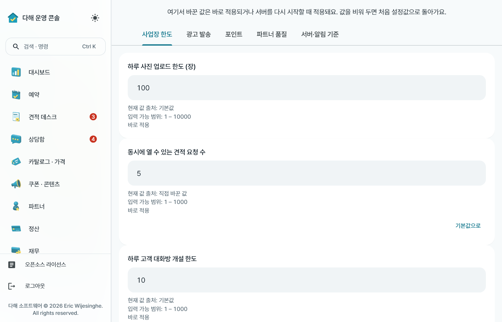
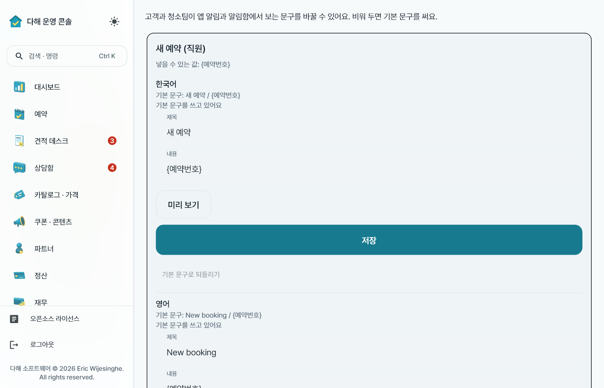
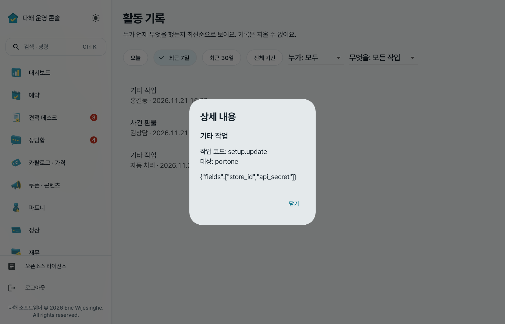
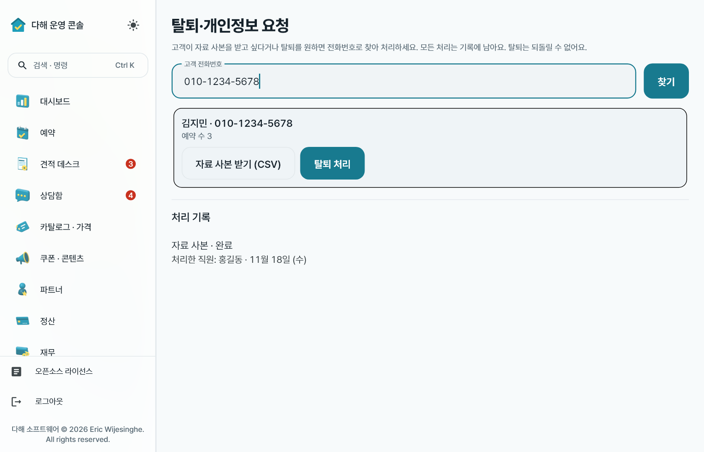
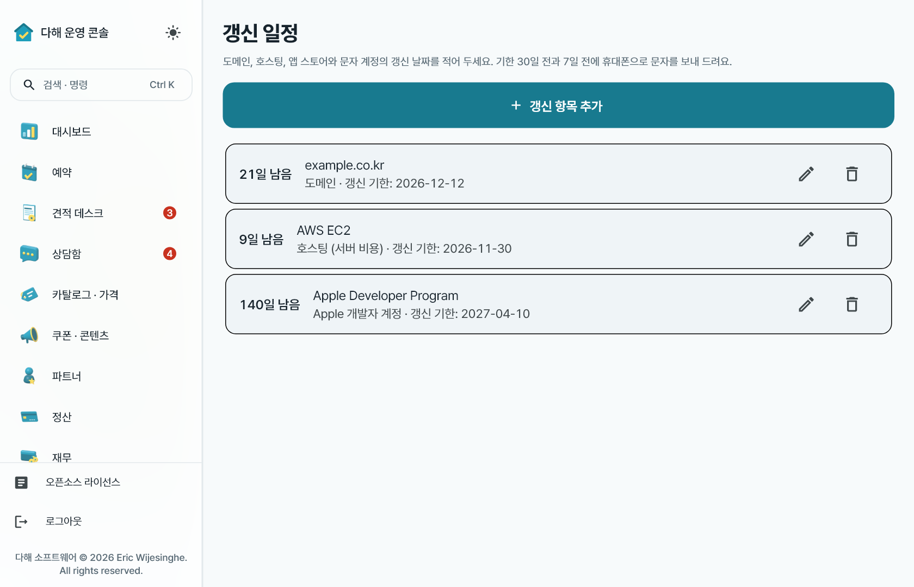

# 23. 운영 규칙, 알림 문구, 활동 기록, 개인정보 요청, 갱신 일정

**이 장에서 할 일:** 사업장 한도와 알림 기준을 정하고, 고객과 청소팀이 받는 앱 알림 문구를 고쳐요.
누가 무엇을 했는지 기록을 보고, 고객의 탈퇴·자료 사본 요청을 처리하고, 도메인·서버 같은 갱신 날짜를 적어 두는 방법도 알아봐요.

> **준비물**
> - 콘솔에 **관리자** 계정으로 로그인할 수 있어야 해요 (6장). **[운영 규칙]**, **[알림 문구]**, **[활동 기록]**, **[갱신 일정]** 메뉴는 관리자에게만 보여요.
> - 인증 앱(6자리 코드가 나오는 앱)이 있는 휴대폰. 고객 자료 사본 받기와 탈퇴 처리 때 코드를 물어봐요 (8장).
> - 갱신 일정 문자를 받으려면: 문자 서비스(Solapi) 연결(14장)과 **[시스템 상태]** → **알림 설정** 의 **알림 받을 휴대폰** (26장)

---

## 23.1 운영 규칙

사장님이 정할 수 있는 한도와 기준이 모여 있어요.

### 화면 읽는 법

1. 왼쪽 메뉴에서 **[운영 규칙]** 을 눌러요.
2. 맨 위에 안내 문장이 있고, 그 아래 탭 다섯 개가 있어요: **사업장 한도**, **광고 발송**, **포인트**, **파트너 품질**, **서버·알림 기준**.
3. 탭을 누르면 항목이 카드 모양으로 나와요. 카드 하나에 이런 내용이 있어요.
   - 맨 위: 항목 이름 (예: **하루 사진 업로드 한도 (장)**)
   - 입력 칸 또는 켜고 끄는 스위치
   - **현재 값 출처**: **기본값** (처음 값), **설치 시 설정값** (설치할 때 정한 값), **직접 바꾼 값** (여기서 바꾼 값)
   - **입력 가능 범위: 최소 – 최대**
   - 바꿀 수 있는 방향: **기본값보다 낮게만 바꿀 수 있어요** 또는 **기본값보다 높게만 바꿀 수 있어요**
   - 적용 시점: **바로 적용** 또는 **서버를 다시 시작해야 적용돼요**
   - 바꿀 수 없는 항목: **여기서는 바꿀 수 없어요 (개발자에게 문의)**

### 값 바꾸기

1. 바꿀 탭을 눌러요.
2. 바꿀 항목 카드의 입력 칸에 새 숫자를 적어요 (스위치면 눌러서 켜거나 꺼요).
3. 같은 탭의 다른 항목도 필요하면 바꿔요. 한 번에 저장돼요.
4. 탭 아래쪽 **[저장]** 을 눌러요.
5. 기록을 지우는 항목(**AI 상담 기록 보관 기간 (일)**, **연결 없는 사진 삭제 기간 (일)**)이나 **노쇼 판정 대기 시간 (분)** 을 바꿨다면 확인 창이 떠요. 내용을 읽고 **[저장]** 을 한 번 더 눌러요.

**이렇게 보이면 성공:** **저장했어요** 가 뜨고, 카드의 **현재 값 출처** 가 **직접 바꾼 값** 으로 바뀌어요.

> **팁** 아무것도 바꾸지 않고 **[저장]** 을 누르면 **바뀐 값이 없어요** 가 떠요.

### 처음 값으로 되돌리기

1. **현재 값 출처** 가 **직접 바꾼 값** 인 카드에는 오른쪽 아래 **[기본값으로]** 버튼이 있어요.
2. **[기본값으로]** 를 눌러요.
3. 탭 아래쪽 **[저장]** 을 눌러요.

**이렇게 보이면 성공:** **저장했어요** 가 뜨고, 값이 설치할 때의 값(또는 기본값)으로 돌아가요.

### 항목 한눈에 보기

아래 "처음 값" 은 코드에 들어 있는 기본값이에요. 설치할 때 다른 값을 정했다면 화면의 **설치 시 설정값** 이 우선해요. 모든 항목은 **바로 적용** 이에요 (결제 대사 주기만 예외).

**사업장 한도**

| 항목 | 범위 | 처음 값 | 참고 |
|---|---|---|---|
| **하루 사진 업로드 한도 (장)** | 1 – 10,000 | 100 | |
| **동시에 열 수 있는 견적 요청 수** | 1 – 1,000 | 3 | 고객 한 명 기준 |
| **하루 고객 대화방 개설 한도** | 1 – 1,000 | 10 | 고객 한 명 기준 |
| **후기 신고 몇 명이면 숨길지** | 1 – 50 | 3 | 높게만 바꿀 수 있어요 |
| **노쇼 판정 대기 시간 (분)** | 10 – 240 | 30 | 바꾸면 노쇼 판정 기준이 바뀌어요 |
| **AI 상담 기록 보관 기간 (일)** | 30 – 3,650 | 180 | 줄이면 오래된 기록이 지워져요 |
| **연결 없는 사진 삭제 기간 (일)** | 7 – 365 | 30 | 줄이면 오래된 사진이 지워져요 |
| **결제 대사 주기 (초)** | 10 – 3,600 | 60 | 여기서 바꿀 수 없어요 (개발자에게 문의) |

**광고 발송**

| 항목 | 범위 | 처음 값 | 참고 |
|---|---|---|---|
| **고객 한 명에게 일주일 최대 광고 수** | 1 – 7 | 2 | 낮게만 바꿀 수 있어요 |
| **재예약 안내 발송 (방문 후 일수)** | 7 – 180 | 30 | |

**포인트**

| 항목 | 범위 | 처음 값 | 참고 |
|---|---|---|---|
| **포인트 한 번에 지급·차감할 최대 점수** | 1 – 1,000,000 | 100,000 | 낮게만 바꿀 수 있어요 |

**파트너 품질**

| 항목 | 범위 | 처음 값 | 참고 |
|---|---|---|---|
| **품질 점수 집계 기간 (일)** | 7 – 365 | 90 | |
| **정시 도착 허용 시간 (분)** | 0 – 60 | 15 | |
| **파트너 교육 완료 전 일감 수락 막기** | 켜기 / 끄기 | 꺼짐 | 켜면 필수 교육을 마치지 않은 파트너는 일감을 수락할 수 없어요 |

**서버·알림 기준**

| 항목 | 범위 | 처음 값 | 참고 |
|---|---|---|---|
| **백업이 이 시간 넘게 없으면 빨간불 (시간)** | 1 – 168 | 36 | 낮게만 |
| **백업이 이 시간 넘게 없으면 노란불 (시간)** | 1 – 168 | 26 | 낮게만. 빨간불 값보다 작아야 해요 |
| **디스크 여유가 이 비율 아래면 빨간불 (%)** | 1 – 50 | 10 | 높게만. 노란불 값보다 작아야 해요 |
| **디스크 여유가 이 비율 아래면 노란불 (%)** | 1 – 80 | 20 | 높게만 |
| **기사님 미배정 예약 알림 기준 (시간)** | 1 – 168 | 24 | 낮게만 |
| **당일 취소 비율 알림 기준 (%)** | 5 – 100 | 30 | 낮게만 |
| **부가가치세 신고 며칠 전에 알림 (일)** | 1 – 14 | 7 | 높게만 |
| **점검 모드 (새 예약 막기)** | 켜기 / 끄기 | 꺼짐 | 26장 참고 |
| **점검 안내 문구** | 최대 200자 | 빈 칸 | 점검 모드일 때 고객에게 보여요 |

> **주의** "낮게만", "높게만" 은 안전을 위한 제한이에요. 광고는 더 적게, 알림은 더 빨리 오는 쪽으로만 바꿀 수 있어요.

> **주의** **파트너 교육 완료 전 일감 수락 막기** 는 교육 화면과 교육 내용이 준비된 뒤에 켜세요. 준비 없이 켜면 파트너가 일감을 받을 수 없어요.

> **팁** **점검 모드 (새 예약 막기)** 는 서버를 손볼 때 잠깐 켜는 스위치예요. 켜는 법과 끄는 법은 26장에서 자세히 설명해요.

---

## 23.2 알림 문구

고객과 청소팀이 **앱 알림**과 **알림함**에서 보는 문구를 바꿔요. 바꾸지 않으면 기본 문구를 써요.

### 문구 바꾸기

1. 왼쪽 메뉴에서 **[알림 문구]** 를 눌러요.
2. 알림마다 카드가 하나씩 있어요. 카드 맨 위에 알림 이름이 있어요. 예: **새 예약 (직원)**, **청소 완료 (고객)**, **견적 선택 (청소팀)**. 괄호 안은 그 알림을 받는 사람이에요.
3. 이름 아래 **넣을 수 있는 값: {예약번호} {업체명}** 처럼 쓸 수 있는 값이 보여요. 알림마다 다르고, 없는 알림도 있어요.
4. 카드 안에 **한국어**, **영어** 칸이 따로 있어요. 고칠 언어를 찾아요.
5. **기본 문구: …** 줄에 지금의 기본 문구가 보여요. 그 아래 **기본 문구를 쓰고 있어요** 또는 **직접 고친 문구를 쓰고 있어요** 가 보여요.
6. **제목** 칸과 **내용** 칸을 고쳐요. 예약번호를 넣고 싶으면 중괄호까지 그대로 `{예약번호}` 라고 적어요.
7. **[미리 보기]** 를 눌러요. **이렇게 보여요** 아래에 실제 값이 들어간 모양이 나와요.
8. 마음에 들면 **[저장]** 을 눌러요.

**이렇게 보이면 성공:** **저장했어요** 가 뜨고, 그 언어 칸에 **직접 고친 문구를 쓰고 있어요** 가 보여요.

> **주의** 글자 수는 **제목 40자, 내용 120자**까지예요. 줄바꿈은 넣을 수 없어요.

> **참고** 알림 이름과 값 이름(`{예약번호}`, `{업체명}`)은 영어 화면에서도 한국어로 보여요. 영어 문구에도 값은 `{예약번호}` 처럼 한국어 이름 그대로 적어요.

> **참고** 이 화면은 앱 알림(푸시)과 앱 안 알림함 문구만 바꿔요. 카카오 알림톡 문구는 카카오 심사를 받은 템플릿을 따라요 (14장).

### 기본 문구로 되돌리기

1. 되돌릴 언어 칸에서 **[기본 문구로 되돌리기]** 를 눌러요.
2. 확인 창에서 **[기본 문구로 되돌리기]** 를 한 번 더 눌러요.

**이렇게 보이면 성공:** **기본 문구로 되돌렸어요** 가 뜨고 **기본 문구를 쓰고 있어요** 로 바뀌어요.

---

## 23.3 활동 기록

누가 언제 무엇을 했는지 최신순으로 보여요. 기록은 지울 수 없어요.

1. 왼쪽 메뉴에서 **[활동 기록]** 을 눌러요.
2. 기간을 골라요: **오늘**, **최근 7일**, **최근 30일**, **전체 기간**. 처음에는 **최근 7일** 이에요.
3. **누가: 모두** 상자를 눌러 사람 종류를 골라요: **직원**, **고객**, **파트너**, **자동 처리**.
4. **무엇을: 모든 작업** 상자를 눌러 일의 종류를 골라요: **사건·환불**, **예약**, **고객 정보**, **직원 관리**, **정산**, **포인트**, **서비스·가격**.
5. 목록에서 궁금한 줄을 눌러요. **상세 내용** 창에 **작업 코드**, **대상**, 기록된 내용이 나와요.
6. **[닫기]** 를 눌러 창을 닫아요.

**이렇게 보이면 성공:** 조건에 맞는 기록이 최신순으로 보여요. 없으면 **조건에 맞는 기록이 없어요** 가 보여요.

> **팁** 고객 연락처를 본 기록(**고객 연락처 조회**), 환불(**사건 환불**), 직원 추가(**직원 추가**), 정산 보류(**정산 보류 변경**) 같은 일이 모두 여기에 남아요. 이상한 기록이 보이면 설치 담당자나 개발사에 알려 주세요.

---

## 23.4 탈퇴·개인정보 요청

고객이 "내 정보 사본을 주세요" 또는 "탈퇴시켜 주세요" 라고 요청할 때 여기서 처리해요. 모든 처리는 기록에 남아요.

### 먼저 할 일: 본인 확인

요청한 사람이 정말 그 고객인지 확인해요. 가입된 휴대폰 번호로 확인하는 것이 기본이에요.

### 고객 찾기

1. 왼쪽 메뉴에서 **[탈퇴·개인정보 요청]** 을 눌러요.
2. **고객 전화번호** 칸에 고객 번호를 적어요.
3. **[찾기]** 를 눌러요.

**이렇게 보이면 성공:** 고객 이름 · 전화번호와 **예약 수 N** 이 보여요. 그 아래 **[자료 사본 받기 (CSV)]**, **[탈퇴 처리]** 버튼이 있어요. 없는 번호면 **이 번호로 등록된 고객이 없어요.** 가 떠요.

### 자료 사본 주기 (CSV)

1. **[자료 사본 받기 (CSV)]** 를 눌러요.
2. 인증 코드 창이 뜨면 인증 앱의 6자리 번호를 넣어요 (8장).
3. 파일이 컴퓨터에 저장돼요.

**이렇게 보이면 성공:** **자료 사본을 저장했어요.** 가 떠요.

> **주의** 받은 파일에는 개인정보가 들어 있어요. **그 고객에게만** 전달하고, 전달한 뒤에는 컴퓨터에서 지우세요.

> **팁** CSV 내려받기는 **웹 브라우저로 연 콘솔**에서만 돼요. 다른 곳에서 누르면 **CSV 내려받기는 웹 콘솔에서 할 수 있어요** 가 떠요.

### 탈퇴 처리 (관리자만)

1. 고객을 찾은 뒤 **[탈퇴 처리]** 를 눌러요.
2. 안내 창을 읽어요: 이름과 연락처 등 개인 정보는 지워지고 **되돌릴 수 없어요**. 예약·결제 기록은 법에 따라 남아요.
3. **고객 전화번호 다시 입력** 칸에 고객 번호를 한 번 더 적어요.
4. 창 안의 **[탈퇴 처리]** 를 눌러요.
5. 인증 코드 창이 뜨면 인증 앱의 6자리 번호를 넣어요.

**이렇게 보이면 성공:** **탈퇴 처리가 끝났어요.** 가 떠요. 번호가 다르면 **전화번호가 맞지 않아요.** 가 떠요.

> **주의** 탈퇴는 되돌릴 수 없어요. 고객이 "잘못 눌렀다" 고 하면 다시 가입하도록 안내하세요.

> **참고** 진행 중인 예약이 있는 고객은 예약이 끝날 때까지 개인 정보 일부가 남아요. **파트너(청소팀) 탈퇴와 자료 사본은 아직 콘솔에서 할 수 없어요.** 파트너 요청은 개발자에게 보내세요.

### 처리 기록

화면 아래 **처리 기록** 에 지금까지 처리한 요청이 남아요. 줄마다 종류(**탈퇴**, **자료 사본**), 결과(**완료**, **실패**), **처리한 직원** 이 보여요. 아직 없으면 **아직 처리한 요청이 없어요.** 가 보여요.

---

## 23.5 갱신 일정

도메인, 서버, 앱 스토어, 문자 계정처럼 해마다(또는 달마다) 갱신해야 하는 날짜를 적어 두면, 기한 **30일 전과 7일 전**에 휴대폰으로 문자를 보내 줘요.

### 항목 추가하기

1. 왼쪽 메뉴에서 **[갱신 일정]** 을 눌러요.
2. **[갱신 항목 추가]** 를 눌러요.
3. **이름 (예: myshop.co.kr)** 칸에 알아보기 쉬운 이름을 적어요 (1~80자).
4. **종류** 에서 하나를 눌러 골라요: **도메인**, **예전 도메인 (별칭)**, **호스팅 (서버 비용)**, **Apple 개발자 계정**, **문자 발송 서비스 (Solapi)**, **외부 백업 저장소**, **기타**.
5. **갱신 기한** 아래 **[날짜 고르기]** 를 눌러 달력에서 날짜를 골라요.
6. **[저장]** 을 눌러요.

**이렇게 보이면 성공:** **저장했어요.** 가 뜨고 목록에 새 줄이 생겨요. 줄 왼쪽에 **N일 남음**, **오늘이 기한이에요**, **기한이 지났어요** 중 하나가 보여요.

> **팁** 처음 쓸 때 이렇게 넣어 두면 좋아요: 도메인, AWS 같은 서버 비용, Apple 개발자 계정(해마다), Solapi, 외부 백업 저장소. 날짜는 각 회사 관리 화면에서 확인하세요.

### 고치기, 지우기

1. 고칠 줄 오른쪽 연필 단추(**수정**)를 눌러요. 내용을 바꾸고 **[저장]** 을 눌러요. 날짜를 바꾸면 새 기한 기준으로 다시 알려 줘요.
2. 지우려면 휴지통 단추(**삭제**)를 눌러요. 확인 창에서 **[삭제]** 를 눌러요. 그 항목의 문자 알림도 멈춰요.

### 자동으로 생기는 줄: 비밀 키 사본 확인

목록에 **비밀 키 사본 확인** 줄이 있을 수 있어요. 마지막으로 비밀 키 사본 시험 업로드에 성공한 날부터 1년이 기한이고, 날짜는 자동으로 정해져요. 이 줄은 고치거나 지울 수 없어요 (백업은 27장).

> **주의** 문자는 **[시스템 상태]** → **알림 설정** → **알림 받을 휴대폰** 번호로 가요. 그 칸이 비어 있으면 **[설정]** → **사업장 정보** 의 **고객센터 전화** 로 가요. 둘 다 없으면 문자가 가지 않아요.

---

## 자주 생기는 문제

| 이렇게 나와요 | 이렇게 해요 |
|---|---|
| 메뉴에 **[운영 규칙]**, **[알림 문구]**, **[활동 기록]**, **[갱신 일정]** 이 없어요 | **상담원** 계정이에요. **관리자** 계정으로 로그인해요. |
| **기본값을 넘는 값은 저장할 수 없어요. 기본값 쪽으로만 바꿀 수 있어요.** | 이 항목은 한쪽으로만 바꿀 수 있어요. 카드의 **낮게만 / 높게만** 안내를 따라요. |
| **노란불 기준과 빨간불 기준의 순서가 맞지 않아요. 두 값을 다시 확인해 주세요.** | 백업은 노란불 시간이 빨간불보다 작아야 하고, 디스크는 빨간불 %가 노란불보다 작아야 해요. |
| **이 값은 여기서 바꿀 수 없어요. 개발자에게 문의해 주세요.** | 결제 대사 주기처럼 잠긴 항목이에요. 개발자에게 문의해요. |
| 규칙 저장 때 **문제가 생겼어요. 잠시 후 다시 시도해 주세요.** | 값이 **입력 가능 범위** 밖이거나 숫자가 아닐 수 있어요. 범위를 확인해요. |
| 알림 문구: **허용되지 않은 값이 들어 있어요. …** | 중괄호 안에는 카드에 적힌 값(예: `{예약번호}`)만 넣어요. |
| 알림 문구: **중괄호가 짝이 맞지 않아요.** | `{` 와 `}` 의 개수를 맞춰요. |
| 알림 문구: **제목과 내용을 모두 입력해 주세요.** | 두 칸 모두 채워요. |
| 알림 문구: **글자 수가 너무 많아요. …** | 제목 40자, 내용 120자 안으로 줄여요. |
| 알림 문구: **줄바꿈이나 조절 문자는 넣을 수 없어요.** | 엔터로 줄을 바꾼 곳을 지우고 한 줄로 적어요. |
| **이 작업은 인증 앱 코드로 한 번 더 확인해야 해요.** | 인증 코드 창에 인증 앱의 **지금** 번호를 넣고 다시 눌러요. |
| **탈퇴 처리는 관리자만 할 수 있어요.** | **관리자** 계정으로 다시 로그인해요. |
| 탈퇴·개인정보 요청 화면의 버튼 모양이 깨져 보여요 | **확인 필요**: 화면 배치 문제가 알려져 있어요. 개발자에게 화면 사진을 보내 주세요. |
| 갱신 일정 문자가 오지 않아요 | **알림 받을 휴대폰** 이나 **고객센터 전화** 가 있는지, 문자 연결(14장)이 됐는지 봐요. |
| **이름은 1~80자로 적어 주세요.** / **갱신 기한 날짜를 골라 주세요.** | 이름을 적고 **[날짜 고르기]** 로 날짜를 골라요. |
