# 24. 고객 앱과 파트너 앱 둘러보기

**이 장에서 할 일:** 고객 앱과 파트너(청소팀) 앱에서 손님과 청소팀이 무엇을 보고 누르는지 따라가 봐요.
고객 문의에 답하거나 청소팀을 교육할 때 이 장을 펴 두면 좋아요. 마지막에는 예약부터 정산까지 한 바퀴 시험하는 순서가 있어요.

> **준비물**
> - 휴대폰 두 대 (또는 한 대에 두 앱): 고객 앱과 파트너 앱. 스토어에 올리기 전이면 25장의 시험용 설치(TestFlight, Play 내부 테스트)로 받아요.
> - 서로 다른 휴대폰 번호 두 개 (고객용, 파트너용). 같은 번호를 고객과 파트너에 같이 쓰지 마세요.
> - 24.3 시험을 하려면: 결제가 **테스트 키**로 연결돼 있어야 해요 (11장, 12장).

> **참고** 앱 화면에 보이는 서비스 이름, 가격, 시간대, 쿠폰, 배너는 모두 콘솔에서 정한 값이에요 (18장, 22장). 아래 사진은 예시 데이터로 찍었어요.

---

## 24.1 고객 앱

### 처음 열기와 로그인

1. 앱을 열면 첫 화면에 **휴대폰 번호로 시작하기** 버튼이 있어요.
2. 버튼을 누르면 동의 항목이 나와요.
   - **이용약관 동의** (필수)
   - **개인정보 수집·이용 동의** (필수)
   - **개인정보 국외 이전 동의** (필수)
   - **마케팅 정보 수신 동의** (선택)
3. 필수 항목에 동의하고 **휴대폰 번호를 알려주세요** 화면에서 번호를 넣은 뒤 **[인증번호 받기]** 를 눌러요.
4. 문자로 받은 번호를 **인증번호 6자리를 입력해 주세요** 화면에 넣고 **[확인]** 을 눌러요. 안 오면 **[다시 받기]**.
5. 처음 가입이면 **이름을 알려주세요** 화면에서 이름을 적고 **[시작하기]** 를 눌러요.

**이렇게 보이면 성공:** 앱 아래쪽에 **홈**, **내 예약**, **상담**, **더보기** 탭 네 개가 보여요. 가입 웰컴쿠폰을 켜 뒀다면 쿠폰이 들어가요 (22장).

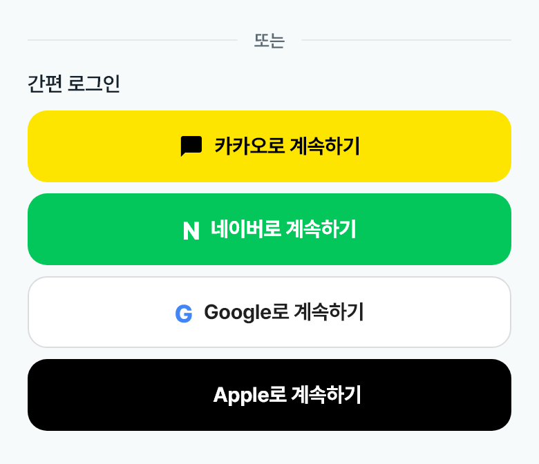

> **참고** 카카오·네이버·구글·Apple 로그인 버튼은 각 회사 설정(15장)을 마치고 그 키로 앱을 다시 만든 뒤에만 보여요. 키가 없으면 버튼이 숨겨져요.

> **참고** **마케팅 정보 수신 동의** 를 한 고객만 광고 캠페인(22장)을 받아요. 고객은 나중에 **더보기** → **계정정보** → **동의 관리** 에서 바꿀 수 있어요.

### 로그인하지 않고 둘러보기

로그인 전에도 서비스와 가격을 볼 수 있어요 (**가입 없이 가격 확인**). 예약하거나 상담하려고 하면 그때 로그인을 요청해요.

### 홈

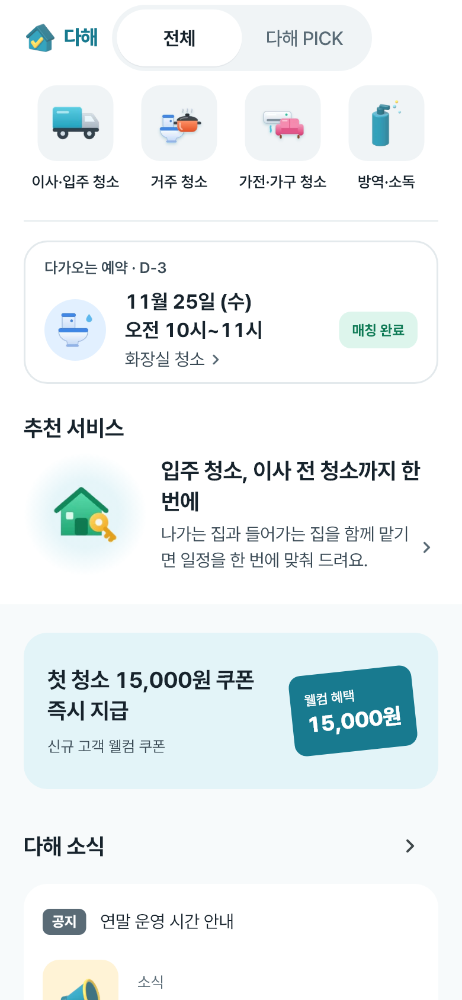

1. 맨 위 왼쪽에 업체 로고와 이름, 오른쪽에 **전체** / **(업체명) PICK** 선택 버튼이 있어요.
2. 그 아래 큰 메뉴 네 개가 있어요 (처음 설정: 이사·입주 청소, 거주 청소, 가전·가구 청소, 방역·소독). 이름, 순서, 그림은 콘솔 **[카탈로그 · 가격]** 의 상품 묶음에서 바꿔요 (18장).
3. 예약이 있으면 **다가오는 예약** 카드가 보여요.
4. 그 아래 추천 서비스, 배너, **다해 소식** 이 이어져요. 배너와 소식은 **[쿠폰 · 콘텐츠]** → **콘텐츠** 에서 만들어요 (22장).

### 정해진 가격 서비스 예약하기

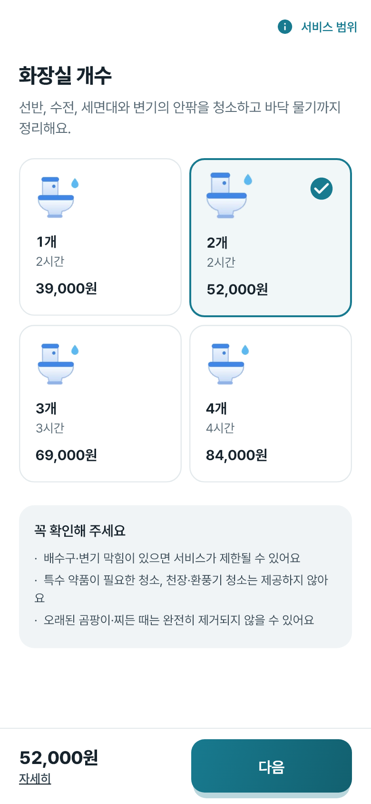

1. 홈에서 큰 메뉴를 누르고 서비스를 골라요.
2. 서비스 화면에서 가격, **소요 시간**, **기본 서비스**, **꼭 확인해 주세요** 를 읽어요. 개수로 고르는 서비스(에어컨, 소파 등)는 + / − 로 개수를 정해요.
3. **[예약하기]** 를 눌러요.
4. **예약할 주소를 선택해 주세요.** 화면에서 주소를 고르거나 **[주소 추가]** 로 새 주소를 넣고 **[다음]** 을 눌러요.

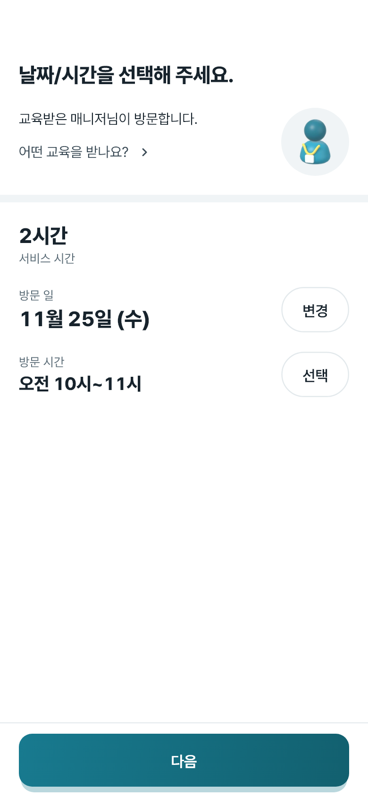

5. **날짜/시간을 선택해 주세요.** 화면에서 **방문 일** 과 **방문 시간** 을 골라요. 꽉 찬 시간은 **마감**, 몇 자리 안 남은 시간은 **N자리 남음** 으로 보여요.
6. **[선택 완료]** 를 눌러요.

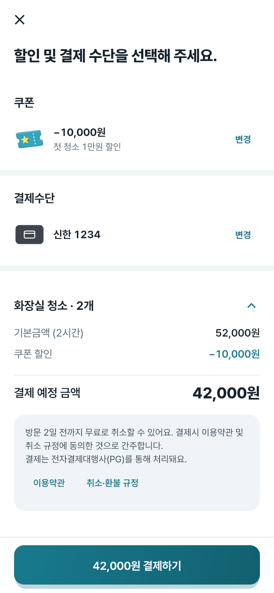

7. **할인 및 결제 수단을 선택해 주세요.** 화면에서 **쿠폰** 과 **포인트** 를 고르고, **결제수단** 을 골라요.
8. **결제 예정 금액** 을 확인하고 **[(금액) 결제하기]** 를 눌러요.
9. 결제사 화면에서 결제를 마쳐요.

**이렇게 보이면 성공:** **예약이 완료됐어요** (또는 **예약이 확정됐어요**) 화면과 **방문 전에 준비해 주세요** 안내가 나와요. **[예약 보기]** 로 예약을 볼 수 있어요.

> **참고** 계좌이체(가상계좌)를 고르면 **입금 계좌가 준비됐어요** 화면에 **은행**, **계좌번호**, **예금주**, **입금 금액**, 입금 기한이 나와요. 기한 안에 입금하면 자동으로 확인되고 예약이 확정돼요.

### 견적 서비스 (이사·입주 청소 등) 요청하기

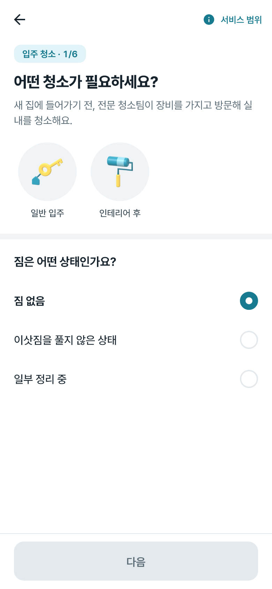

1. 견적 서비스를 고르면 질문이 차례로 나와요: **어떤 청소가 필요하세요?**, **집 구조를 알려주세요** (건물 유형, 구조, 복층 유무), **공간을 알려주세요** (화장실 개수, 베란다/다용도실 개수, 엘리베이터 유무), 짐 상태, 날짜·시간, 주소.
2. 마지막 확인 화면에서 **예상 서비스 금액** 과 **예약금 (확정 시 결제)** 을 봐요. **지금은 결제하지 않아요**.
3. **[예약 신청하기]** 를 눌러요.

**이렇게 보이면 성공:** **상담 요청이 접수됐어요** 화면이 나오고, **상담** 탭에 그 예약의 상담방이 열려요.

그다음 순서는 이래요.

1. 직원이 콘솔 **[견적 데스크]** 에서 최종 금액을 정해 보내요 (19장).
2. 고객 상담방에 **최종 견적이 도착했어요** 가 와요.
3. 고객이 예약 상세에서 **[예약금 결제하기]** 를 누르면 예약이 확정돼요.
4. 청소가 끝나면 **[잔금 결제하기]** 로 나머지를 내요.

### 내 예약과 예약 상세

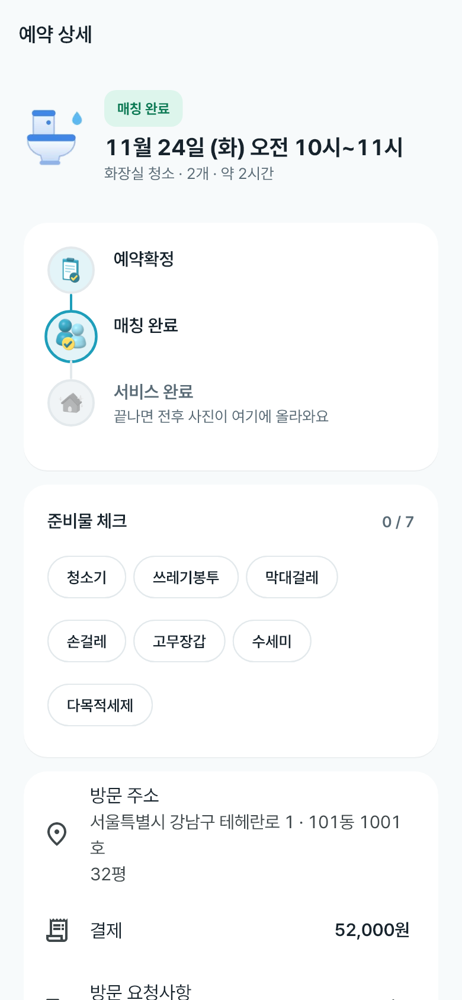

1. **내 예약** 탭에서 예약을 눌러요. **예약 상세** 화면이 열려요. **주간 보기** / **월간 보기** 로 달력 모양을 바꿀 수 있어요.
2. 예약 상세에서 할 수 있는 일:
   - **방문 요청사항**: **출입 방법 (공동현관 비밀번호 등)**, **주차**, **기타** 를 적고 **[저장]**
   - **준비물 체크**
   - **[일정 변경]**: 새 날짜를 골라요. 바로 바뀌거나(**일정을 변경했어요**), 파트너가 확인한 뒤 바뀌어요(**일정 변경 확인 중**)
   - **[예약 취소]**: 아래 "예약 취소" 참고
   - **[상담팀에 문의하기]**, **[문제 신고하기]**
   - 청소가 끝나면 **청소 전** / **청소 후** 사진, **청소는 어떠셨나요?** 후기, **[같은 조건으로 다시 예약]**

### 예약 취소

1. 예약 상세에서 **[예약 취소]** 를 눌러요.
2. **예약을 취소할까요?** 창에 **취소 수수료**, **환불 금액**, **취소·환불 기준** 이 보여요. 기준은 콘솔에서 정한 취소 규정을 따라요 (18장).
3. 이유를 고르고(선택) **[취소하고 (금액) 환불받기]** 를 눌러요. 그만두려면 **[유지하기]**.

> **참고** 앱에서 취소할 수 없는 시점이면 **이 시점부터는 앱에서 취소할 수 없어요. 상담팀에 문의해 주세요** 가 떠요. 이때는 직원이 콘솔에서 처리해요 (19장, 21장).

### 상담

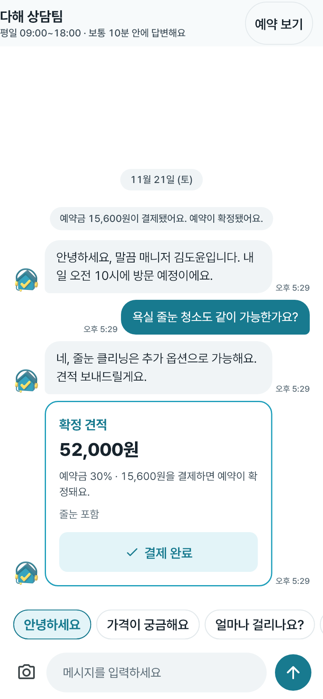

1. **상담** 탭을 누르고 **[새 상담]** 을 눌러요.
2. **무엇이 궁금하세요?** 에서 주제를 골라요.
3. 글을 쓰거나 **사진 보내기** 로 사진을 보내요. 자주 쓰는 문장 버튼(**안녕하세요**, **가격이 궁금해요** 등)도 있어요.
4. 상담방 위쪽에 **상담 가능 시간** 이 보여요. 이 시간은 콘솔 **[설정]** → **사업장 정보** 의 **상담 시간** 을 따라요 (비어 있으면 앱 기본값 **평일 09:00~18:00**).

> **참고** AI 상담원을 켜 뒀다면(16장) AI 가 먼저 답할 수 있어요. 직원이 답하면 그 대화에서 AI 는 물러나요. 고객의 답장은 콘솔 **[상담함]** 에 와요 (19장).

### 더보기

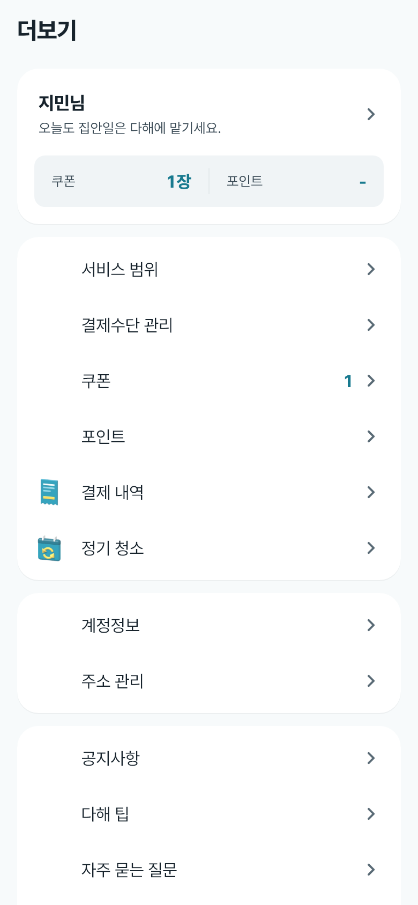

**더보기** 탭에는 **서비스 범위**, **결제수단 관리**, **쿠폰**, **포인트**, **결제 내역**, **정기 청소**, **계정정보**, **주소 관리**, **공지사항**, **(업체명) 팁**, **자주 묻는 질문**, **상담하기**, **제휴 문의**, **언어**, **테마**, **개인정보 처리방침**, **이용약관**, **오픈소스 라이선스**, **버전 정보** 가 있어요.

- **정기 청소** → **정기 청소 신청**: **주기** (**매주**, **2주마다**, **4주마다**), **요일**, **시작 시간** 을 고르면 방문 하루 전에 등록된 카드로 결제돼요.
- **계정정보** 에서 할 수 있는 일:
  - **동의 관리**: 마케팅 수신 등 동의를 바꿔요.
  - **내 데이터 내려받기**: 고객이 직접 자기 정보 사본을 봐요.
  - **로그아웃**
  - **회원 탈퇴**: 개인정보가 삭제되고 되돌릴 수 없어요. 진행 중인 예약은 먼저 취소해야 해요.

> **팁** 고객이 앱에서 탈퇴하지 못하겠다고 하면, 콘솔 **[탈퇴·개인정보 요청]** 에서 대신 처리할 수 있어요 (23장).

---

## 24.2 파트너(청소팀) 앱

### 가입과 승인

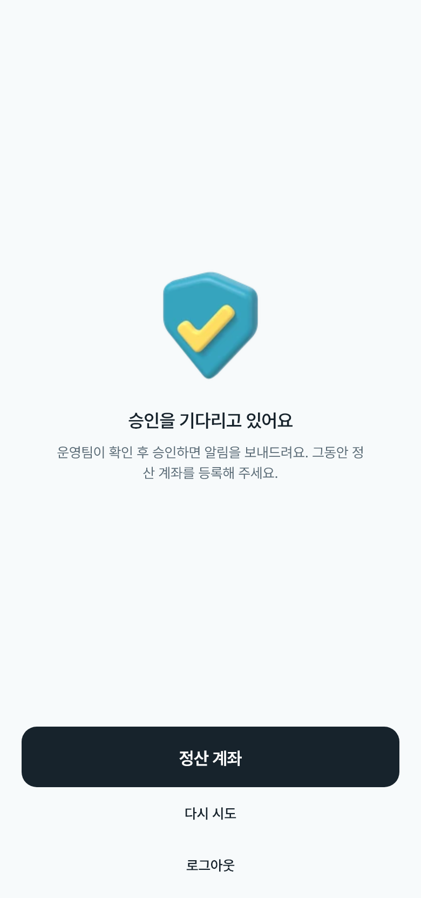

1. 파트너 앱을 열고 **휴대폰 번호로 시작하기** 를 눌러요.
2. 번호를 넣고 **[인증번호 받기]**, 받은 번호를 넣고 **[확인]** 을 눌러요.
3. **파트너 정보를 알려주세요** 화면에서 **대표자 이름**, **팀 이름**, **할 수 있는 서비스**, **활동 지역** 을 정하고 **[가입 신청]** 을 눌러요.
4. **승인을 기다리고 있어요** 화면이 나와요. 이때 **정산 계좌** 를 먼저 등록해 두라고 안내해요.
5. 사장님(또는 관리자)이 콘솔 **[파트너]** 에서 **검증 체크리스트** 를 채우고 **[승인]** 을 눌러요 (20장).

**이렇게 보이면 성공:** 승인되면 파트너 앱 아래에 **일감**, **내 견적**, **일정**, **상담**, **더보기** 탭이 보여요.

> **참고** 파트너가 초대한 팀원도 콘솔에서 따로 **[승인]** 해야 고객 주소를 보고 일을 받을 수 있어요 (20장). 정지된 계정은 **계정이 일시 중지됐어요. 운영팀에 문의해 주세요.** 가 떠요.

### 일감 받기

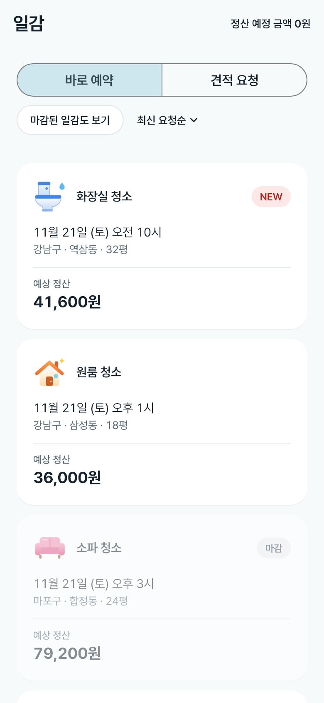

1. **일감** 탭을 눌러요. 위쪽에 **정산 예정 금액** 이 보여요.
2. **바로 예약** (정해진 가격 예약)과 **견적 요청** (견적을 내야 하는 요청)을 골라 볼 수 있어요.
3. 정렬: **최신 요청순**, **가까운 방문일순**, **금액 높은순**. **마감된 일감도 보기** 로 지난 일감도 볼 수 있어요.
4. 카드마다 **고객 예상가** 와 **예상 정산** 이 보여요. 정확한 주소와 고객 정보는 수락한 뒤에 보여요.

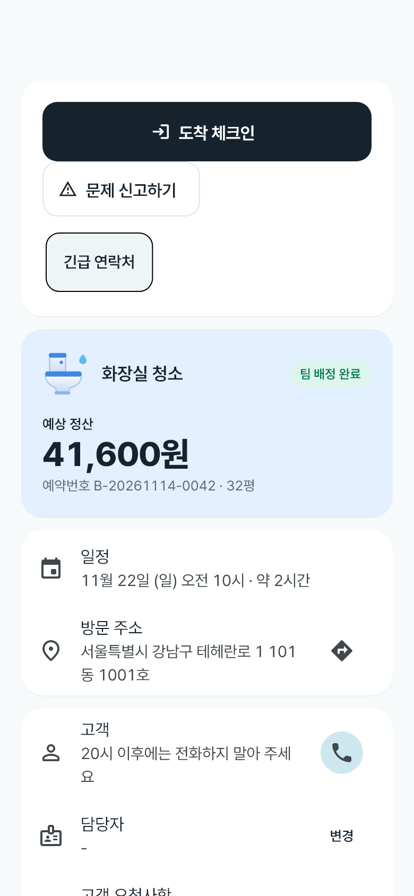

5. 카드를 누르면 상세가 열려요. **서비스 금액**, **수수료 N%**, **받을 금액** 을 확인해요.
6. 바로 예약이면 **[수락하기]**, 견적 요청이면 **[견적 보내기]** 를 눌러요.

**이렇게 보이면 성공:** 수락하면 **방문 주소**, **[길찾기]**, 고객 정보, **고객 요청사항**, **팀 메모 (고객에게 보이지 않아요)**, **[운영팀과 채팅]** 이 보여요.

> **참고** 보낸 견적은 **내 견적** 탭에 모여요. 상태는 **대기**, **선택됨**, **미선택**, **종료** 이고, 대기 중인 견적은 **[견적 철회]** 할 수 있어요.

### 방문 당일

1. 도착하면 **[도착 체크인]** 을 눌러요.
2. 출입 비밀번호가 등록된 예약이면 **[출입 비밀번호 보기]** 로 봐요. 방문 당일에만 보여요.
3. 문제가 생기면 **[문제 신고하기]** 를 눌러요. 콘솔 **사건 접수함** 으로 가요 (22장).

### 작업 완료

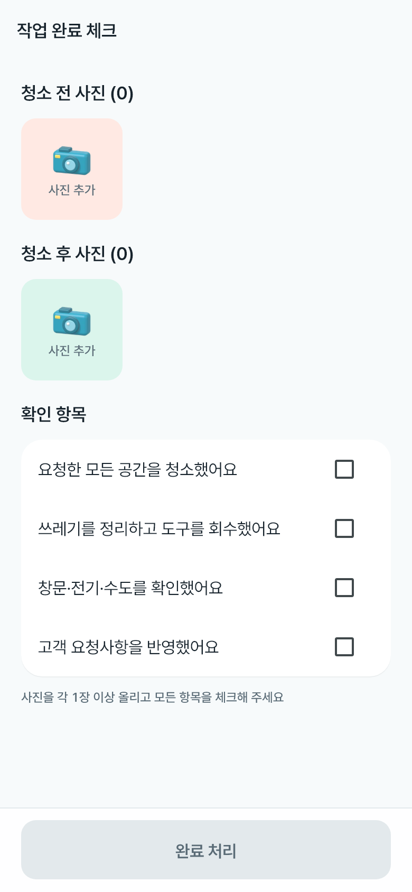

1. 일감 상세에서 **[작업 완료 체크]** 를 눌러요.
2. **청소 전 사진** 과 **청소 후 사진** 에 **[사진 추가]** 로 사진을 각 1장 이상 올려요.
3. **확인 항목** 네 개(**요청한 모든 공간을 청소했어요**, **쓰레기를 정리하고 도구를 회수했어요**, **창문·전기·수도를 확인했어요**, **고객 요청사항을 반영했어요**)를 모두 체크해요.
4. **[완료 처리]** 를 눌러요.

**이렇게 보이면 성공:** **수고하셨어요!** 와 정산 예정일이 보여요. 고객 잔금이 남은 예약이면 **고객 잔금 결제 후 정산일이 정해져요** 가 보여요.

> **팁** 신호가 약하면 **신호가 없어요. 저장해 두고 연결되면 자동으로 보낼게요.** 가 떠요. 앱을 지우지 말고 신호가 잡히는 곳에서 앱을 다시 열면 돼요.

### 수입과 정산

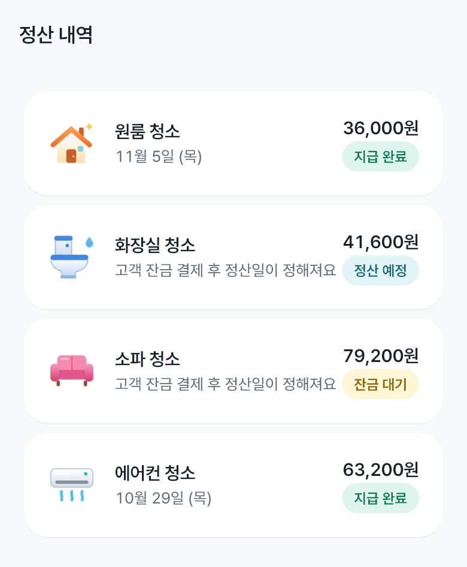

1. **더보기** → **수입** 을 눌러요.
2. **주간** / **월간** 으로 기간을 바꿔요.
3. **다음 지급**, **지급 대기**, **지급 완료** 금액과 **정산 내역** 이 보여요. 정산 상태는 **잔금 대기**, **정산 예정**, **지급 완료**, **보류** 예요.
4. 사업자가 아닌 파트너는 **예상 원천징수 (미지급분 기준)** 가 함께 보여요.

### 더보기

파트너 앱 **더보기** 에는 **수입**, **고객 리뷰**, **품질 점수**, **서비스 · 지역**, **근무 일정**, **정산 계좌**, **팀원**, **알림 설정**, **운영팀과 채팅**, **언어**, **테마**, **로그아웃**, **회원 탈퇴** 가 있어요. 배정된 작업이나 남은 정산이 있으면 탈퇴가 거절돼요.

---

## 24.3 처음부터 끝까지 한 번 시험해 보기

문을 열기 전에 사장님이 직접 한 바퀴 돌려 보세요. **결제를 테스트 키로 연결한 상태**에서만 하세요 (11장, 12장).

1. **파트너 가입**: 파트너용 번호로 파트너 앱에 가입해요 (24.2).
2. **파트너 승인**: 콘솔 **[파트너]** 에서 그 파트너의 **검증 체크리스트** 를 채우고 **[승인]** 해요 (20장).
3. **고객 예약**: 고객용 번호로 고객 앱에 가입하고, 정해진 가격 서비스를 하나 예약해요. 결제사의 **테스트 카드**로 결제해요.
4. **콘솔 확인**: 콘솔 **[대시보드]** 와 **[예약]** 에 새 예약이 보이는지 봐요 (19장).
5. **파트너 수락**: 파트너 앱 **일감** 에서 그 예약을 열고 **[수락하기]** 를 눌러요.
6. **방문 흉내**: 파트너 앱에서 **[도착 체크인]** → **[작업 완료 체크]** → 사진 올리기 → 확인 항목 체크 → **[완료 처리]**.
7. **고객 확인**: 고객 앱 예약 상세에 **청소 전** / **청소 후** 사진이 보이는지, 후기를 남길 수 있는지 봐요. 잔금이 남은 예약이면 **[잔금 결제하기]** 도 해 봐요.
8. **정산 확인**: 콘솔 **[정산]** 에 그 건이 지급 예정으로 올라왔는지 봐요. **[지급 요청]** 부터의 순서는 21장을 따라요.
9. **취소·환불 시험**: 같은 방법으로 예약을 하나 더 만들고, 고객 앱에서 **[예약 취소]** 를 해서 환불 금액이 맞는지 봐요.

**이렇게 보이면 성공:** 예약 → 배정 → 완료 → 정산까지 막힘 없이 이어지고, 알림이 고객·파트너 휴대폰에 와요.

> **주의** 실거래 키(`live_…`)로 바꾼 뒤에 시험하면 진짜 돈이 오가요. 실수로 결제했다면 콘솔에서 바로 환불하세요 (21장).

> **팁** 시험이 끝나면 시험용 고객 계정은 콘솔 **[탈퇴·개인정보 요청]** 에서 정리할 수 있어요 (23장). 시험용 파트너 계정은 콘솔 **[파트너]** 에서 정지해요.

---

## 자주 생기는 문제

| 이렇게 나와요 | 이렇게 해요 |
|---|---|
| 인증번호 문자가 오지 않아요 | 문자 연결(14장)과 Solapi 잔액을 확인해요. 콘솔 **[시스템 상태]** 의 외부 서비스 항목도 봐요 (26장). |
| 카카오·네이버·구글·Apple 버튼이 없어요 | 각 로그인 키(15장)를 넣고 앱을 다시 만들어야 보여요. 개발자에게 문의해요. |
| 홈의 큰 메뉴나 가격이 이상해요 | 콘솔 **[카탈로그 · 가격]** 에서 고쳐요 (18장). 저장하면 앱에 바로 반영돼요. |
| 원하는 시간이 모두 **마감** 이에요 | 시간대별 예약 가능 수를 늘려요 (18장). |
| 이용약관·개인정보 처리방침 화면이 비어 있어요 | 콘솔 **콘텐츠** 에서 **약관** 글을 만들어요 (22장). |
| 파트너 앱이 계속 **승인을 기다리고 있어요** 예요 | 콘솔 **[파트너]** 에서 **검증 체크리스트** 네 항목을 모두 체크해야 **[승인]** 돼요 (20장). |
| 파트너 **일감** 이 비어 있어요 (**지금 맞는 일감이 없어요**) | 파트너의 **서비스 · 지역**, **근무 일정** 을 넓히라고 안내해요. |
| **[완료 처리]** 가 안 눌려요 | 전후 사진을 각 1장 이상 올리고 확인 항목 네 개를 모두 체크해요 (**사진을 각 1장 이상 올리고 모든 항목을 체크해 주세요**). |
| 고객이 탈퇴 버튼을 못 찾아요 | **더보기** → **계정정보** → **회원 탈퇴** 예요. |
| 상담 시간이 틀리게 보여요 | 콘솔 **[설정]** → **사업장 정보** → **상담 시간** 을 고쳐요 (10장). |
