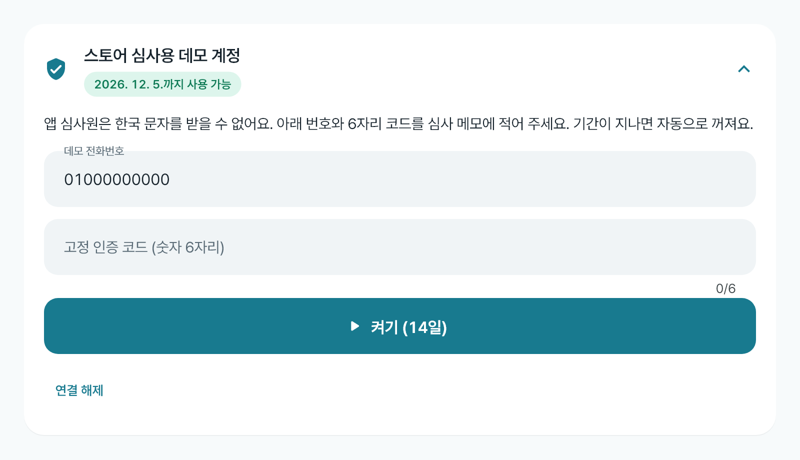
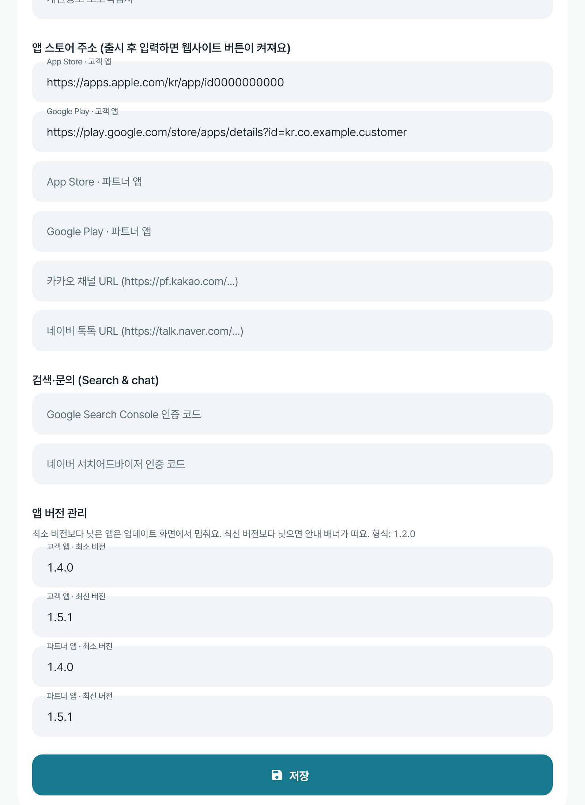
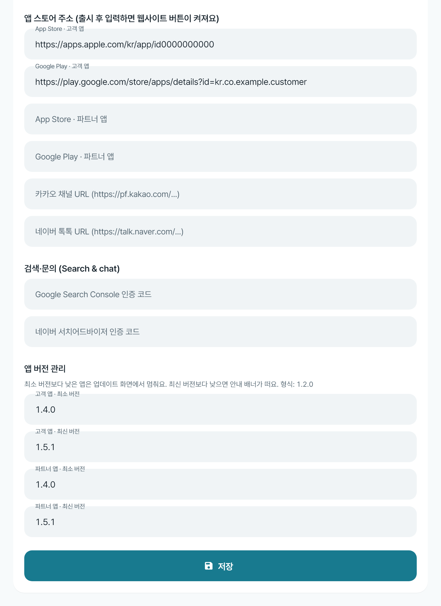

# 25. 스토어에 앱 올리기

**이 장에서 할 일:** 고객 앱과 파트너 앱을 Google Play 와 App Store 에 올리기 위해 사장님이 할 일을 순서대로 해요.
앱을 만드는(빌드하는) 일은 개발자가 해요. 사장님은 회사 이름으로 스토어 계정을 만들고, 개발자에게 권한을 주고, 심사 준비를 도와요.

> **준비물**
> - 사업자등록증 (회사 이름으로 계정을 만들어요)
> - **D-U-N-S 번호** (회사 고유 번호. 무료로 발급되지만 며칠 걸려요. Apple 과 Google 모두 조직 계정에 필요해요)
> - 회사 결제 카드 (스토어 등록비. 금액은 각 스토어 요금표를 보세요. 문서 기준 Apple 은 연 99 USD 예요)
> - 개발자의 Google 계정 이메일과 Apple ID (개발자에게 받아요)
> - 콘솔 사장님(소유자) 계정과 인증 앱 (심사용 데모 계정을 켤 때 필요해요, 17장)
> - 서버가 켜져 있고 도메인이 연결돼 있어야 해요 (4장, 5장)

> **참고** 스토어 회사 사이트의 메뉴 이름과 화면은 회사 사정으로 바뀔 수 있어요. 이 장의 외부 사이트 메뉴 이름이 화면과 다르면 비슷한 이름을 찾으세요.

---

## 25.1 누가 무엇을 하나요

| 일 | 누가 |
|---|---|
| Google Play 개발자 계정을 **조직**으로 가입 | 사장님 |
| Apple Developer Program 을 **조직**으로 가입, 계약 동의, App Store Connect API **액세스 요청** (한 번) | 사장님 (계정 소유자만 할 수 있어요) |
| 개발자를 두 스토어에 **관리자(Admin)** 로 초대 | 사장님이 초대, 개발자가 수락 |
| 앱 등록, 키 만들기, 빌드, 업로드, 심사 제출 | 개발자 |
| 콘솔에서 심사용 데모 계정 켜기 (고객 앱용) | 사장님 |
| 시험용 앱을 휴대폰에 깔아 확인 | 사장님과 개발자 |
| 승인 뒤 콘솔에 스토어 주소 넣기 | 사장님 |

> **주의** 계정은 꼭 **회사(사업자) 이름**으로 만들어요. 스토어 정책상 앱 주인이 사장님 회사여야 해요. 개인 계정으로 만들면 판매자 이름이 개인 이름으로 보여요.

> **참고** 맥(Mac)도, 코드도, 빌드 프로그램도 필요 없어요. 앱은 개발자가 인터넷(GitHub)에서 만들어 사장님 회사 스토어 계정으로 올려요.

---

## 25.2 사장님이 할 일 (한 번만)

### Google Play 개발자 계정 만들기

1. 컴퓨터 브라우저로 `play.google.com/console` 에 들어가요.
2. 회사용 Google 계정으로 로그인해요.
3. 계정 종류에서 **조직** 을 골라요.
4. 회사 정보와 D-U-N-S 번호를 넣고, 등록비를 결제하고, 신원 확인을 마쳐요.

> **주의** **개인** 계정은 정식 출시 전에 테스터 12명이 14일 동안 비공개 테스트를 해야 해요. 그래서 **조직** 계정을 권해요.

### Google Play 에 개발자 초대하기

1. Play Console 왼쪽 메뉴에서 **사용자 및 권한** (Users and permissions) 을 눌러요.
2. 새 사용자를 초대하는 버튼을 눌러요.
3. 이메일 칸에 개발자 Eric 의 Google 계정 이메일을 넣어요. 자동 업로드용 서비스 계정 `eric-play-upload` 는 나중에 개발자가 직접 만들어 초대해요.
4. 권한에서 **관리자** (Admin) 를 줘요.
5. 초대를 보내요. 개발자가 메일에서 수락하면 끝이에요.

**이렇게 보이면 성공:** 사용자 목록에 개발자 이메일이 보여요.

### Apple Developer Program 가입하기

1. 컴퓨터 브라우저로 `developer.apple.com` 에 들어가요.
2. 회사용 Apple ID 로 로그인하고 **조직** 으로 가입해요. D-U-N-S 번호가 필요해요.
3. 연회비를 결제하고 승인 메일을 기다려요.
4. 승인 뒤 계약(Agreements)에 동의해요. 계정 소유자만 할 수 있어요.
5. App Store Connect → **사용자 및 액세스** → **통합** → **App Store Connect API** 에서 **액세스 요청** 을 한 번 눌러요. 이게 없으면 개발자가 앱을 자동으로 올리는 키를 만들 수 없어요.

> **참고** 앱이 유료가 아니고 결제는 PortOne·토스 웹 결제라서, App Store 의 세금·정산 정보는 기본적으로 필요 없어요.

### App Store Connect 에 개발자 초대하기

1. App Store Connect 에서 **사용자 및 액세스** 를 눌러요.
2. 사용자 추가(+) 버튼을 눌러요.
3. 개발자의 이름 **Eric Wijesinghe** 와 Apple ID 이메일을 넣어요.
4. 역할에서 **Admin** 을 골라요.
5. 초대를 보내요. 개발자가 수락하면 끝이에요.

**이렇게 보이면 성공:** 사용자 목록에 개발자가 **Admin** 으로 보여요.

### 앱 ID (첫 업로드 전에 정해요)

기본 앱 ID 는 아래와 같아요. 사장님 회사 이름으로 따로 스토어에 올린다면 첫 업로드 **전에** 개발자와 다른 ID 를 정할 수 있어요.

| 앱 | 기본 앱 ID |
|---|---|
| 고객 앱 | `kr.co.dahae.customer` |
| 파트너 앱 | `kr.co.dahae.partner` |

다른 ID 를 쓰기로 했다면 두 곳에 **같은 값**을 넣어요.

1. **[개발자]** GitHub `store` 환경 변수 `CUSTOMER_APP_ID`, `PARTNER_APP_ID` 에 새 ID 를 넣어요. Firebase 에도 같은 ID 로 앱을 등록해요.
2. **[사장님]** 콘솔 **[설정]** → **앱 링크** 카드의 **안드로이드 패키지 이름 (한 줄에 하나)** 과 **iOS 번들 ID (한 줄에 하나)** 칸에 같은 ID 를 넣고 **[저장]** 해요 (15장 15.5). 기본 ID 를 쓰면 두 칸은 비워 둬요.

> **주의** 앱 ID 는 스토어에 한 번 올리면 **바꿀 수 없어요**. 새 ID 는 새 스토어 앱이에요. 이미 올린 앱의 ID 를 바꾸면 기존 고객이 그 앱으로 업데이트를 받지 못해요.

### 비밀 파일 보관

개발자가 만드는 `.p8` 파일, 업로드 키(keystore), 서비스 계정 키는 비밀번호와 같아요.

- 카카오톡 단체방, 이메일 본문, 공유 폴더에 올리지 마세요.
- 개발자는 이 값들을 GitHub 의 비공개 보관함(`store` 환경의 Secrets)에만 넣어요.
- 사본은 비밀번호 관리 앱에 보관해요. 업로드 키를 잃어버리면 Play 업데이트가 막혀요.

---

## 25.3 개발자가 하는 일 (요약)

사장님이 할 일은 아니지만, 무엇이 진행되는지 알아 두세요. 자세한 내용은 33장(개발자 부록)에 있어요.

1. 두 스토어에 앱 두 개를 등록해요 (위의 앱 ID).
2. 자동 업로드용 키를 만들어요 (Apple API 키, Play 서비스 계정, 안드로이드 업로드 키).
3. 앱 알림(Firebase)과 간편 로그인 키를 넣어요 (15장, 16장).
4. GitHub 의 `store-apps` 작업을 실행해 앱을 만들어요. 휴대폰 홈 화면의 앱 이름(고객 앱: **짧은 이름**, 파트너 앱: **(짧은 이름) 파트너**), 앱 아이콘, 색은 빌드할 때 서버에서 받아요. 콘솔 **사업장 정보** 에 저장한 값이에요 (28장).
5. 안드로이드는 첫 번째 파일만 Play Console 에 손으로 올리고, 그다음부터는 **내부 테스트** 에 초안으로 자동으로 올라가요.
6. 아이폰은 **TestFlight** 에 올라가요.
7. 첫 업로드 뒤 Play 의 앱 서명 지문(SHA-1, SHA-256)을 카카오·구글 콘솔과 사장님 콘솔 **[설정]** → **앱 링크** 에 넣어요 (15장).

### 시험용 앱 깔아 보기 (사장님도 같이)

1. **아이폰**: App Store 에서 **TestFlight** 앱을 받고, 개발자가 보낸 초대를 열어 고객 앱과 파트너 앱을 깔아요.
2. **안드로이드**: 개발자가 보낸 Play **내부 테스트** 링크로 앱을 깔아요.
3. 24장 24.3 의 순서대로 한 바퀴 시험해요. 로그인(전화, 카카오, 네이버, 구글, Apple), 사진, 결제창, 알림을 봐요.

---

## 25.4 스토어 설명 문구와 질문 답

스토어 화면에 넣을 글과 스토어가 묻는 질문의 답은 미리 만들어져 있어요. 개발자가 이 파일을 보고 넣어요. 사장님은 한 번 읽고 회사 사정과 맞는지 확인해요.

| 무엇 | 파일 |
|---|---|
| 앱 이름, 짧은 설명, 긴 설명, 키워드 (한국어 / 영어) | `docs/store/listing-ko.md`, `docs/store/listing-en.md` |
| 스토어 화면 사진 | 개발자가 만들어 릴리스에 첨부해요 (`docs/store/screenshots/`) |
| Google 데이터 보안 답 | `docs/store/data-safety.md` |
| Google 앱 콘텐츠 질문 답 (광고, 대상 연령, 등급, 금융 기능 등) | `docs/store/play-declarations.md` |
| Apple 개인정보 라벨, 연령 등급, 수출 규정 | `docs/store/app-privacy.md` |
| 심사원에게 보낼 메모 | `docs/store/review-notes.md` |

> **주의** 각 답안 파일 끝의 **판단이 필요한 항목** 은 제출 전에 사장님과 개발자가 같이 확인해요. 예를 들어 포인트 제도를 쓰면 Google 금융 기능 답이 달라져요 (`play-declarations.md` 9항).

> **주의** 설명 문구에는 "방문 2일 전까지 무료 취소" 같은 약속이 들어 있어요. 콘솔에서 취소 규정을 바꿨다면(18장) 문구도 같이 고쳐 달라고 개발자에게 말하세요.

---

## 25.5 심사 준비

심사원은 한국 휴대폰 문자를 받을 수 없어요. 그래서 심사 전용 번호 하나에 고정 인증번호를 정해 둬요.

### 심사용 데모 계정 켜기

1. 콘솔 **[설정]** 에서 **스토어 심사용 데모 계정** 카드를 찾아요 (자세한 방법은 17장).
2. **데모 전화번호** 에 **아무도 쓰지 않는** 휴대폰 번호를 넣어요.
3. **고정 인증 코드 (숫자 6자리)** 에 숫자 6자리를 정해 넣어요.
4. **[켜기 (14일)]** 을 눌러요. 소유자 코드를 물어보면 인증 앱 번호를 넣어요.

**이렇게 보이면 성공:** 카드에 **(날짜)까지 사용 가능** 이 보여요. 이 번호로 고객 앱에 들어가면 예시 예약 2건(예정 1건, 완료 1건)이 미리 들어 있어요 (켜 둔 서비스가 하나 이상 있을 때).

> **주의** 14일이 지나면 자동으로 꺼져요. 심사가 길어지면 다시 켜야 해요. 이미 고객, 파트너, 직원이 쓰는 번호는 **이미 고객, 파트너 또는 직원이 쓰는 번호예요. 아무도 쓰지 않는 번호를 넣어 주세요.** 가 떠요.

### 파트너 앱 심사 계정 (심사용 구글 계정)

> **주의** 고정 인증 코드는 **고객 앱에서만** 돼요. 파트너 앱에 데모 전화번호를 넣으면 문자가 오지 않고, 고정 인증 코드를 넣어도 인증번호가 맞지 않는다고 나와요. 서버가 일부러 막아 둔 것이에요.

- 그래서 파트너 앱 심사원은 심사 전용 **구글 계정** 으로 **[Google로 계속하기]** 를 눌러 들어가요 (`docs/store/review-notes.md` 1항).
1. 심사 전용 구글 계정을 하나 새로 만들어요. 이 주소와 비밀번호가 심사 메모의 `<REVIEW_GOOGLE_EMAIL>`, `<REVIEW_GOOGLE_PASSWORD>` 예요.
2. 제출 전에 파트너 앱에서 그 구글 계정으로 한 번 로그인하고, **회사 휴대폰 번호** 로 번호 확인을 끝내요. 가입 정보(지역, 서비스)도 넣어요.
3. 콘솔 **[파트너]** 에서 그 파트너의 **[승인]** 을 누르고 **검증 체크리스트** 를 채운 뒤 **[활동 중으로 승인]** 해요 (20장).

**이렇게 보이면 성공:** 그 구글 계정으로 파트너 앱에 들어가면 **일감**, **내 견적**, **일정**, **상담**, **더보기** 탭이 보여요.

> **참고** 파트너 앱에 **[Google로 계속하기]** 버튼이 없으면 앱 빌드에 구글 로그인 값이 빠진 것이에요. 개발자에게 다시 빌드해 달라고 하세요 (15장).

- 데모 전화번호로 파트너나 직원을 등록하지 마세요. 그러면 데모 계정 카드를 다시 저장할 때 **이미 고객, 파트너 또는 직원이 쓰는 번호예요. 아무도 쓰지 않는 번호를 넣어 주세요.** 가 떠요.

### 심사 메모와 주소 넣기 (개발자와 같이)

1. `docs/store/review-notes.md` 의 `<REVIEW_PHONE>`, `<REVIEW_CODE>`, `<REVIEW_GOOGLE_EMAIL>`, `<REVIEW_GOOGLE_PASSWORD>`, `<도메인>`, `<domain>`, `<API_DOMAIN>` 자리를 실제 값으로 바꿔요.
2. 그 글을 Play Console 의 **앱 액세스** 와 App Store Connect 의 **심사 정보 > 메모** 에 붙여 넣어요.
3. 개인정보처리방침 주소: `https://도메인/privacy.html`
4. 계정 삭제 안내 주소: `https://도메인/delete-account.html` (두 주소는 서버 설치 뒤 자동으로 생겨요)

> **주의** 실제 번호와 인증번호는 문서 파일에 저장하지 마세요. 제출하는 화면에만 넣어요.

### 제출 전 마지막 확인 (사장님 체크리스트)

- [ ] 심사용 데모 계정이 켜져 있고 기간이 심사 동안 남아 있어요.
- [ ] 심사용 구글 계정으로 파트너 앱에 로그인해 번호 확인을 끝냈고, 콘솔에서 **[활동 중으로 승인]** 했어요 (25.5).
- [ ] 심사 메모의 `<…>` 자리를 모두 채웠어요.
- [ ] **[쿠폰 · 콘텐츠]** → **성장** → **후기 신고 관리** 에 대기 건이 없어요 (22장). 심사 중에 들어오면 바로 처리해요.
- [ ] 고객 앱의 **이용약관**, **개인정보 처리방침** 화면에 글이 보여요 (22장 콘텐츠 **약관**).
- [ ] Apple 로그인을 쓰면 콘솔 Apple 카드에 키(.p8)를 넣고, Apple 개발자 계정에 서버 알림 주소 `https://도메인/v1/auth/apple/notifications` 를 등록했어요 (15장). 키는 `Eric Sign in with Apple` 하나로 두 앱에 모두 써요. 서버가 이 키로 서명하고, 앱마다 번들 ID (`kr.co.dahae.customer`, `kr.co.dahae.partner`) 를 클라이언트 ID 로 써요.
- [ ] 이름·상표 확인: 상표 검색(KIPRIS), 카카오 채널·알림톡 이름, 결제사 가맹점 이름, 약관 변경 7일 전 공지 (28장).
- [ ] 서버가 켜져 있어요. 심사 중에는 서버를 끄거나 점검 모드를 켜지 마세요.

> **참고** 심사 제출 버튼은 보통 개발자가 눌러요. 사장님 회사 직원도 같은 권한이 있으면 제출할 수 있어요. 심사 기간은 스토어 정책에 따라요.

---

## 25.6 승인된 뒤에 할 일

### 스토어 주소 넣기

1. 콘솔 **[설정]** → **사업장 정보** 카드를 열어요 (10장).
2. **앱 스토어 주소 (출시 후 입력하면 웹사이트 버튼이 켜져요)** 묶음을 찾아요.
3. 칸 네 개에 스토어 주소를 붙여 넣어요: **App Store · 고객 앱**, **Google Play · 고객 앱**, **App Store · 파트너 앱**, **Google Play · 파트너 앱**.
4. **[저장]** 을 눌러요.

**이렇게 보이면 성공:** **저장했어요** 가 뜨고, 웹사이트에 스토어 버튼이 생겨요.

### 앱 버전 관리

같은 카드의 **앱 버전 관리** 에는 앱마다 **최신 버전** 과 **최소 버전** 칸이 있어요 (형식: `1.2.0`).

- **최신 버전** 보다 낮은 앱에는 업데이트 안내 배너가 떠요.
- **최소 버전** 보다 낮은 앱은 업데이트 화면에서 멈춰요.

> **주의** **최소 버전** 은 새 버전이 두 스토어 **모두**에서 받을 수 있게 된 뒤에 올리세요. 먼저 올리면 아직 업데이트를 받을 수 없는 고객의 앱이 멈춰요.

> **주의** 토스페이먼츠가 들어간 첫 버전보다 오래된 스토어 고객 앱은 토스페이먼츠 결제창을 열 수 없어서, 토스페이먼츠로 가는 결제 방법이 실패해요 (돈은 나가지 않아요). 토스페이먼츠로 결제를 받기 전에(12장) 새 앱을 내고, 두 스토어에 모두 나오면 고객 앱의 **최소 버전** 을 그 버전으로 올리세요. 그 버전 번호는 개발자와 **확인 필요** 예요. 웹 앱은 늘 최신이에요.

### 심사용 데모 계정 끄기

심사가 끝나면 **스토어 심사용 데모 계정** 카드에서 **[연결 해제]** 를 눌러 꺼요. 그냥 두어도 14일 뒤에 자동으로 꺼져요.

### 앱 업데이트

> **참고** 콘솔에서 이름, 로고, 색, 앱 ID, 도메인을 바꿨다면 **[설정]** 의 **스토어 앱 빌드** 카드에 바뀐 항목이 나와요. 이런 값은 새 빌드에만 들어가요. 개발자에게 새 빌드를 부탁하고, 새 앱이 스토어에 나오면 **[빌드했어요]** 를 눌러요 (28장 28.7).

1. 개발자가 새 버전 번호(예: `v1.6.1`)를 붙이고 `store-apps` 를 다시 실행해요.
2. 안드로이드는 Play Console 에서 초안을 확인하고 출시해요. 아이폰은 TestFlight 확인 뒤 심사에 보내요.
3. 승인되면 고객 휴대폰이 자동으로 업데이트해요.

### 다른 스토어

- 아이폰 출시의 자세한 순서: `docs/store/ios-release.md` (개발자용)
- Microsoft Store(윈도우) 제출 가이드도 `docs/store/microsoft-store.md` 에 있어요. 사장님 회사가 윈도우 스토어에 올릴지는 **확인 필요** 예요. 관리 콘솔은 스토어 앱이 아니라 웹 주소(`https://도메인/admin/`)로 써요.

---

## 자주 생기는 문제

| 이렇게 나와요 | 이렇게 해요 |
|---|---|
| Apple 에서 개발자가 API 키를 못 만들어요 | 계정 소유자(사장님)가 **App Store Connect API** 의 **액세스 요청** 을 했는지 확인해요. |
| 개발자가 초대 메일을 못 받았어요 | 이메일 주소 철자를 확인하고 다시 초대해요. 스팸함도 봐요. |
| 심사원이 로그인하지 못했다고 거절했어요 | 데모 계정이 꺼졌을 수 있어요 (14일). 콘솔에서 다시 켜고 심사 메모의 번호·코드와 같은지 확인해요. |
| 심사원이 파트너 앱에 들어가지 못했어요 | 고정 인증 코드는 고객 앱에서만 돼요. 심사 메모에 심사용 구글 계정이 있는지, 그 계정이 콘솔에서 **활동 중** 으로 승인됐는지 확인해요 (25.5). |
| 심사원이 계정 삭제 방법을 물어요 | 앱 안 **더보기** → **계정정보** → **회원 탈퇴**, 웹 `https://도메인/delete-account.html` 이에요. |
| 결제 방식(인앱 결제) 때문에 거절됐어요 | `docs/store/review-notes.md` 4항의 영어 문장(방문 청소라는 실물 서비스 설명)을 심사 메모에 넣어 다시 제출해요. |
| 안드로이드에서 카카오·구글 로그인이 안 돼요 | Play 앱 서명 SHA-1 을 카카오·구글 콘솔에 등록해야 해요. 개발자에게 알려요 (15장). |
| 개발자가 "빌드가 서버 브랜드를 못 읽어서 멈췄다"고 해요 | 콘솔 **사업장 정보** 에 로고(또는 글자 로고)를 저장했는지 봐요. 서버에 로고가 없으면 빌드가 멈춰요 (28장 28.3). |
| 업데이트한 뒤 옛날 앱이 멈췄어요 | **최소 버전** 을 너무 일찍 올렸어요. 낮춰서 **[저장]** 하고, 새 버전이 두 스토어에 다 나온 뒤 다시 올려요. |
