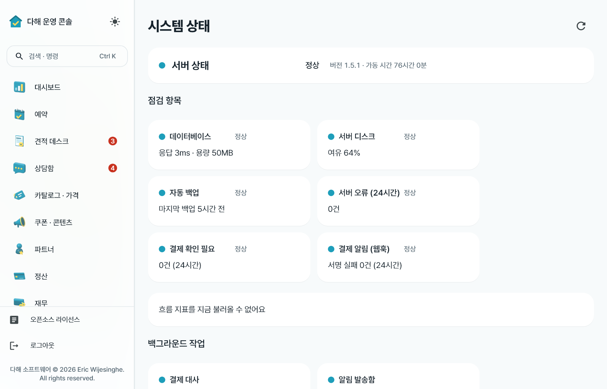
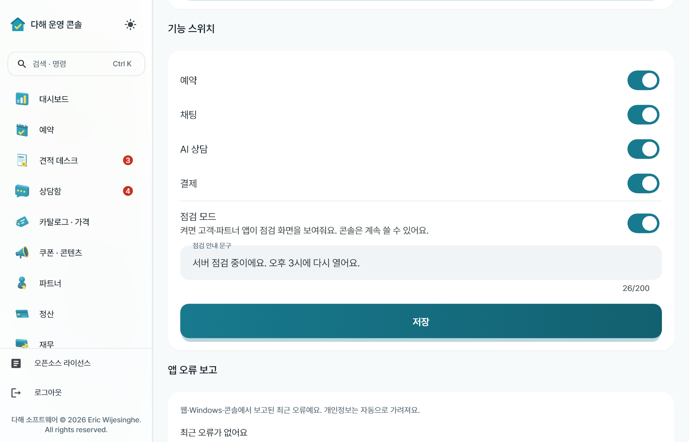
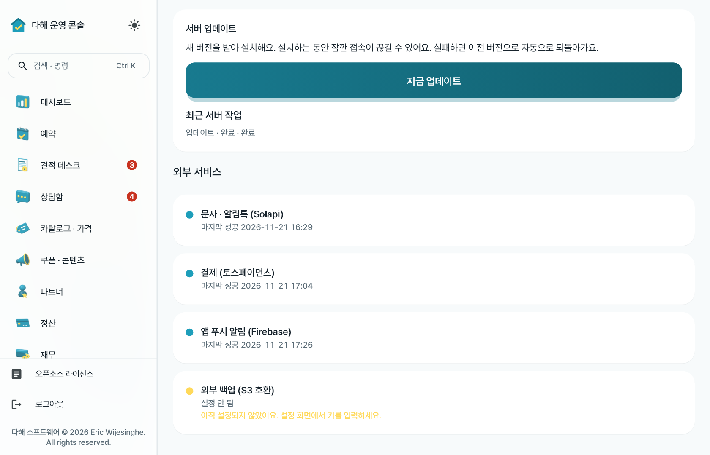

# 26. 시스템 상태, 알림, 업데이트

**이 장에서 할 일:** 콘솔의 **[시스템 상태]** 화면을 읽는 법을 배워요. 문제가 생기면 문자로 알림을 받도록 정하고, 기능 스위치와 점검 모드를 써 보고, 버튼 하나로 서버를 업데이트해요.

> **준비물**
>
> - 콘솔에 로그인할 수 있는 계정 (6장). 화면은 누구나 볼 수 있지만, 스위치를 바꾸고 저장하는 일은 **관리자**만 할 수 있어요.
> - 서버 업데이트를 하려면 **소유자**(사장님) 계정과 휴대폰의 인증 앱 (6장).
> - 알림 문자를 받으려면 **문자 · 알림톡 (Solapi)** 카드가 연결돼 있어야 해요 (14장).

---

## 26.1 시스템 상태 화면 열기

1. 콘솔 왼쪽 메뉴에서 **[시스템 상태]** 를 눌러요. 휴대폰에서는 왼쪽 위 메뉴 버튼(☰)을 먼저 눌러 메뉴를 열어요.
2. 화면 맨 위에 **시스템 상태** 라는 제목이 보여요.
3. 제목 오른쪽의 동그란 화살표 버튼(**새로고침**)을 누르면 최신 상태를 다시 불러와요. 휴대폰에서는 화면을 아래로 끌어내려도 새로고침돼요.

이렇게 보이면 성공: 맨 위에 **서버 상태** 카드가 있고, 그 아래로 **점검 항목**, **예약 흐름 (최근 30일)**, **백그라운드 작업**, **서버 업데이트**, **외부 서비스**, **알림 설정**, **기능 스위치**, **앱 오류 보고** 순서로 이어져요.

### 색의 뜻

화면의 모든 항목 앞에는 작은 동그라미가 있어요. 색과 글자는 이렇게 읽어요.

| 색 | 화면 글자 | 뜻 | 할 일 |
|---|---|---|---|
| 초록 | **정상** | 문제없어요 | 없음 |
| 노랑 | **확인 필요** | 곧 문제가 될 수 있거나, 아직 설정하지 않은 항목이에요 | 시간 날 때 확인 |
| 빨강 | **조치 필요** | 지금 문제가 있어요 | 빨간 글씨 안내대로 바로 처리 |

> **팁** 맨 위 **서버 상태** 의 색은 화면에서 **가장 나쁜 항목의 색**을 따라가요. 그래서 쓰지 않는 서비스(예: 애플 로그인을 안 쓰는 경우)가 **설정 안 됨** 으로 노랑이면, 서버 상태도 계속 노랑일 수 있어요. 노랑의 이유가 쓰지 않는 서비스의 **설정 안 됨** 뿐이라면 괜찮아요.

---

## 26.2 서버 상태 카드

맨 위 카드 한 줄에 세 가지가 보여요.

- **서버 상태**: 전체 색과 글자 (**정상** / **확인 필요** / **조치 필요**).
- **버전**: 지금 서버에 설치된 다해 버전이에요 (예: `버전 1.5.1`).
- **가동 시간**: 서버 프로그램이 마지막으로 다시 시작된 뒤 지난 시간이에요 (예: `가동 시간 52시간 10분`).

> **팁** 업데이트를 하면 프로그램이 다시 시작되므로 **가동 시간** 이 0에 가깝게 돌아가요. 업데이트 뒤 **버전** 숫자가 바뀌고 **가동 시간** 이 짧아졌다면 업데이트가 들어간 거예요.

---

## 26.3 점검 항목 (여섯 가지)

**점검 항목** 아래에 카드 여섯 장이 있어요. 빨강이 되면 카드 아래에 빨간 글씨로 할 일이 나와요. 아래 표의 기준은 처음 설치했을 때의 값이에요. 디스크와 백업 기준은 **[운영 규칙]** 에서 더 엄격하게 바꿀 수 있어요 (23장).

| 카드 이름 | 보이는 값 | 노랑이 되는 때 | 빨강이 되는 때 | 빨강일 때 화면 안내 (요약) |
|---|---|---|---|---|
| **데이터베이스** | 응답 ○ms · 용량 ○MB | - | 데이터베이스에 연결하지 못할 때 | 계속되면 개발사에 연락 |
| **서버 디스크** | 여유 ○% | 여유 20% 미만 | 여유 10% 미만 | 오래된 백업을 지우거나 디스크를 늘리기 |
| **자동 백업** | 마지막 백업 ○시간 전 | 26시간 넘음 | 36시간 넘음, 또는 **백업 기록이 없어요** | 개발사에 백업 확인 요청, 외부 백업 연결 확인 |
| **서버 오류 (24시간)** | ○건 | 20건 이상 | 100건 이상 | 반복되면 개발사에 전달 |
| **결제 확인 필요** | ○건 (24시간) | - | 1건이라도 있을 때 | 결제사 관리자 화면에서 그 결제를 확인하고 필요하면 직접 환불 |
| **결제 알림 (웹훅)** | 서명 실패 ○건 (24시간) | 1~2건 | 3건 이상 | 웹훅 시크릿(PortOne) 또는 보안 키(토스페이먼츠)를 다시 넣기 |

빨강일 때 무엇을 하는지는 29장 표에 자세히 있어요.

### 예약 흐름 카드

점검 항목 아래에 **예약 흐름 (최근 30일)** 카드가 있어요. 대시보드에 있는 것과 같은 카드예요 (19장). **기사님 배정까지 걸린 시간 (중앙값)**, **24시간 넘게 기사님이 없는 예약**, **오늘 당일 취소**, **서비스별 미도착(노쇼) 비율** 을 보여 줘요. 값을 못 불러오면 **흐름 지표를 지금 불러올 수 없어요** 라고 나와요. 서버 고장이 아니라 잠깐 못 읽은 것이니 잠시 뒤 새로고침하세요.

---

## 26.4 백그라운드 작업

서버는 눈에 보이지 않는 곳에서 정해진 일을 계속 해요. **백그라운드 작업** 카드마다 일의 이름과 **마지막 성공 (날짜 시각)** 이 보여요.

| 화면 이름 | 하는 일 (쉬운 말) |
|---|---|
| **설정 새로고침** | 콘솔에서 바꾼 설정을 서버가 다시 읽어요 |
| **결제 대사** | 결제사 기록과 우리 기록을 맞춰 봐요 |
| **운영 알림** | 이 장 26.6의 알림을 보내요 |
| **지급 상태 동기화** | 토스 지급 결과를 다시 물어봐요 |
| **보관 기간 정리** | 보관 기간이 지난 개인정보를 지워요 |
| **미도착 확인** | 기사님이 오지 않은 예약을 찾아요 |
| **포인트 만료** | 기간이 지난 포인트를 정리해요 |
| **마케팅 발송** | 예약해 둔 광고 메시지를 보내요 |
| **품질 점수** | 파트너 품질 점수를 계산해요 |
| **대기 예약** | 대기 예약을 처리해요 |
| **정기 청소** | 정기 청소 회차를 만들고 결제해요 |
| **알림 발송함** | 예약 알림 문자를 보내고, 실패하면 다시 보내요 |

- 색: 초록은 정상, 노랑은 **오류 ○회** 가 있었지만 계속 도는 중, 빨강은 **멈춤** 이에요. 작업 하나라도 **멈춤** 이면 맨 위 서버 상태도 빨강이 돼요.
- **알림 발송함** 카드에 빨간 글씨로 **발송 실패 ○건 (재시도 끝)** 이 보이면, 여러 번 다시 보내도 끝내 못 보낸 문자가 있다는 뜻이에요. 그 문자는 콘솔에서 다시 보낼 수 없어요. 필요한 고객에게는 전화나 앱 메시지로 직접 알려 주세요.
- **아직 성공한 적 없음** 은 서버가 막 다시 시작돼서 아직 한 번도 돌지 않은 경우예요. 몇 분 뒤 새로고침하세요.

> **주의** 작업이 **멈춤** 으로 30분 넘게 그대로면 개발자에게 화면을 캡처해 보내 주세요.

---

## 26.5 외부 서비스

**외부 서비스** 아래에는 연결한 회사 서비스가 한 줄씩 보여요.

보이는 서비스: **결제 (PortOne)**, **결제 (토스페이먼츠)**, **문자 · 알림톡 (Solapi)**, **앱 푸시 알림 (Firebase)**, **카카오 로그인**, **네이버 로그인**, **구글 로그인**, **애플 로그인**, **외부 백업 (S3 호환)**, **사진 외부 백업 (S3 호환)**.

각 줄의 둘째 줄은 이렇게 읽어요.

| 화면 글자 | 뜻 | 색 |
|---|---|---|
| **설정 안 됨** | 설정 화면에서 아직 키를 넣지 않았어요. 아래에 **아직 설정되지 않았어요. 설정 화면에서 키를 입력하세요.** 가 나와요 | 노랑 |
| **아직 사용 기록이 없어요** | 키는 넣었지만 아직 한 번도 쓰이지 않았어요 | 초록 |
| **마지막 성공 (날짜 시각)** | 마지막으로 잘 된 때예요 | 초록. 24시간 안에 실패가 있었지만 그 뒤에 다시 성공했으면 노랑 |
| **마지막 실패 (날짜 시각) (오류 코드)** | 마지막 실패 뒤로 아직 성공이 없어요. 실패한 때와 짧은 오류 코드가 보여요 | 실패가 24시간 안이면 빨강, 그보다 오래됐으면 초록 |

빨강이면 아래에 **연동이 실패하고 있어요. 설정 화면에서 키를 다시 확인하고 [연결 확인] 을 누르세요.** 가 나와요. 이때 할 일:

1. 왼쪽 메뉴에서 **[설정]** 을 눌러요.
2. 빨강이었던 서비스의 카드를 찾아요.
3. **[연결 확인]** 을 눌러요. **결제 (PortOne)** 와 **결제 (토스페이먼츠)** 카드는 **[API 키 확인]** 이에요. 소유자 계정이면 카드가 잠겨 있어도 잠금을 풀지 않고 누를 수 있어요. 다른 관리자에게는 잠긴 카드의 이 버튼이 보이지 않아요.
4. **연결됨** 이 나오면 끝이에요.
5. 아니면 그 회사 사이트에서 키를 새로 복사해요. 카드가 잠겨 있으면 **[잠금 해제 (소유자 코드)]** 를 누르고 인증 앱의 6자리를 넣어요 (9장). 키를 붙여넣고 **[저장]** 한 뒤 다시 확인해요.
6. **[시스템 상태]** 로 돌아와 새로고침해요.

> **팁** **사진 외부 백업 (S3 호환)** 은 따로 설정하는 카드가 없어요. **외부 백업 (S3 호환)** 카드 하나를 채우면 데이터베이스와 사진이 함께 서버 밖에 올라가요 (17장).

---

## 26.6 알림 설정 (문제가 생기면 문자 받기)

문제가 생기면 서버가 **상담함**에 알림을 남기고, 사장님 휴대폰으로 문자를 보내요. 같은 문제는 6시간에 한 번만 보내요.

### 받을 알림 고르기

1. **[시스템 상태]** 화면을 아래로 내려 **알림 설정** 을 찾아요.
2. 알림 종류마다 스위치가 있어요. 처음에는 모두 켜져 있어요. 받기 싫은 알림만 스위치를 눌러 꺼요.

| 스위치 이름 | 언제 알려 주나 |
|---|---|
| **문자(SMS) 발송 실패** | 문자가 짧은 시간에 여러 번 실패할 때 |
| **앱 알림(푸시) 실패** | 푸시가 여러 번 실패할 때 |
| **결제 연동 실패** | 결제사 연결이 여러 번 실패할 때 |
| **결제 자동 처리 실패** | 돈은 받았는데 예약 처리가 안 됐을 때 |
| **결제사(PortOne/토스페이먼츠) 내역 불일치** | 결제사 기록과 우리 기록이 다를 때 |
| **소셜 로그인 실패** | 카카오·네이버·구글·애플 로그인이 여러 번 실패할 때 |
| **자동 백업 누락** | 매일 백업이 오래 없을 때 |
| **사진 외부 백업 실패** | 사진을 서버 밖에 올리지 못했을 때 |
| **데이터베이스 외부 백업 실패** | 데이터를 서버 밖에 올리지 못했을 때 |
| **외부 백업 미설정** | 외부 백업을 아직 연결하지 않았을 때 |
| **디스크 부족** | 서버 디스크 여유가 적을 때 |
| **계정 보안 이상(로그인 잠금 등)** | 틀린 비밀번호나 인증 번호가 몰릴 때 |
| **인증 번호 발송이 평소보다 많음(문자 비용)** | 로그인 인증 문자가 갑자기 많이 나갈 때 |
| **기사님 미배정 예약 (오래 방치)** | 확정된 예약에 오래 기사님이 없을 때 |
| **당일 취소가 많음** | 오늘 방문 예약의 당일 취소가 많을 때 |
| **부가가치세 신고 기한 임박** | 부가세 신고 기한이 다가올 때 |
| **토스 정산 송금 결과 확인 안 됨 (30분 이상)** | 토스 지급 결과를 30분 넘게 모를 때 |

> **주의** **결제 자동 처리 실패**, **자동 백업 누락**, **디스크 부족**, **외부 백업 미설정** 은 끄지 마세요. 이 알림이 없으면 고객 돈이나 데이터 문제를 늦게 알게 돼요.

### 조용한 시간 정하기

밤에 알림을 보내지 않는 시간이에요. 문자뿐 아니라 상담함 알림과 앱 푸시도 쉬어요. 처음 값은 **22시 ~ 7시** (한국 시간)예요. 시간이 끝나면 그때도 남아 있는 문제를 알려 줘요. 그 사이에 저절로 풀린 문제는 알리지 않아요.

1. **조용한 시간** 아래 **시작** 칸을 눌러 시각을 골라요 (예: **22시**).
2. **끝** 칸을 눌러 시각을 골라요 (예: **7시**).

> **팁** **시작** 과 **끝** 을 같은 시각으로 고르면 조용한 시간이 없어져요. 밤에도 바로 문자를 받아요.

### 알림 받을 휴대폰

1. **알림 받을 휴대폰** 칸에 문자를 받을 번호를 넣어요 (예: `010-1234-5678`).
2. 비워 두면 **사업장 정보** 카드의 고객센터 번호로 보내요 (10장). 칸 아래에 그 번호가 괄호로 보여요.

### 저장하기

1. 알림 설정 카드 맨 아래 **[저장]** 을 눌러요.

이렇게 보이면 성공: 화면 아래에 **알림 설정을 저장했어요** 가 잠깐 나와요. **저장하지 못했어요. 입력값을 확인해 주세요.** 가 나오면 휴대폰 번호를 다시 확인하세요.

> **팁** 이 장의 알림 문자는 여기 **알림 설정** 의 번호로 가요. **[내 계정]** 화면에도 같은 이름의 **알림 받을 휴대폰** 이 있지만 (8장), 따로 저장되는 칸이고, 이 장의 알림은 그 칸의 번호를 쓰지 않아요. 헷갈리지 않게 두 칸에 같은 번호를 넣어 두면 편해요.

---

## 26.7 기능 스위치와 점검 모드

### 기능 스위치

**기능 스위치** 에는 **예약**, **채팅**, **AI 상담**, **결제** 스위치가 있어요. 처음에는 모두 켜져 있어요. 끄면 고객·파트너 앱에서 그 기능이 멈춰요.

언제 쓰나요:
- **결제**: 결제사에 문제가 생겨서 결제를 잠시 막고 싶을 때.
- **채팅**: 상담할 사람이 없어 채팅을 잠시 닫고 싶을 때.
- **AI 상담**: AI 상담원을 잠시 끄고 싶을 때.
- **예약**: 예약 기능을 통째로 잠시 멈출 때.

> **주의** 스위치를 끄면 그 기능 전체가 멈춰요. 예를 들어 **예약** 을 끄면 새 예약뿐 아니라 고객이 자기 예약을 보는 것도 막혀요. 새 예약만 잠시 막으려면 아래 **점검 모드** 를 쓰세요.

### 점검 모드

**점검 모드** 를 켜면 고객·파트너 앱 화면 맨 위에 **점검 중이에요** 안내 띠와 점검 안내 문구가 보여요. 스위치 아래 설명에는 "점검 화면" 이라고 나오지만, 앱 전체를 막는 화면이 아니라 위쪽 안내 띠예요. 앱과 콘솔은 계속 쓸 수 있어요. 새 예약, 정기 구독 신청, 예약 결제 시작이 막혀요. 이미 있는 예약을 보거나 취소하는 일은 계속 돼요.

점검 모드 켜는 순서:

1. **점검 모드** 스위치를 눌러 켜요.
2. **점검 안내 문구** 칸에 고객에게 보여 줄 말을 써요 (200자까지). 예: `오늘 밤 11시부터 12시까지 점검해요. 잠시 뒤 다시 이용해 주세요.`
3. 카드 맨 아래 **[저장]** 을 눌러요.
4. 화면 아래에 **알림 설정을 저장했어요** 가 잠깐 나와요. (이 카드도 같은 저장 안내 문구를 써요. 기능 스위치가 저장된 거예요.)
5. 30초쯤 지나면 서버가 새 예약을 막아요. 고객 앱을 완전히 닫았다가 다시 열어, 맨 위에 점검 안내가 보이는지 확인해요. 이미 열려 있던 앱은 다시 열거나, 다른 앱을 10분 넘게 쓰다가 돌아올 때 새 설정을 읽어요.

점검 모드 끄는 순서:

1. **점검 모드** 스위치를 다시 눌러 꺼요.
2. **[저장]** 을 눌러요.
3. 30초 뒤 고객 앱을 완전히 닫았다가 다시 열고, 예약이 다시 되는지 확인해요.

> **주의** 점검 모드를 켠 채로 두면 손님이 예약을 못 해요. 일이 끝나면 꼭 끄고 **[저장]** 하세요.

> **팁** 데이터를 백업 시점으로 되돌리기(복원) 전에는 점검 모드를 먼저 켜 두세요 (27장).

---

## 26.8 앱 오류 보고

**앱 오류 보고** 에는 웹, Windows, 콘솔에서 보고된 최근 오류가 보여요. 개인정보는 자동으로 가려져요.

1. 줄마다 오류 문장과 `앱 이름 · 버전 · 날짜 시각` 이 보여요.
2. 줄을 누르면 자세한 기록이 펼쳐져요.
3. 같은 오류가 여러 번 보이면 그 줄을 펼친 화면을 캡처해 개발자에게 보내 주세요.

오류가 없으면 **최근 오류가 없어요** 가 나와요.

---

## 26.9 서버 업데이트 (버튼 하나로)

서버는 **매주 월요일 새벽 4시** (기본값)에 스스로 새 버전으로 업데이트해요. 업데이트 전에 먼저 백업하고, 새 버전이 3분 안에 응답하지 않으면 이전 버전으로 자동으로 되돌려요. 그래서 평소에는 아무것도 안 해도 돼요. 새 안정 버전이 나오면 자동 업데이트는 바로 받지 않고, 처음 확인한 뒤 24시간이 지난 다음 차례에 받아요. 그래서 새 버전이 들어가기까지 1~2주 걸릴 수 있어요.

개발자가 "새 버전을 올렸어요" 라고 알려 주었는데 월요일까지 기다리기 싫을 때만 아래처럼 직접 업데이트해요.

1. 손님이 적은 시간을 골라요. 설치하는 동안 잠깐 접속이 끊길 수 있어요.
2. **[시스템 상태]** 화면에서 **서버 업데이트** 카드를 찾아요 (**백그라운드 작업** 바로 아래).
3. **[지금 업데이트]** 를 눌러요. 이 버튼은 **소유자** 계정에만 보여요.
4. **인증 번호 입력** 창이 열려요. 휴대폰 인증 앱을 열어요.
5. **인증 번호 6자리** 칸에 인증 앱에 지금 보이는 6자리를 넣어요.
6. **[계속]** 을 눌러요.

이렇게 보이면 성공: 화면 아래에 **업데이트를 시작했어요. 아래에서 진행 상황을 볼 수 있어요** 가 나오고, **최근 서버 작업** 맨 위에 `업데이트 · 대기 중` 이 생겨요. **[지금 업데이트]** 버튼은 업데이트가 끝날 때까지 눌리지 않아요.

> **팁** 버튼을 누르면 소유자 계정에 등록된 휴대폰으로 **서버 작업이 요청됐어요: 업데이트. 본인이 요청하지 않았다면 바로 확인하세요.** 문자가 가요 (**문자 · 알림톡 (Solapi)** 이 연결돼 있을 때). 본인이 누른 것이면 그냥 두세요.

7. 1~2분마다 왼쪽 메뉴에서 다른 화면(예: **[대시보드]**)을 눌렀다가 다시 **[시스템 상태]** 를 눌러 진행 상황을 봐요. 제목 옆 **새로고침** 버튼은 이 카드의 **최근 서버 작업** 목록까지는 다시 읽지 않아요.
8. 접속이 잠깐 끊기면 몇 분 기다렸다가 브라우저에서 콘솔 주소를 다시 열어요. 로그인 화면이 나오면 다시 로그인해요.

**최근 서버 작업** 의 상태 글자:

| 화면 글자 | 뜻 | 할 일 |
|---|---|---|
| **대기 중** | 서버가 곧 시작해요 | 기다리기 |
| **진행 중** | 백업 → 새 버전 받기 → 응답 확인 중이에요. 뒤에 지금 단계가 함께 보일 수 있어요 | 기다리기 |
| **완료** | 업데이트가 끝났어요 | 맨 위 **버전** 이 바뀌었는지 확인 |
| **실패** | 업데이트하지 못했어요 | 화면을 캡처해 개발자에게 보내기 |
| **실패해서 이전 버전으로 되돌렸어요** | 새 버전이 응답하지 않아 원래 버전으로 돌아갔어요. 서비스는 이전 버전으로 계속 돌아요 | 개발자에게 알리기 |
| **확인이 필요해요** | 서버가 알 수 없는 상태를 보냈어요 | 개발자에게 알리기 |

> **주의** 인증 앱 번호는 한 번만 쓸 수 있어요. 번호가 틀렸다는 안내가 나오면 30초쯤 기다렸다가 인증 앱에 새로 나온 번호로 다시 해 보세요.

> **팁** 업데이트는 프로그램만 바꿔요. 고객, 예약, 설정 같은 데이터는 그대로예요.

### 업데이트 뒤에 이상하면

업데이트는 성공했는데 화면이나 기능이 이상하면, 개발자에게 알려 주세요. 개발자가 서버에서 바로 전 버전으로 되돌려요(되돌리기). 콘솔에는 되돌리기 버튼이 없어요. 되돌려도 데이터는 지워지지 않아요 (33장).

---

## 26.10 AWS 서버라면

AWS 에 설치한 서버(3~4장)도 위의 **[지금 업데이트]** 버튼을 똑같이 쓸 수 있어요. 여기에 더해, 개발자가 새 안정 버전을 내면 GitHub 의 자동 배포로 서버에 들어가요. DODA 가 원하면 GitHub 에서 배포 승인자를 둘 수 있어요. 승인자를 두면 승인한 뒤에만 들어가요. 자세한 내용은 개발자 부록(33장)에 있어요.

- AWS 서버에도 매주 월요일 04:00 자동 업데이트가 기본으로 켜져 있어요. GitHub 배포로만 올리고 싶으면 개발자에게 자동 업데이트를 꺼 달라고 하세요.
- 베타 버전은 자동 배포되지 않아요. 손님을 받는 서버에는 안정 버전만 가요.

---

## 자주 생기는 문제

> **자주 생기는 문제**
>
> - **[지금 업데이트] 버튼이 안 보여요** → 소유자 계정으로 로그인했는지 확인하세요. 다른 관리자에게는 버튼이 보이지 않아요.
> - **[지금 업데이트] 가 회색이라 안 눌려요** → 이미 업데이트가 **대기 중** 이거나 **진행 중** 이에요. 끝날 때까지 기다리세요.
> - **알림 설정의 스위치가 회색이에요** → **상담원** 계정이에요. **관리자** 계정으로 로그인하세요.
> - **알림 문자가 안 와요** → **알림 받을 휴대폰** 번호와 **조용한 시간** 을 확인하고, **[설정]** 의 **문자 · 알림톡 (Solapi)** 카드에서 **[연결 확인]** 을 눌러 보세요.
> - **서버 상태가 계속 노랑이에요** → **외부 서비스** 에서 노랑인 줄을 보세요. 쓰지 않는 서비스의 **설정 안 됨** 이면 괜찮아요.
> - **업데이트 뒤 콘솔이 안 열려요** → 5분 기다린 뒤 다시 열어 보세요. 그래도 안 되면 29장의 "사이트가 아예 안 열려요" 를 따라 하세요.
> - **시스템 상태 화면이 열리지 않고 오류가 나와요** → 새로고침을 눌러 보고, 계속되면 29장의 "콘솔은 열리는데 화면마다 오류가 나요" 를 보세요.
