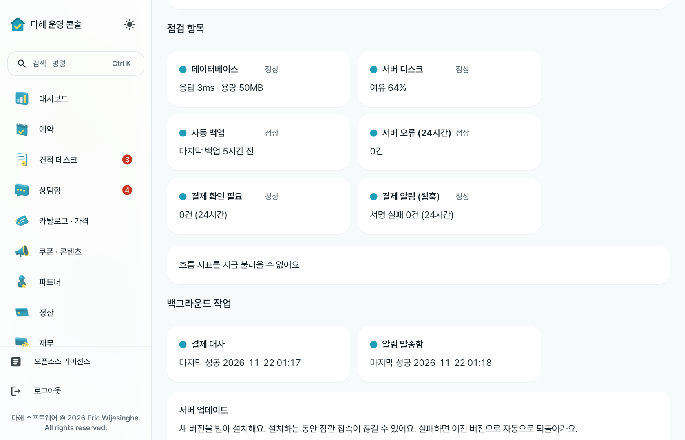

# 27. 백업과 복원

**이 장에서 할 일:** 무엇이 언제 어디에 백업되는지 알아요. 콘솔에서 백업이 잘 되는지 확인하고, 꼭 필요한 **비밀 키 사본**을 서버 밖에 보관해요. 데이터를 되돌려야 할 때(복원) 사장님이 할 일과 개발자에게 부탁할 일을 나눠 봐요.

> **준비물**
>
> - 콘솔 관리자 계정 (6장).
> - 외부 백업 저장소 연결 (17장의 **외부 백업 (S3 호환)** 카드). 아직 안 했다면 이 장을 읽고 17장을 먼저 하세요.
> - 비밀 키 사본을 보관할 곳: 비밀번호 관리 앱 또는 USB 메모리.
> - 복원과 키 사본은 서버에서 명령을 쳐야 해서 **개발자(설치 담당)** 의 도움이 필요해요.

---

## 27.1 무엇이, 언제, 어디에 백업되나요

서버 안 백업과 외부 백업은 자동이라 사장님이 따로 누를 것은 없어요. 비밀 키 사본만 사람이 만들어요 (27.4).

| 무엇 | 언제 | 어디에 | 얼마나 보관 |
|---|---|---|---|
| **서버 안 백업** (고객·예약 데이터 + 사진 파일) | 매일 새벽 3시 30분 (한국 시간). 그리고 업데이트·되돌리기·복원 직전에도 한 번 | 서버 디스크의 백업 폴더 | 14일 |
| **외부 백업** (서버 안 백업의 사본) | 서버 안 백업이 끝난 바로 뒤 | 17장에서 연결한 S3 호환 저장소 (예: Cloudflare R2, 네이버 클라우드 Object Storage, AWS S3) | 카드의 보관 기간 (처음 값 30일, 1~3650일) |
| **비밀 키 사본** | 자동이 아니에요. 설치 직후 개발자가 한 번 만들고, 키가 바뀔 때마다 다시 만들어요 | 서버 밖 (비밀번호 관리 앱, USB) | 사장님이 보관 |

- 백업 파일은 모두 **암호화**돼요. 서버 디스크에도 암호화되지 않은 백업은 남지 않아요.
- 백업은 하루 한 번이라, 최악의 경우 **하루치 데이터**(마지막 백업 뒤에 들어온 예약 등)를 잃을 수 있어요.
- 서버 디스크에만 백업이 있으면, 서버가 통째로 고장 났을 때 백업도 함께 사라져요. 그래서 **외부 백업을 꼭 연결**하세요.

> **주의** 외부 백업은 서버 안의 **비밀 키(`DATA_KEY`)** 로 잠겨 있어요. 서버를 잃으면 이 키도 함께 잃어요. **비밀 키 사본이 없으면 외부 백업이 있어도 열 수 없어요.** 27.4를 꼭 하세요.

---

## 27.2 콘솔에서 백업이 잘 되는지 확인하기

일주일에 한 번 확인하면 충분해요.

1. 왼쪽 메뉴에서 **[시스템 상태]** 를 눌러요.
2. **점검 항목** 의 **자동 백업** 카드를 봐요.

| 보이는 것 | 뜻 | 할 일 |
|---|---|---|
| 초록 **정상**, **마지막 백업 ○시간 전** (26시간 이하) | 매일 백업이 잘 돼요 | 없음 |
| 노랑 **확인 필요** (26시간 넘음) | 어젯밤 백업이 늦거나 빠졌어요 | 다음 날 다시 확인. 또 노랑이면 개발자에게 알리기 |
| 빨강 **조치 필요** (36시간 넘음) | 백업이 멈췄어요 | 화면의 안내대로 개발자에게 백업 확인을 요청 |
| 빨강 **백업 기록이 없어요** | 아직 한 번도 백업 기록이 없어요 | 설치 첫날이면 다음 날 새벽 3시 30분 뒤 다시 확인. 계속 그러면 개발자에게 알리기 |

3. 화면을 내려 **외부 서비스** 에서 **외부 백업 (S3 호환)** 과 **사진 외부 백업 (S3 호환)** 줄을 봐요.
   - **마지막 성공 (날짜 시각)** 이 오늘이나 어제면 정상이에요.
   - **설정 안 됨** 이면 17장의 외부 백업 카드를 아직 채우지 않은 거예요.
   - **마지막 실패 …** 가 빨강이면 17장의 카드에서 **[연결 확인]** 을 눌러 보세요.

> **팁** **알림 설정** 의 **자동 백업 누락**, **데이터베이스 외부 백업 실패**, **사진 외부 백업 실패**, **외부 백업 미설정** 스위치를 켜 두면, 백업에 문제가 생겼을 때 문자로 알려 줘요 (26장).

> **팁** 백업 기준 시간(26시간, 36시간)은 **[운영 규칙]** 에서 더 짧게만 바꿀 수 있어요 (23장).

---

## 27.3 AWS 서버라면 (백업이 한 겹 더)

AWS 에 설치한 서버(3~4장)에는 AWS 가 하는 **디스크 스냅샷**이 하나 더 있어요.

| 무엇 | 언제 | 어디에 | 보관 |
|---|---|---|---|
| 디스크 스냅샷 | 매일 새벽 3시 (한국 시간) | AWS 콘솔 **EC2 > 스냅샷** | 7개 |

- 스냅샷은 서버 디스크를 통째로 찍어 둔 사진 같은 거예요. 서버와 같은 AWS 계정 안에 있어요.
- 그래서 스냅샷만으로는 부족해요. 서버 밖 외부 백업(17장)과 비밀 키 사본(27.4)도 꼭 하세요.
- 스냅샷으로 되돌리는 방법은 이 매뉴얼에 없어요. 필요하면 개발자와 상의하세요.

---

## 27.4 비밀 키 사본 만들기와 보관 (꼭 하세요)

지금은 콘솔에서 비밀 키 사본을 만들거나 받을 수 없어요. 개발자(설치 담당)에게 부탁해요.

1. 개발자에게 **"비밀 키 사본을 만들어 주세요"** 라고 말해요.
2. 개발자가 서버에서 사본 파일을 만들고, **잠금 비밀번호**(12자 이상)를 정해요. 파일 이름은 `keys-날짜-시각.env.enc` 모양이에요.
3. 파일을 받아요. 카카오톡이나 이메일 본문에 붙여넣어 받지 마세요. 파일 그대로 USB 나 비밀번호 관리 앱으로 받아요.
4. 파일을 **비밀번호 관리 앱** 이나 **USB 메모리**에 저장해요. 서버가 아닌 곳이어야 해요.
5. 잠금 비밀번호를 파일과 **다른 곳**에 적어 둬요 (예: 파일은 USB, 비밀번호는 비밀번호 관리 앱).
6. 개발자가 서버에서 "서버 밖에 보관했어요?" 라고 물으면, 보관을 마쳤다고 알려 줘요. 개발자가 서버에 확인 기록을 남겨요.

이렇게 되면 성공: 개발자가 서버에서 `sudo dahae status` 를 실행했을 때 `✔ 비밀 키 사본 있음` 과 `✔ 비밀 키 사본을 서버 밖에 보관했다고 확인했어요` 가 나와요.

> **주의** 사본 파일과 잠금 비밀번호를 **둘 다** 잃으면 외부 백업을 열 수 없어요. 반대로 둘 다 남에게 넘어가면 그 사람이 서버의 비밀 키를 알 수 있어요. 두 가지를 따로, 안전하게 두세요.

> **팁** 콘솔 **[갱신 일정]** 에서 **[갱신 항목 추가]** 를 누르고, **종류** 는 **기타**, 이름은 `비밀 키 사본 확인`, 날짜는 1년 뒤로 넣어 두면 확인할 때를 잊지 않아요 (23장).

**다시 만들어야 할 때:** 개발자가 서버의 키를 바꾼 뒤에는 새 사본을 만들어 보관해요. 새 사본이 생기면 예전 사본은 쓰지 않아요.

---

## 27.5 데이터를 되돌려야 할 때 (복원)

복원은 **지금 데이터를 백업 시점으로 되돌리는 일**이에요. 백업 시점 뒤에 들어온 예약과 고객 변경은 **사라져요**. 꼭 필요할 때만 해요.

**언제 하나요:** 실수로 많은 데이터를 지웠을 때, 업데이트 뒤 데이터가 깨졌을 때, 서버가 고장 나서 새 서버로 옮길 때.

**누가 하나요:** 명령은 **개발자(설치 담당)** 가 서버에서 실행해요. 콘솔에는 복원 버튼이 없어요. 사장님은 언제로 되돌릴지 정하고, 손님이 예약하지 못하게 막아요.

### 사장님이 할 일

1. 언제로 되돌릴지 정해요. 예: "11월 10일 새벽 백업으로". 백업은 매일 새벽 3시 30분에 만들어져요.
2. 왼쪽 메뉴 **[시스템 상태]** 를 열고 **점검 모드** 를 켜요. **점검 안내 문구** 를 쓰고 **[저장]** 을 눌러요 (26.7). 그래야 복원하는 동안 새 예약이 들어오지 않아요.
3. 개발자에게 아래 내용을 알려 줘요.
   - 무슨 일이 있었는지 (예: "가격표를 잘못 지웠어요", "업데이트 뒤 예약이 이상해요")
   - 되돌릴 날짜와 시각
   - 서버 안 백업이 있는지, 서버가 고장 나서 외부 백업에서 가져와야 하는지
   - 점검 모드를 켰다는 것
4. 개발자가 끝났다고 하면 콘솔에서 **[예약]**, **[고객]** 화면을 열어 예약과 고객이 제대로 보이는지 확인해요.
5. 문제가 없으면 **점검 모드** 를 끄고 **[저장]** 을 눌러요.
6. 백업 시점 뒤에 들어왔던 예약이 있다면, 그 고객들에게 연락해 다시 예약해 달라고 안내해요.

> **팁** 복원하기 직전에 서버는 **지금 상태도 먼저 백업**해 둬요. 그래서 복원이 마음에 들지 않으면 개발자가 그 백업으로 다시 되돌릴 수 있어요.

> **주의** 복원 중에 오류가 나면, 데이터베이스는 복원 전 그대로 남아요. 그때는 개발자가 보내는 안내를 기다리세요. 개발자가 쓰는 명령은 33장에 있어요.

---

## 27.6 매달 하는 백업 점검 (운영 서버에서 해도 안전해요)

1. 왼쪽 메뉴 **[설정]** 을 눌러요.
2. **외부 백업 (S3 호환)** 카드를 찾아요.
3. **[연결 확인]** 을 눌러요. 소유자 계정이면 카드가 잠겨 있어도 잠금을 풀지 않고 누를 수 있어요. 다른 관리자에게는 잠긴 카드의 이 버튼이 보이지 않으니 소유자가 해요.
4. 초록색 **연결됨** 이 나오면 성공이에요. 서버가 저장소에 작은 시험 파일을 올렸다가 바로 지워요.
5. 개발자에게 "외부 백업 목록에 어젯밤 파일이 있는지 봐 주세요" 라고 부탁해요. 개발자가 서버에서 목록을 확인해요.

**실제 복원 연습**은 운영 서버가 아니라 **따로 만든 시험 서버**에서 해요. 운영 서버에서 연습하면 실제 데이터가 바뀌어요. 시험 서버 연습은 27.7과 같은 순서이고 개발자가 해요. 1년에 몇 번 할지는 개발자와 정하세요.

---

## 27.7 새 서버로 옮기기 (서버 고장, 이사)

서버가 고장 났거나 다른 회사 서버로 옮길 때 쓰는 순서예요. 개발자가 하고, 보통 1시간 안팎이 걸려요. 사장님은 순서만 알아 두면 돼요.

1. 새 서버를 만들고 다해를 설치해요 (2부, 4장 또는 7장).
2. (옛 서버가 살아 있으면) 옛 서버에서 마지막 백업과 비밀 키 사본을 만들어요.
3. 새 서버에 **비밀 키 사본**을 넣어요. 이때 잠금 비밀번호가 필요해요. 사장님이 보관한 파일과 비밀번호를 개발자에게 전해 줘요 (전화 등 채팅이 아닌 방법으로).
4. 새 서버의 콘솔에서 **외부 백업 (S3 호환)** 카드를 예전과 같은 값으로 다시 채우고 저장해요 (17장).
5. 개발자가 외부 백업에서 데이터를 되돌려요.
6. **예전 사장님 계정**(이메일, 비밀번호, 인증 앱)으로 로그인해요. 새 서버에서 새로 만든 계정은 복원하면서 사라져요.
7. 도메인의 A 레코드를 **새 서버의 IP** 로 바꿔요 (5장).
8. 새 서버가 잘 되는 것을 확인한 뒤에 옛 서버를 꺼요.

> **주의** 새 서버가 정상인지 확인하기 전에는 옛 서버의 데이터를 지우지 마세요.

---

## 27.8 도메인을 바꾸려면

도메인(사이트 주소)을 바꾸는 정식 절차는 아직 문서로 정해져 있지 않아요 (**확인 필요**). 바꾸기 전에 꼭 개발자와 상의하세요. 바꾸면 아래도 함께 바뀌어야 해요.

- 고객 앱과 파트너 앱: 서버 주소가 앱 안에 들어 있어서, 앱을 다시 만들어 스토어에 올려야 해요 (25장).
- 결제 웹훅 주소: PortOne 과 토스 화면에 넣은 주소를 새 도메인으로 고쳐야 해요 (11~13장).
- 간편 로그인: 카카오, 네이버, 구글, 애플에 등록한 주소도 바꿔야 할 수 있어요 (15장).

---

## 자주 생기는 문제

> **자주 생기는 문제**
>
> - **자동 백업 카드가 빨강이에요** → 개발자에게 "자동 백업이 멈췄어요, 확인해 주세요" 라고 알려요. 서버 디스크가 꽉 찼을 수도 있으니 **서버 디스크** 카드도 같이 보세요.
> - **외부 백업이 '설정 안 됨' 이에요** → 17장대로 **외부 백업 (S3 호환)** 카드를 채우세요.
> - **외부 백업 줄이 빨강이에요** → **[설정]** 의 외부 백업 카드에서 **[연결 확인]** 을 누르세요 (소유자는 잠금을 풀지 않아도 돼요). 키가 틀렸다고 나오면 카드의 잠금을 풀고, 저장소에서 새로 만든 키를 넣고 **[저장]** 하세요.
> - **비밀 키 사본 비밀번호를 잊었어요** → 그 사본은 쓸 수 없어요. 서버가 살아 있을 때 바로 개발자에게 새 사본을 만들어 달라고 하세요.
> - **복원했더니 최근 예약이 없어요** → 정상이에요. 백업 시점 뒤의 예약은 사라져요. 고객에게 연락해 다시 예약을 받으세요.
> - **복원 뒤에도 고객 앱에 점검 안내가 보여요** → **점검 모드** 를 끄고 **[저장]** 했는지 확인하세요. 30초 기다린 뒤 앱을 완전히 닫았다가 다시 여세요.
