# 28. 브랜드 바꾸기: 이름, 로고, 색, 도메인

**이 장에서 할 일:** 고객이 보는 서비스 이름, 로고, 대표 색, 웹사이트 주소(도메인)를 콘솔에서 바꿔요.
저장하면 무엇이 바로 바뀌고 무엇이 새 스토어 앱 빌드를 기다려야 하는지, 다른 회사 사이트에서 직접 바꿔야 하는 것은 무엇인지도 알아봐요.

> **준비물**
> - 콘솔에 **관리자** 계정으로 로그인할 수 있어야 해요 (6장). 도메인 바꾸기와 **[빌드했어요]** 는 **소유자** 계정만 할 수 있어요.
> - 로고 그림 파일 (PNG 또는 JPG 권장. 정사각형이면 보기 좋아요. 아이폰 사진 형식(HEIC)은 쓰지 마세요). 로고가 없으면 콘솔이 이름 첫 글자로 글자 로고를 만들어 줘요.
> - 대표 색의 색 번호 (`#RRGGBB` 형식, 예: `#187A8F`). 없으면 콘솔의 색 동그라미에서 골라도 돼요.
> - 사업자등록증 (상호, 대표자, 사업자등록번호를 그대로 옮겨 적어요)
> - 도메인을 바꿀 때만: 새 도메인을 산 곳(가비아, Cloudflare 등)의 관리 화면 로그인, 사장님 휴대폰의 인증 앱

---

## 28.1 한눈에 보기: 무엇이 언제 바뀌나요

이름, 로고, 색은 모두 **[설정]** → **사업장 정보** 카드 하나에서 바꿔요. **[저장]** 을 누르면 콘솔이 아래 표를 그대로 보여 줘요 (28.6).

| 언제 | 무엇이 | 콘솔에 나오는 말 |
|---|---|---|
| 바로 | 문자·알림톡 앞머리 `[이름]`, 결제 이름(카드 명세서에 찍히는 주문 이름), 검색 페이지 | **바로: 문자·알림톡·결제 이름, 검색 페이지** |
| 다음에 열 때 | 웹사이트, 개인정보처리방침·이용약관 페이지, 브라우저 탭 아이콘, 공유 이미지 | **다음에 열 때: 홈페이지·약관 페이지, 아이콘, 공유 이미지** |
| 다음 요청 때 | 고객 앱, 파트너 앱, 관리 콘솔 (웹으로 여는 것과 휴대폰에 설치된 것 모두) | **다음 요청 때: 고객·파트너·관리 앱 (웹과 설치된 앱)** |
| 새 스토어 빌드 뒤 | 휴대폰 홈 화면의 앱 이름, 앱 아이콘, 앱 ID | **스토어 빌드 후: 앱 이름·아이콘·앱 ID (스토어 앱 빌드 카드)** |
| 사장님이 직접 | 결제사(PG) 가맹점 이름, 카카오 채널 이름, 스토어 등록 정보 | **직접 바꿔야 해요: PG 가맹점 이름, 카카오 채널 이름, 스토어 등록 정보** |

> **참고** 앱은 서버에 무언가를 물어볼 때마다 "브랜드가 바뀌었는지" 함께 확인해요. 앱을 다시 화면에 띄울 때도 확인해요. 그래서 저장한 뒤 앱을 한 번 닫았다 열거나 화면을 하나 넘기면 새 이름과 색으로 바뀌어요.

> **참고** 다해는 고객에게 이메일을 보내지 않아요. 알림은 문자, 알림톡, 앱 푸시로 가요. 그래서 바꿀 이메일 문구는 없어요.

---

## 28.2 이름 바꾸기

1. 왼쪽 메뉴에서 **[설정]** 을 눌러요.
2. 맨 위 **사업장 정보** 카드를 눌러 펼쳐요.
3. 카드 맨 위의 색칠된 미리보기 띠를 봐요. 앱 맨 위 줄이 어떻게 보일지 보여 줘요.
4. 아래 칸을 차례대로 채워요.

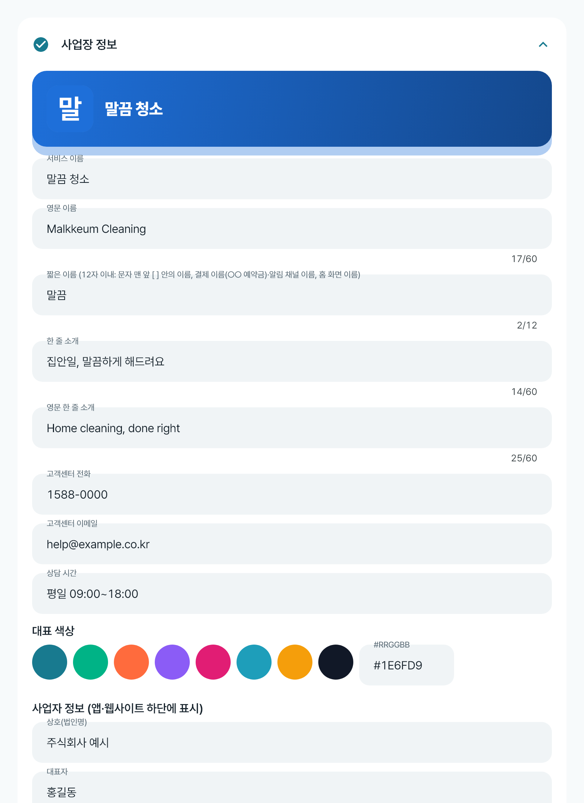

| 칸 이름 | 넣을 값 | 어디에 쓰이나요 |
|---|---|---|
| **서비스 이름** | 고객이 보는 이름 (꼭 넣어야 해요) | 앱 머리말, 웹사이트, 알림 문구의 `{업체명}`, 알림톡의 `#{brand}`, 콘솔 제목 (**(이름) 운영 콘솔**) |
| **영문 이름** | 영어 이름 (예: `Banjjak Clean`). 60자까지 | 앱과 알림을 영어로 볼 때. 비우면 **서비스 이름** 을 써요 |
| **짧은 이름 (12자 이내: 문자 앞머리, 홈 화면 이름)** | 12자 이내의 짧은 이름 | 문자 앞머리 `[짧은 이름]`, 결제 이름(예: `짧은이름 예약금`), 휴대폰 홈 화면의 앱 이름 (새 스토어 빌드부터), 앱 푸시 알림 채널 이름. 비우면 **서비스 이름** 앞 12자를 써요 |
| **한 줄 소개** | 서비스를 한 문장으로 (예: `검증된 청소 전문가를 1분 만에`). 60자까지 | 공유 이미지(카카오톡 등에 링크를 보낼 때 뜨는 그림), 웹 앱 설명 |
| **영문 한 줄 소개** | 영어 한 줄 소개. 60자까지 | 영어 화면 |

5. 카드 맨 아래 **[저장]** 을 눌러요 (28.6).

**이렇게 보이면 성공:** 미리보기 띠의 이름이 새 이름으로 바뀌어 있어요.

> **주의** **짧은 이름** 은 12자를 넘으면 저장되지 않고 **입력값을 확인해 주세요** 가 떠요. **영문 이름**, **한 줄 소개**, **영문 한 줄 소개** 는 60자까지예요.

> **주의** **서비스 이름** 과 사업자 정보의 **상호(법인명)** 은 달라요. 사업자등록증의 상호를 바꾸지 않았다면 **상호(법인명)** 은 등록증 그대로 두세요. 이용약관과 웹사이트 바닥글에는 상호가 들어가요.

> **팁** 문자 앞머리와 결제 이름은 짧을수록 좋아요. 결제사마다 주문 이름 길이 제한이 있어서 12자로 묶어 둔 거예요.

---

## 28.3 로고 바꾸기 (한 번만 올리면 돼요)

로고는 **한 장만** 올리면 돼요. 저장할 때 콘솔이 그 로고로 필요한 크기 7가지를 직접 만들어서 함께 올려요. 브라우저 탭 아이콘, 앱 아이콘, 휴대폰 홈 화면 아이콘, 공유 이미지(1200×630), 스토어용 아이콘(1024×1024) 같은 것들이에요.

### 로고 파일이 있을 때

1. **사업장 정보** 카드의 미리보기 띠 왼쪽, 네모난 그림 칸(그림과 + 표시)을 눌러요. 이 칸의 이름이 **로고 올리기** 예요.
2. 파일 고르기 창에서 로고 파일을 골라 **[열기]** 를 눌러요.
3. 그림 칸에 로고가 보여요. 아직 저장된 것은 아니에요.
4. 카드 맨 아래 **[저장]** 을 눌러요. 그다음은 28.6 을 따라 해요.

### 로고 파일이 없을 때 (글자 로고)

로고가 없으면 처음 설치된 다해 기본 로고가 보여요. 기본 로고는 다해 저작권자의 것이니, 다른 이름으로 영업한다면 꼭 바꾸세요.

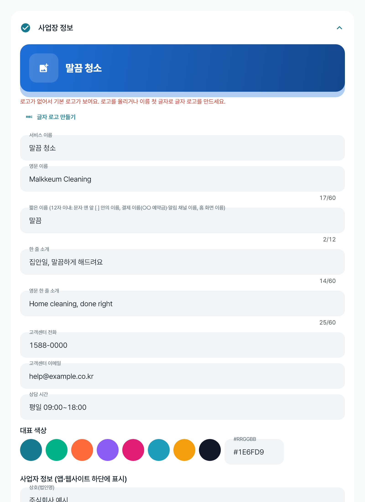

1. 먼저 **서비스 이름** 칸에 이름을 넣어요. 이름이 비어 있으면 다음 단추가 눌리지 않아요.
2. 미리보기 띠 아래에 빨간 글씨 **로고가 없어서 기본 로고가 보여요. 로고를 올리거나 이름 첫 글자로 글자 로고를 만드세요.** 가 보여요.
3. 그 아래 **[글자 로고 만들기]** 를 눌러요.
4. 그림 칸에 대표 색 바탕에 이름 첫 글자가 흰색으로 들어간 로고가 보여요.
5. 카드 맨 아래 **[저장]** 을 눌러요 (28.6).

> **팁** 대표 색을 먼저 고른 다음 **[글자 로고 만들기]** 를 누르세요. 글자 로고는 누르는 순간의 색으로 만들어져요. 색을 바꾸었다면 한 번 더 누르세요.

> **주의** 로고(또는 글자 로고)가 하나도 없으면 아이콘과 공유 이미지를 만들지 않아요. 스토어 앱 빌드도 서버에 로고가 없으면 멈춰요 (25장). 스토어에 내기 전에 꼭 로고를 저장하세요.

---

## 28.4 대표 색 바꾸기

1. 같은 카드의 **대표 색상** 아래 동그란 색 8개 중 하나를 눌러요. 또는 오른쪽 **#RRGGBB** 칸에 색 번호를 넣어요.
2. 미리보기 띠가 그 색으로 바뀌어요.
3. **[저장]** 을 눌러요 (28.6).

| 앱 | 대표 색이 쓰이는 곳 |
|---|---|
| 고객 앱 | 버튼과 머리말 같은 주된 색 |
| 파트너 앱 | 강조 색만. 파트너 앱의 바탕 색(짙은 남색)은 그대로예요. 기사님이 고객 앱과 헷갈리지 않게 하려는 거예요 |
| 관리 콘솔 | 콘솔의 주된 색 |
| 웹사이트 | 웹사이트와 약관 페이지의 강조 색 |

> **주의** 너무 밝은 색을 고르면 **이 색 위의 흰 글자가 잘 안 보여요. 저장해도 앱에는 적용되지 않아요. 조금 더 진한 색을 고르세요.** 가 빨갛게 떠요. 그 색은 저장은 되지만 앱은 쓰지 않고 기본 색을 써요. 더 진한 색을 고르세요.

> **팁** 처음 설치된 다해 기본 색은 `#187A8F` 예요.

---

## 28.5 사업자 정보 (법적으로 필요한 칸)

1. 같은 카드의 **사업자 정보 (앱·웹사이트 하단에 표시)** 묶음으로 내려가요.
2. **상호(법인명)**, **대표자**, **사업자등록번호**, **통신판매업 신고번호**, **사업장 주소**, **호스팅 서비스 제공자**, **개인정보 보호책임자** 를 서류 그대로 적어요 (칸 설명은 10장).
3. **개인정보 문의 이메일** 칸에 고객이 개인정보 문의를 보낼 이메일 주소를 넣어요. 서버는 이 값을 웹사이트에 보낼 준비가 되어 있지만, 개인정보처리방침 페이지의 어느 자리에 나오는지는 **확인 필요** 예요.
4. **[저장]** 을 눌러요 (28.6).

> **팁** 사업자등록번호 10자리를 저장하면 웹사이트 바닥글과 이용약관에 공정거래위원회 **사업자정보확인** 링크가 자동으로 생겨요. 저장한 뒤 링크를 눌러 내 회사 정보가 뜨는지 확인하세요.

---

## 28.6 저장하기: 미리 보기와 적용 안내

1. 카드 맨 아래 **[저장]** 을 눌러요.
2. 로고, 대표 색, 서비스 이름, 한 줄 소개 중 하나라도 바꿨다면 **[저장]** 단추 아래에 **이미지를 만들고 있어요** 가 잠깐 보여요.
3. **이렇게 보여요** 창이 열려요. 맨 위에 **저장하면 이 이미지들을 올리고 모든 화면에 바로 적용해요.** 가 있고, 그 아래에 만든 이미지가 이름표와 함께 보여요: **브라우저 탭**, **앱 아이콘**, **홈 화면 아이콘**, **공유 카드**.

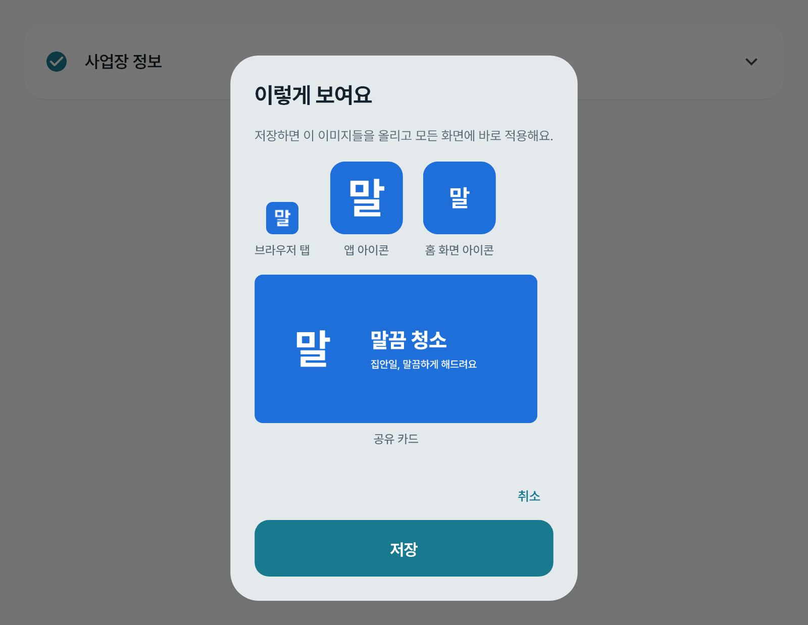

4. 그림을 하나씩 봐요. 로고가 잘리거나 너무 작으면 **[취소]** 를 누르고 다른 로고 파일로 28.3 부터 다시 해요. **[취소]** 를 누르면 아무것도 저장되지 않아요.
5. 괜찮으면 **[저장]** 을 눌러요.
6. **[저장]** 단추 아래에 **이미지 올리는 중 (0/7)** 처럼 올리는 진행 숫자가 보이고, 이미지를 하나 올릴 때마다 앞 숫자가 올라가요. 이 글이 사라질 때까지 기다려요. 이 화면을 떠나지 마세요.
7. 화면 아래에 **저장했어요** 가 뜨고, **저장했어요. 이렇게 적용돼요** 창이 열려요. 28.1 의 표와 같은 내용이에요.

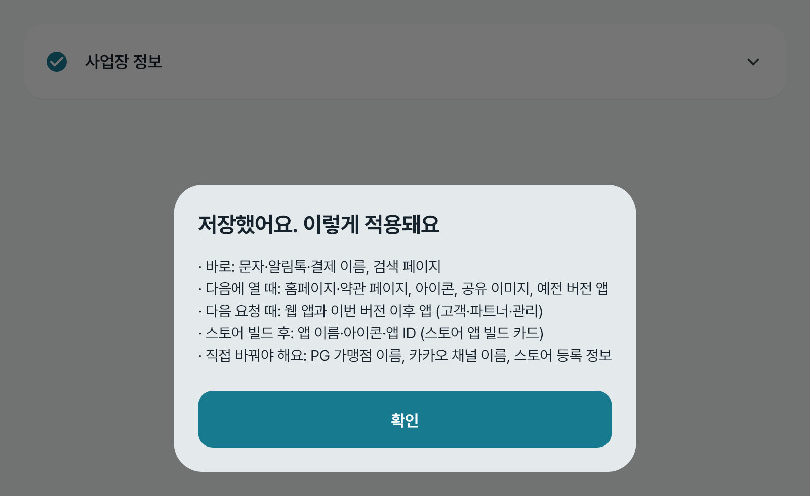

8. 다 읽었으면 **[확인]** 을 눌러요.

**이렇게 보이면 성공:** 콘솔 왼쪽 맨 위 제목이 **(새 이름) 운영 콘솔** 로 바뀌고, 콘솔 색이 새 대표 색으로 바뀌어요. 바로 아래 **스토어 앱 빌드** 카드에 바뀐 항목이 나와요 (28.7).

> **참고** 전화번호나 사업자 정보만 바꿨다면 2~6번 없이 바로 7번으로 가요. 이미지는 로고, 색, 이름, 한 줄 소개가 바뀔 때만 다시 만들어요.

> **참고** 앱 화면 안의 브랜드 문구도 서비스 이름을 따라가요. 예: 홈의 **(이름) 소식**, **(이름) PICK**, **(이름) 안심예약**, 더보기의 **(이름) 팁** 과 인사말 **오늘도 집안일은 (이름)에 맡기세요.**, 파트너 앱 제목 **(이름) 파트너**.

### 웹사이트와 약관 페이지

웹사이트와 개인정보처리방침·이용약관 페이지는 페이지를 열 때마다 서버가 지금 값을 채워 넣어요. 그래서 따로 다시 만들 필요가 없어요.

- 서비스 이름, 사업자 정보, 대표 색, 아이콘, 공유 이미지가 들어가요.
- 이용약관의 취소·환불 표는 콘솔의 취소 규정(18장)을 따라가요.
- 개인정보처리방침의 처리 위탁 표는 **[설정]** 에서 저장한 카드에 맞춰 **이용 중** 또는 **현재 이용하지 않음** 으로 바뀌어요.
- 콘솔 **[쿠폰 · 콘텐츠]** → **콘텐츠** 에서 **약관** 글(식별자 `terms`, `privacy`)을 게시하면 웹사이트에도 그 글이 나와요 (22장).

> **주의** 약관 문구가 바뀌는 것이니, 이름만 바꿔도 시행일 **최소 7일 전**에 앱 **공지사항**(22장)과 웹사이트에 알리세요 (28.9).

---

## 28.7 스토어 앱 빌드 카드

휴대폰에 설치된 스토어 앱은 몇 가지를 앱 파일 안에 넣어서 만들어요. 이런 것은 개발자가 새로 빌드해서 스토어에 올려야 바뀌어요. **스토어 앱 빌드** 카드가 무엇이 바뀌어 새 빌드가 필요한지 알려 줘요.

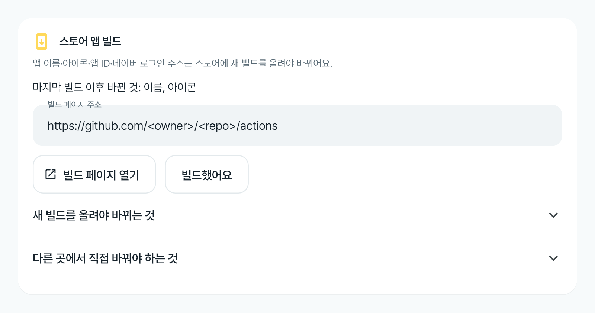

1. **[설정]** 에서 **사업장 정보** 바로 아래 **스토어 앱 빌드** 카드를 봐요.
2. 카드 설명: **앱 이름·아이콘·앱 ID·네이버 로그인 주소는 스토어에 새 빌드를 올려야 바뀌어요.**
3. 그 아래 한 줄을 읽어요.

| 화면 글자 | 뜻 | 할 일 |
|---|---|---|
| **마지막 빌드 이후 바뀐 것이 없어요** (초록 체크) | 새 빌드가 필요 없어요 | 없음 |
| **마지막 빌드 이후 바뀐 것: 이름, 아이콘, …** (노란 아이콘) | 적힌 항목이 지금 스토어 앱과 달라요 | 개발자에게 새 스토어 빌드를 부탁해요 (25장) |

바뀐 것으로 나올 수 있는 항목은 다섯 가지예요.

| 항목 | 언제 나오나요 |
|---|---|
| **이름** | **서비스 이름** 이나 **짧은 이름** 을 바꿨을 때 |
| **아이콘** | 로고를 바꿨거나, 색·이름·한 줄 소개를 바꿔서 스토어용 아이콘을 다시 만들었을 때 |
| **색** | **대표 색상** 을 바꿨을 때 |
| **앱 ID** | **앱 링크** 카드의 앱 ID 칸을 바꿨을 때 (15장, 25장) |
| **도메인** | 도메인을 바꿨거나(28.8), 예전 도메인을 닫았을 때 |

4. 개발자가 새 빌드를 마치면, 개발자가 알려 준 빌드 페이지 주소(`https://` 로 시작)를 **빌드 페이지 주소** 칸에 붙여넣어요. 비워 둬도 돼요.
5. **[빌드했어요]** 를 눌러요. 이 단추는 **소유자** 계정으로 눌러야 기록돼요.

**이렇게 보이면 성공:** **빌드했다고 기록했어요** 가 뜨고, 카드가 **마지막 빌드 이후 바뀐 것이 없어요** 와 **마지막 빌드 기록: (날짜 시각)** 으로 바뀌어요.

- **[빌드 페이지 열기]** 는 **빌드 페이지 주소** 칸에 `https://` 주소가 있을 때만 눌려요. 누르면 그 페이지가 새 창으로 열려요.
- 카드 아래 **새 빌드를 올려야 바뀌는 것** 을 누르면 전체 목록이 펼쳐져요: 앱 ID, 홈 화면 이름·앱 아이콘·시작 화면, 스토어 등록 문구·스크린샷·개인정보 주소, 서명 키와 애플 팀, Firebase 설정 파일, 카카오·네이버·구글 앱 키, 앱 링크 주소(네이버 로그인), 처음 접속하는 서버 주소, 처음 열 때 잠깐 보이는 기본 브랜드, 앱에 들어 있는 언어.
- **다른 곳에서 직접 바꿔야 하는 것** 을 누르면: 카드 명세서의 가맹점 이름(포트원·토스), 카카오 채널 이름과 알림톡 문구, 문자 발신번호 등록, 소셜 로그인 동의 화면의 앱 이름, 스토어 등록 이름 (28.9).

> **팁** 이 카드는 처음 열린 순간의 값을 "마지막 빌드"로 삼아요. 그래서 이미 운영 중인 서버에서는 처음에 **마지막 빌드 이후 바뀐 것이 없어요** 로 나와요.

> **참고** **[빌드했어요]** 는 기록만 해요. 앱을 만들거나 스토어에 올리지는 않아요. 실제로 새 앱이 스토어에 나온 뒤에 누르세요.

---

## 28.8 도메인(웹사이트 주소) 바꾸기

도메인은 고객이 웹사이트에 들어오는 주소예요 (예: `example.co.kr`). 처음 설치할 때 정한 도메인을 콘솔에서 새 도메인으로 옮길 수 있어요.

먼저 알아 둘 것:

- 옮기는 동안 서비스가 **30초쯤** 멈춰요. 손님이 적은 시간에 하세요.
- 새 주소가 응답하지 않으면 서버가 **스스로 예전 설정으로 되돌려요**. 망가진 채로 남지 않아요.
- **예전 도메인도 계속 응답해요.** 휴대폰에 설치된 앱, 결제 완료 확인, 로그인 돌아오기는 예전 주소로도 계속 돼요. 웹사이트 페이지만 새 주소로 넘어가요.
- 끝나면 바깥 서비스(결제, 로그인, 검색, 스토어)에 새 주소를 넣어야 해요. 콘솔이 넣을 값을 복사 단추와 함께 보여 줘요 (28.8.5).
- 예전 도메인은 새 스토어 앱이 나오고 최소 앱 버전을 올린 **뒤에만** 닫아요 (28.8.6).

### 28.8.1 먼저 한 번만: 서버 승인 코드 등록하기

도메인 바꾸기 같은 큰 작업은 사장님 인증 코드에 더해 **서버 승인 코드** 가 하나 더 필요해요. 서버가 직접 확인하는 두 번째 6자리 코드예요. 인증 앱에 한 번만 등록하면 돼요. 이미 등록했다면 28.8.2 로 가요.

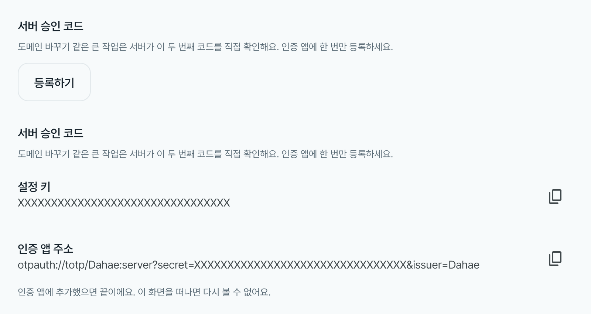

1. **소유자** 계정으로 콘솔에 로그인해요.
2. 왼쪽 메뉴에서 **[시스템 상태]** 를 눌러요.
3. **서버 업데이트** 카드를 찾아요 (26장 26.9).
4. 카드 안 **서버 설정** 아래로 내려가 **서버 승인 코드** 를 찾아요. 설명: **도메인 바꾸기 같은 큰 작업은 서버가 이 두 번째 코드를 직접 확인해요. 인증 앱에 한 번만 등록하세요.**
5. **[등록하기]** 를 눌러요.
6. **인증 번호 입력** 창이 열려요. 휴대폰 인증 앱에 지금 보이는 사장님 6자리를 **인증 번호 6자리** 칸에 넣고 **[계속]** 을 눌러요.
7. 단추가 **서버가 코드를 만들고 있어요** 로 바뀌어요. 1분쯤 기다려요.
8. **설정 키** 와 **인증 앱 주소** 두 줄이 나와요. 각 줄 오른쪽에 복사 단추가 있어요.
9. 휴대폰 인증 앱을 열고 계정 추가 버튼(보통 **+**)을 눌러요.
10. **설정 키 입력** (앱에 따라 "키 입력", "Enter a setup key")을 골라요.
11. 계정 이름에 알아보기 쉬운 이름을 넣어요 (예: `서버 승인`).
12. 키 칸에 콘솔의 **설정 키** 를 띄어쓰기 없이 정확히 넣어요. 키 종류가 있으면 **시간 기준** 을 골라요.
13. 인증 앱에서 **추가** 를 눌러요.

**이렇게 보이면 성공:** 인증 앱에 6자리 숫자가 하나 **더** 생겨요. 콘솔에는 **인증 앱에 추가했으면 끝이에요. 이 화면을 떠나면 다시 볼 수 없어요.** 가 보여요.

> **주의** 이제 인증 앱에 6자리가 **두 개** 있어요. 하나는 로그인과 사장님 인증에 쓰는 원래 코드, 하나는 서버 승인 코드예요. 헷갈리지 않게 이름을 붙여 두세요. 1Password 같은 앱에 **인증 앱 주소** 를 붙여 넣으면 이름이 `(내 도메인):server` 로 들어가요.

> **주의** **설정 키** 는 인증 앱에 넣은 뒤 종이나 메모에 남기지 마세요. 이 화면을 떠나면 다시 볼 수 없어요. 서버 승인 코드는 서버마다 한 번만 만들 수 있어요. 휴대폰을 잃어버려 다시 만들어야 하면 개발자에게 서버 승인 코드 초기화(`sudo dahae owner-reset`)를 부탁하세요 (33장).

> **팁** **등록하지 못했어요: (이유)** 가 나오면 이유를 캡처해 개발자에게 보내세요. 이미 서버 승인 코드가 만들어져 있으면 다시 만들 수 없어요. 그때는 예전에 등록한 코드를 그대로 쓰면 돼요.

### 28.8.2 새 도메인의 DNS 넣기

1. 새 도메인을 산 곳(가비아, Cloudflare, Route 53 등)의 DNS 관리 화면을 열어요. 방법은 5장과 같아요.
2. 새 도메인에 **A 레코드** 를 만들고, 값에 **이 서버의 IP** 를 넣어요. IP 는 28.8.3 의 확인 결과에도 나와요.
3. `www.새도메인` 도 같은 IP 로 A 레코드를 넣어요.
4. **예전 도메인의 A 레코드는 지우지 마세요.** 예전 도메인을 닫을 때(28.8.6)까지 그대로 둬요.
5. 새 도메인에 **AAAA 레코드**(IPv6)가 있으면 지우거나 이 서버 주소로 바꿔요.
6. 몇 분에서 몇 시간 기다려요 (5장 5.4).

### 28.8.3 DNS 확인하기

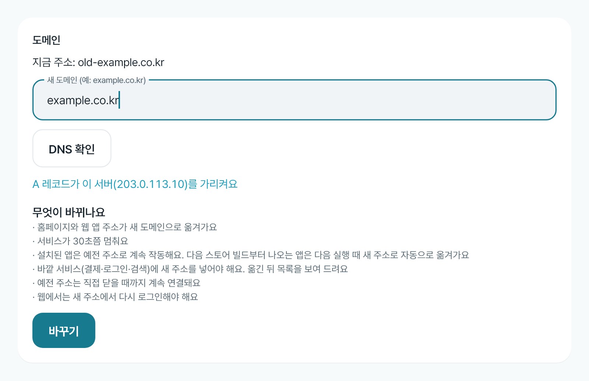

1. **[설정]** 에서 **도메인** 카드를 찾아요 (**앱 링크** 카드 바로 아래).
2. 카드 맨 위에 **지금 주소: (지금 도메인)** 이 보여요.
3. **[도메인 바꾸기]** 를 눌러요.
4. **새 도메인 (예: example.co.kr)** 칸에 새 도메인을 넣어요. `https://` 나 `/` 없이 `myshop.co.kr` 처럼 이름만 넣어요.
5. **[DNS 확인]** 을 눌러요. 단추가 **DNS를 확인하고 있어요** 로 바뀌고, 서버가 직접 DNS 를 확인해요.
6. 결과 줄을 읽어요.

| 화면 글자 | 뜻 | 할 일 |
|---|---|---|
| **A 레코드가 이 서버(IP)를 가리켜요** (초록) | 준비됐어요 | 7번으로 가요 |
| **A 레코드를 이 서버 IP (IP)로 바꿔 주세요. 지금 값: (값)** (빨강) | 새 도메인이 아직 이 서버를 가리키지 않아요. **없음** 이면 레코드가 아직 안 보여요 | 28.8.2 를 확인하고 기다렸다가 다시 **[DNS 확인]** |
| **AAAA 레코드가 다른 곳을 가리켜요. 지우거나 이 서버 주소로 바꿔 주세요.** (빨강) | IPv6 레코드가 방해해요 | AAAA 레코드를 지우거나 고친 뒤 다시 확인 |
| **도메인 형식이 아니거나 지금 주소와 같아요** (칸 아래 빨강) | 글자를 잘못 넣었거나 지금 도메인과 같아요 | 다시 입력 |

7. 초록이고 빨간 줄이 없으면 아래에 **무엇이 바뀌나요** 목록과 **[바꾸기]** 단추가 나와요. 목록을 끝까지 읽어요.
   - 홈페이지와 웹 앱 주소가 새 도메인으로 옮겨가요
   - 서비스가 30초쯤 멈춰요
   - 설치된 앱은 예전 주소로 계속 작동해요. 1.x 이후 버전은 다음 실행 때 새 주소로 자동으로 옮겨가요
   - 바깥 서비스(결제·로그인·검색)에 새 주소를 넣어야 해요. 옮긴 뒤 목록을 보여 드려요
   - 예전 주소는 직접 닫을 때까지 계속 연결돼요
   - 웹에서는 새 주소에서 다시 로그인해야 해요

> **참고** 화면의 "1.x 이후 버전" 이 정확히 몇 버전부터인지는 **확인 필요** 예요. 그 전 버전의 앱도 예전 주소로 계속 작동하니 걱정하지 않아도 돼요.

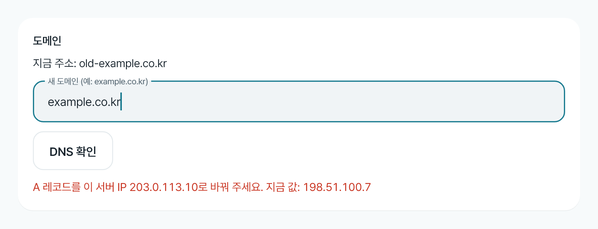

### 28.8.4 바꾸기 (사장님 코드 + 서버 승인 코드)

1. 손님이 적은 시간인지 확인해요.
2. **[바꾸기]** 를 눌러요.
3. **인증 번호 입력** 창이 열려요. 인증 앱의 **사장님** 6자리를 넣고 **[계속]** 을 눌러요.
4. 카드에 **바꾸는 중이에요. 서비스가 30초쯤 멈춰요.** 가 보여요.
5. 곧 **서버 승인 코드** 창이 열려요: **인증 앱의 서버 승인 코드 6자리를 넣으세요. 사장님 코드와 달라요.**
6. 인증 앱에서 28.8.1 에 등록한 **서버 승인** 6자리를 **인증 번호 6자리** 칸에 넣고 **[계속]** 을 눌러요.
7. 서버가 주소를 바꾸고, 새 주소가 응답하는지 기다려요. 길면 5분까지 걸려요. 이 화면을 그대로 두세요.

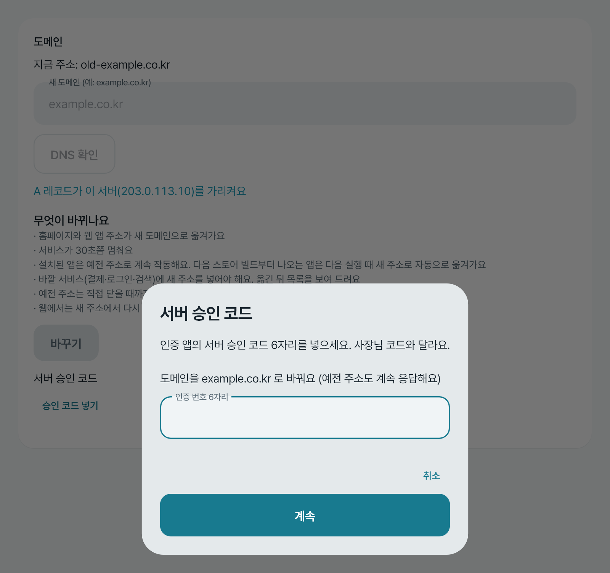

**이렇게 보이면 성공:** 카드에 **(새 도메인)(으)로 바꿨어요** 와 **[새 주소로 열기]** 가 보여요. **지금 주소** 가 새 도메인으로 바뀌고, **예전 주소 (계속 연결돼요)** 아래에 예전 도메인이 보여요.

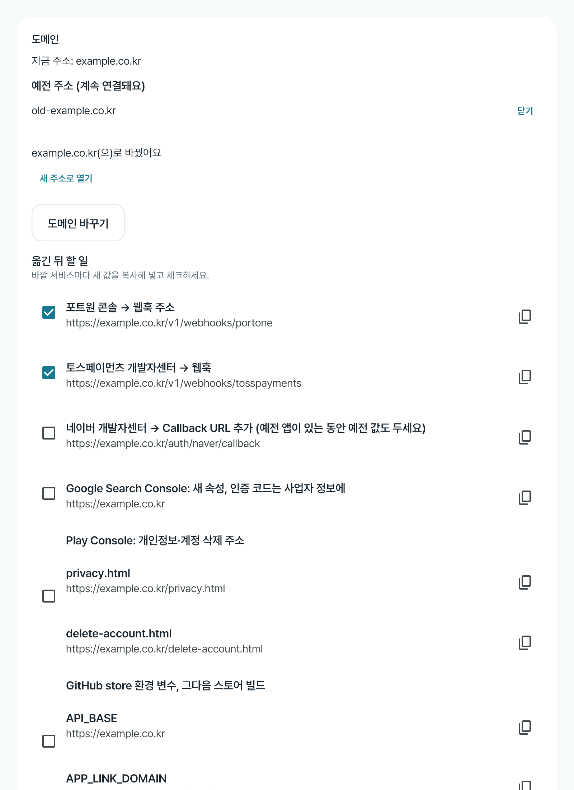

8. **[새 주소로 열기]** 를 눌러요. 새 주소의 콘솔(`https://새도메인/admin/`)이 열려요.
9. 새 주소에서 다시 로그인해요. 앞으로는 이 주소를 즐겨찾기 하세요.

> **주의** 서버 승인 코드는 **10분 안에** 넣어야 해요. 틀린 코드를 넣으면 창이 다시 열려요. 5번 틀리면 그 작업은 취소돼요. 한 시간 안에 10번 틀리면 승인이 1시간 동안 잠겨요.

> **팁** 서버 승인 코드 창에서 **[취소]** 를 눌렀다면 카드에 **서버 승인 코드** 와 **[승인 코드 넣기]** 가 남아 있어요. 10분 안에 **[승인 코드 넣기]** 를 눌러 다시 넣으면 돼요. 그사이 콘솔 창을 닫았다면 10분 기다린 뒤 28.8.3 부터 다시 해요.

> **팁** 이 작업을 시작하면 소유자 휴대폰으로 **서버 작업이 요청됐어요: 도메인 바꾸기. 본인이 요청하지 않았다면 바로 확인하세요.** 문자가 가요 (Solapi 가 연결돼 있을 때). 진행 상황은 **[시스템 상태]** → **서버 업데이트** 카드의 **최근 서버 작업** 에도 `도메인 바꾸기 · 진행 중` 처럼 보여요.

### 28.8.5 안 됐을 때 (자동으로 되돌려요)

| 화면 글자 (빨강) | 뜻 | 할 일 |
|---|---|---|
| **되돌렸어요: (이유)** | 새 주소가 5분 안에 응답하지 않아서 서버가 예전 설정으로 되돌렸어요. 서비스는 예전 주소로 그대로 돌아요 | 새 도메인의 A 레코드와, 서버 방화벽에서 80·443 이 열려 있는지 확인한 뒤 다시 해요 |
| **서버가 거절했어요: 서버 승인 코드가 없어요. 설정에서 먼저 만들어 주세요** | 서버 승인 코드를 아직 등록하지 않았어요 | 28.8.1 을 먼저 해요 |
| **서버가 거절했어요: 틀린 승인 코드가 많아서 승인이 잠겨 있어요 (1시간 뒤에 풀려요)** | 승인 코드를 너무 많이 틀렸어요 | 1시간 뒤 다시 해요 |
| **서버가 거절했어요: 다른 작업이 서버 승인을 기다리고 있어요** | 앞서 시작한 작업이 아직 승인을 기다려요 | 10분 기다린 뒤 다시 해요 |
| **서버 프로그램이 예전 버전이에요. 설치 명령을 한 번 다시 실행한 뒤 바꿔 주세요.** | 이 기능 전에 설치한 서버예요 | 개발자에게 설치 줄을 한 번 다시 실행해 달라고 해요 (데이터는 그대로예요) |
| **바꾸지 못했어요: (이유)** | 그 밖의 실패예요. 승인 코드를 5번 틀려 취소된 경우도 여기에 나와요 | 화면을 캡처해 개발자에게 보내요 |

> **참고** **(이유)** 자리의 글은 서버가 보내는 한국어 문장이에요. 영어 화면에서도 한국어로 나와요.

### 28.8.6 옮긴 뒤 할 일 (체크리스트)

**도메인** 카드 맨 아래 **옮긴 뒤 할 일** 목록이 있어요: **바깥 서비스마다 새 값을 복사해 넣고 체크하세요.** 줄마다 넣을 값과 복사 단추가 있어요. 넣고 나면 왼쪽 네모를 눌러 체크해요. 체크는 서버에 저장돼서 다른 관리자에게도 보여요. 도메인을 다시 바꾸면 체크가 모두 지워지고 새 값으로 바뀌어요.

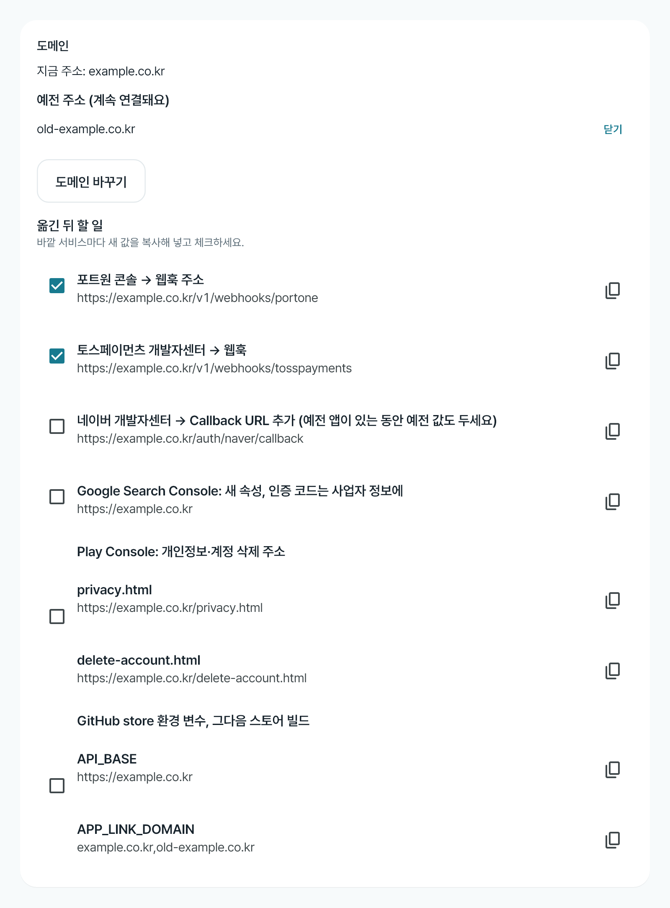

| 화면 줄 | 넣을 값 (예: 새 도메인이 `new.co.kr`) | 왜 하나요 |
|---|---|---|
| **포트원 콘솔 → 웹훅 주소** | `https://new.co.kr/v1/webhooks/portone` | PortOne 결제 결과를 새 주소로 받아요 (11장 11.5). PortOne을 안 쓰면 건너뛰어요 |
| **토스페이먼츠 개발자센터 → 웹훅** | `https://new.co.kr/v1/webhooks/tosspayments` | 토스페이먼츠 결제 결과와 가상계좌 입금 알림 (12장 12.5). 토스페이먼츠를 안 쓰면 건너뛰어요 |
| **토스 지급대행 웹훅** | `https://new.co.kr/v1/webhooks/toss` | 토스 지급대행을 쓸 때만 (13장) |
| **PG 계약의 사이트 주소 (다시 심사할 수 있어요)** | `https://new.co.kr` | 결제사 계약서의 사이트 주소. 결제사가 다시 심사할 수 있어요. 실제로 다시 심사하는지는 결제사마다 달라서 **확인 필요** 예요. 결제사 영업 담당에게 먼저 물어보세요 |
| **네이버 개발자센터 → Callback URL 추가 (예전 앱이 있는 동안 예전 값도 두세요)** | `https://new.co.kr/auth/naver/callback` | 네이버 로그인 뒤 돌아올 주소. 예전 주소는 **지우지 말고** 새 주소를 **추가** 해요. 네이버가 여러 주소를 받는지는 **확인 필요** 예요 (15장) |
| **네이버 개발자센터 → 서비스 URL** | `https://new.co.kr` | 네이버 로그인 앱 정보의 서비스 주소 |
| **카카오 개발자센터 → 플랫폼 → Web (등록했다면)** | `https://new.co.kr` | 카카오에 웹 사이트 도메인을 등록해 두었을 때만 (15장) |
| **Google Cloud 동의 화면: 홈페이지·개인정보 주소 (설정했다면)** | `https://new.co.kr/privacy.html` | 구글 로그인 동의 화면에 주소를 적어 두었을 때만 (15장) |
| **Google Search Console: 새 속성, 인증 코드는 사업자 정보에** | `https://new.co.kr` | 구글 검색에 새 주소를 새 속성으로 등록하고, 받은 인증 코드는 **사업장 정보** 의 **Google Search Console 인증 코드** 칸에 넣어요 (10장 10.6) |
| **네이버 서치어드바이저: 새 사이트, 인증 코드는 사업자 정보에** | `https://new.co.kr` | 네이버 검색에 새 사이트 등록, 인증 코드는 **네이버 서치어드바이저 인증 코드** 칸에 (10장 10.6) |
| **App Store Connect: 개인정보·지원 주소** | `https://new.co.kr/privacy.html` 과 `https://new.co.kr/delete-account.html` | 애플 스토어 등록 정보의 주소 (25장) |
| **Play Console: 개인정보·계정 삭제 주소** | 위와 같은 두 주소 | 구글 플레이 등록 정보의 주소 (25장) |
| **Microsoft Partner Center: 개인정보·지원 주소** | 위와 같은 두 주소 | 윈도우 스토어에 올렸을 때만 |
| **GitHub store 환경 변수, 그다음 스토어 빌드** | `API_BASE=https://new.co.kr` 과 `APP_LINK_DOMAIN=new.co.kr,(예전 도메인)` | **[개발자]** 개발자가 바꾸고 새 스토어 빌드를 만들어요 (25장, 33장) |
| **웹 링크 버튼이 있는 알림톡 템플릿 (다시 승인 받아야 해요)** | `https://new.co.kr` | 알림톡 템플릿에 웹 링크 단추가 있으면 새 주소로 고쳐 카카오 승인을 다시 받아요 (14장) |
| **예전 A/AAAA 레코드는 닫을 때까지 두고, www.새도메인 추가** | 예전 도메인과 `www.new.co.kr` | DNS 관리 화면에서: 예전 도메인 레코드는 그대로 두고, `www.새도메인` 레코드가 있는지 확인 (28.8.2) |
| **새 스토어 앱이 나온 뒤: 사업자 정보에서 최소 앱 버전 올리기** | (값 없음) | 새 주소로 만든 앱이 두 스토어에 모두 나온 뒤 **사업장 정보** → **앱 버전 관리** 의 **최소 버전** 을 그 버전으로 올려요 (10장 10.7) |

> **주의** 결제 웹훅 세 줄(포트원, 토스페이먼츠, 토스 지급대행)은 **가장 먼저** 하세요. 예전 주소로도 웹훅은 계속 들어오지만, 예전 도메인을 닫는 순간 끊겨요.

### 28.8.7 예전 도메인 닫기 (마지막에, 꼭 순서대로)

> **주의** 예전 도메인을 닫으면 그 주소를 쓰는 앱은 **더 이상 서버에 연결되지 않아요.** 휴대폰에 깔린 예전 앱은 처음 설치할 때의 주소를 쓰고 있어요. 그래서 아래가 **모두** 끝난 뒤에만 닫으세요.
> 1. 새 주소로 만든 고객 앱과 파트너 앱이 두 스토어에 모두 나왔어요.
> 2. **최소 버전** 을 그 새 버전으로 올렸어요 (10장 10.7). 그래야 예전 앱을 쓰는 사람이 업데이트 화면으로 안내돼요.
> 3. 웹훅과 로그인 주소를 모두 새 주소로 바꿨어요 (28.8.6).
>
> 닫은 주소를 다시 여는 단추는 없어요.

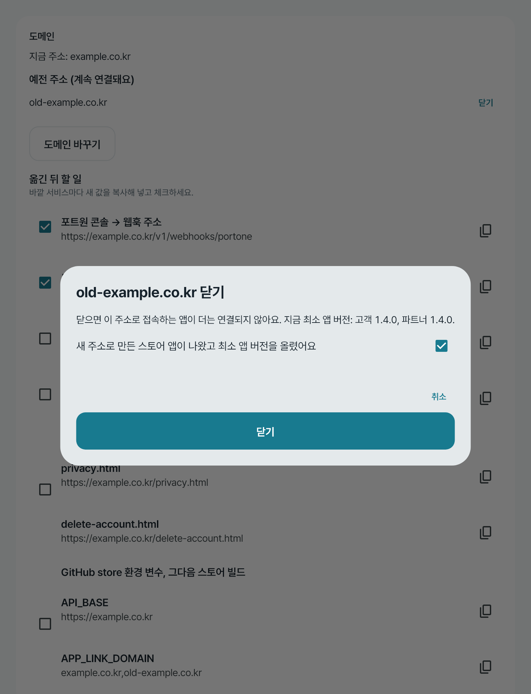

1. **도메인** 카드의 **예전 주소 (계속 연결돼요)** 아래, 닫을 주소 오른쪽 **[닫기]** 를 눌러요.
2. **(예전 도메인) 닫기** 창이 열려요. **닫으면 이 주소로 접속하는 앱이 더는 연결되지 않아요. 지금 최소 앱 버전: 고객 (버전), 파트너 (버전).** 을 읽어요. 버전이 `-` 이면 최소 버전을 아직 안 넣은 거예요. 그때는 **[취소]** 를 누르고 위 2번부터 해요.
3. **새 주소로 만든 스토어 앱이 나왔고 최소 앱 버전을 올렸어요** 를 체크해요. 체크해야 **[닫기]** 가 눌려요.
4. **[닫기]** 를 눌러요.
5. **인증 번호 입력** 창에 사장님 6자리를 넣고 **[계속]** 을 눌러요.

**이렇게 보이면 성공:** **예전 주소를 닫았어요** 가 뜨고, 그 주소가 **예전 주소** 목록에서 사라져요.

6. 이제 DNS 관리 화면에서 예전 도메인의 A/AAAA 레코드를 지워도 돼요.

### 28.8.8 PC 에 설치한 콘솔 앱을 쓴다면

PC 에 설치한 콘솔 앱처럼 서버 주소를 직접 입력해 쓰는 콘솔에는 도메인을 바꾼 뒤 화면 위에 **서버 주소가 (새 주소)(으)로 바뀌었어요. 이 앱의 서버 주소도 바꿔 주세요.** 가 떠요.

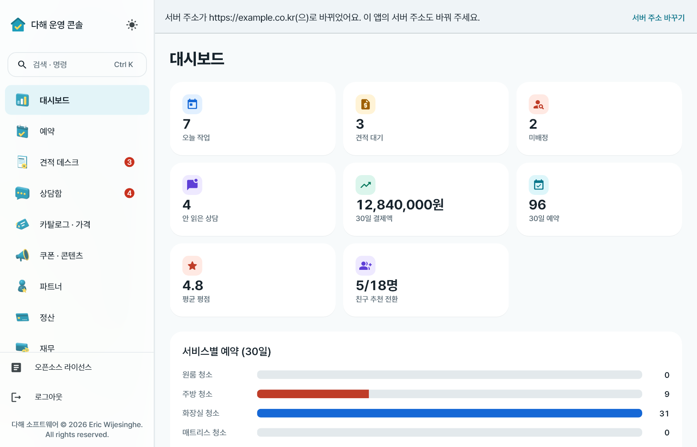

1. **[서버 주소 바꾸기]** 를 눌러요.
2. 새 주소를 넣고 다시 로그인해요.

> **참고** 이 안내는 권하는 것일 뿐이에요. 예전 도메인을 닫기 전까지는 예전 주소로도 계속 쓸 수 있어요.

---

## 28.9 다른 회사 사이트에서 직접 바꿔야 하는 것

콘솔이 바꿀 수 없는 이름이에요. 각 회사 관리 화면에서 직접 바꿔요.

| 어디 | 할 일 |
|---|---|
| 결제사(PortOne, 토스, 카카오페이, 네이버페이 등) | 관리자 화면의 가맹점 이름과 카드 명세서 표시 이름을 바꿔요. 안 바꾸면 고객 카드 명세서에 예전 가맹점 이름이 찍혀요. |
| 카카오톡 채널 | 채널 프로필 이름을 바꿔요. 카카오 심사가 끝날 때까지 알림톡은 예전 채널 이름으로 나가요. |
| 알림톡 템플릿 | 본문의 `#{brand}` 는 자동으로 바뀌어요. 템플릿에 옛 이름이나 주소를 직접 적어 둔 것은 새로 등록해 승인받아요 (14장). |
| 문자 발신번호 | 발신번호 등록 내용(회사 이름 등)이 바뀌었다면 Solapi 에서 고쳐요 (14장). |
| 카카오·네이버·Apple·Google 개발자 사이트 | 간편 로그인 동의 화면의 앱 이름을 바꿔요 (15장). |
| App Store Connect, Play Console | 스토어 앱 이름, 설명 문구, 스크린샷을 바꿔요 (25장). |

### 스토어에 내기 전 법적 확인 (꼭 하세요)

1. **상표 검색**: KIPRIS(`https://www.kipris.or.kr`)에서 쓸 이름을 37류(청소업), 35류(중개·광고), 9류(앱)로 검색해요. 겹치는 상표가 있으면 변리사와 상의한 뒤 이름을 정해요.
2. **상호와 서비스 이름 구분**: 새 이름이 사업자등록증의 상호인지, 서비스 이름일 뿐인지 정해요.
3. **약관 변경 공지**: 이름만 바뀌어도 약관 문구가 바뀐 것이에요. 시행일 **최소 7일 전**에 앱 **공지사항**(22장 콘텐츠 **공지**)과 웹사이트에 알려요.
4. **약관 문구 검토**: 특히 취소·환불 조항은 법률 검토를 권해요.

> **참고** 이 확인 목록의 원본은 `docs/REBRAND-CHECKLIST.md` 예요.

---

## 28.10 바뀌지 않는 것

| 무엇 | 왜 |
|---|---|
| 모든 페이지의 소프트웨어 표시 **다해 소프트웨어 © 2026 Eric Wijesinghe** | 라이선스 조건이라 남아요 (0장) |
| 콘솔을 앱처럼 설치했을 때의 설치 ID | 바꾸면 이미 설치한 콘솔이 둘로 갈라져요. 화면에 보이는 이름은 **(이름) 관리자**, 짧은 이름은 **(짧은 이름) 관리** 로 따라 바뀌어요 |
| 이미 인증 앱에 등록한 직원 2단계 인증의 이름 | 인증 앱은 등록할 때 받은 이름을 그대로 둬요. 새로 등록하는 직원부터 **(이름) staff** 로 보여요 |
| 서비스 지역(서울), 예약 시작 시각, 휴일, 통화(원), 언어(한국어·영어), 시간대(한국 시간) | 프로그램을 고쳐야 해요. 개발자에게 문의해요 |

---

## 자주 생기는 문제

| 이렇게 나와요 | 이렇게 해요 |
|---|---|
| 색을 바꿨는데 앱 색이 그대로예요 | 빨간 대비 경고가 떴다면 그 색은 앱에 쓰이지 않아요. 더 진한 색을 골라 다시 저장해요. 경고가 없었다면 앱을 완전히 닫았다 다시 열어요. 파트너 앱은 강조 색만 바뀌어요. |
| **로고로 이미지를 만들지 못했어요. 다른 PNG나 JPG 파일로 해 보세요.** | 로고 파일을 읽지 못했어요. PNG 나 JPG 로 바꿔 28.3 부터 다시 해요. |
| **[저장]** 을 눌렀는데 **이렇게 보여요** 창이 안 떠요 | 로고·색·이름·한 줄 소개를 바꾸지 않았거나, 로고가 하나도 없어요. 로고가 없으면 28.3 의 **[글자 로고 만들기]** 를 해요. |
| **[글자 로고 만들기]** 가 회색이에요 | **서비스 이름** 칸이 비어 있어요. 이름을 먼저 넣어요. |
| **입력값을 확인해 주세요** | **서비스 이름** 이 비었거나, **짧은 이름** 이 12자를 넘었거나, 다른 칸이 너무 길어요. 색 번호는 `#` 과 숫자·영문 6자리예요. |
| 휴대폰 홈 화면의 앱 이름과 아이콘이 그대로예요 | 정상이에요. 새 스토어 빌드에서만 바뀌어요. **스토어 앱 빌드** 카드를 보고 개발자에게 부탁해요 (28.7). |
| **[빌드했어요]** 를 눌렀더니 오류가 나요 | 소유자 계정이 아니거나, **빌드 페이지 주소** 가 `https://` 로 시작하지 않아요. |
| 고객 카드 명세서에 예전 이름이 나와요 | 결제사 관리자 화면에서 가맹점 표시 이름을 바꿔요 (28.9). |
| 알림톡에 예전 이름이 나와요 | 카카오 채널 이름 심사가 끝났는지, 템플릿에 옛 이름이 직접 적혀 있지 않은지 봐요. |
| **[DNS 확인]** 이 계속 빨강이에요 | DNS 가 아직 퍼지지 않았을 수 있어요. 30분쯤 뒤 다시 눌러요. 값이 **없음** 이면 A 레코드를 넣은 도메인 철자를 확인해요. |
| 서버 승인 코드 창에서 계속 다시 물어요 | 사장님 코드가 아니라 **서버 승인** 6자리를 넣어야 해요. 인증 앱에서 28.8.1 에 등록한 항목을 보세요. |
| 도메인을 바꾼 뒤 결제는 됐는데 예약이 "결제 대기"로 남아요 | 결제사 웹훅이 아직 예전 주소이거나 잘못됐어요. 28.8.6 의 웹훅 줄을 먼저 처리해요. |
| 도메인을 바꾼 뒤 네이버 로그인이 앱으로 돌아오지 않아요 | 네이버 개발자센터에 새 Callback URL 을 **추가** 했는지 봐요. 새 주소로 만든 앱은 새 스토어 빌드가 나온 뒤부터 새 주소로 돌아와요. |
