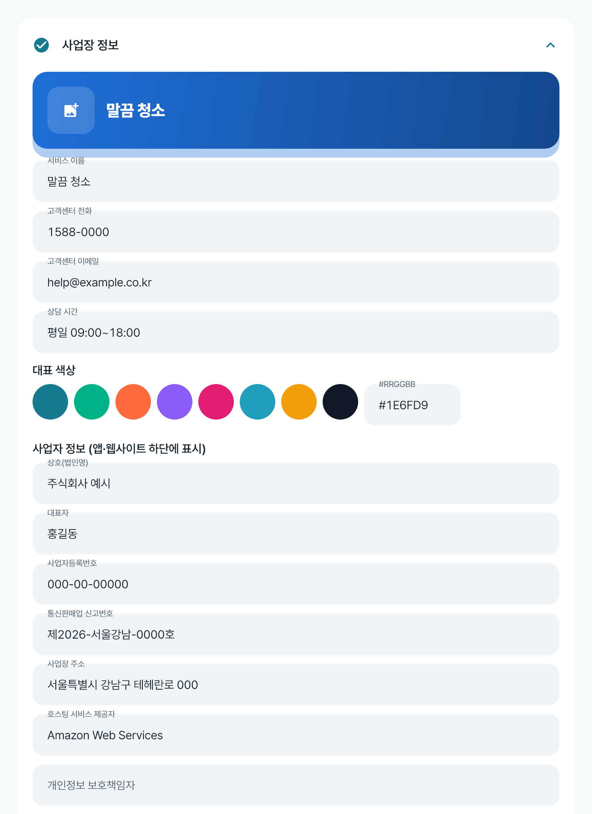
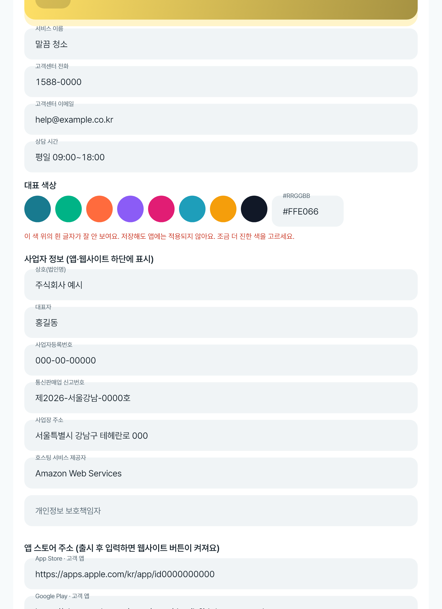
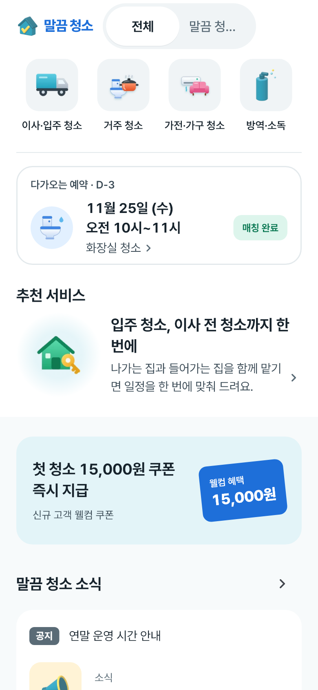

# 28. 이름, 로고, 색 (현재 방식)

**이 장에서 할 일:** 고객이 보는 서비스 이름, 로고, 대표 색을 콘솔에서 바꾸는 방법을 알아봐요.
지금은 콘솔에서 바꿀 수 있는 것과 개발자가 앱을 다시 만들어야 바뀌는 것이 나뉘어 있어요. 이 장에서 둘을 구분해요.

> **준비물**
> - 콘솔에 **관리자** 계정으로 로그인할 수 있어야 해요 (6장).
> - 로고 그림 파일 (PNG 또는 JPG 권장. 아이폰 사진 형식(HEIC)은 앱에서 보이지 않을 수 있어요)
> - 대표 색의 색 번호 (`#RRGGBB` 형식, 예: `#187A8F`). 없으면 콘솔의 색 동그라미에서 골라도 돼요.
> - 사업자등록증 (상호, 대표자, 사업자등록번호를 그대로 옮겨 적어요)

> **참고** 클릭 한 번으로 이름·로고·색·앱 이름까지 모두 바꾸는 **브랜드 변경판**이 나올 예정이에요. 그 전까지는 이 장의 방법을 쓰세요.

---

## 28.1 콘솔에서 바로 바꿀 수 있는 것

모두 콘솔 **[설정]** → **사업장 정보** 카드에 있어요. 칸 하나하나의 설명은 10장에 있어요.

### 서비스 이름, 로고, 대표 색 바꾸기

1. 왼쪽 메뉴에서 **[설정]** 을 눌러요.
2. **사업장 정보** 카드를 눌러 열어요.
3. 카드 맨 위의 미리 보기를 봐요. 앱 맨 위 줄이 어떻게 보일지 보여 줘요.
4. **서비스 이름** 칸에 고객에게 보일 이름을 적어요.
5. **[로고 올리기]** 를 눌러 로고 그림을 골라요. 미리 보기에 로고가 바뀌어 보여요.
6. **대표 색상** 아래 색 동그라미 중 하나를 누르거나, `#RRGGBB` 칸에 색 번호를 적어요.
7. 카드 맨 아래 **[저장]** 을 눌러요.

**이렇게 보이면 성공:** **저장했어요** 가 뜨고, 미리 보기에 새 이름·로고·색이 보여요.

> **주의** 너무 밝은 색을 고르면 **이 색 위의 흰 글자가 잘 안 보여요. 저장해도 앱에는 적용되지 않아요. 조금 더 진한 색을 고르세요.** 가 빨갛게 떠요. 이 색은 저장은 되지만 앱은 쓰지 않고 처음 설치된 기본 색을 써요. 더 진한 색을 고르세요.

> **팁** 처음 설치된 다해 기본 색은 `#187A8F` 예요. 예전에 다른 이름이나 색을 저장한 서버라면 저장된 값이 우선하니, 새 이름과 색을 직접 다시 저장하세요.

### 바뀐 내용이 보이는 곳

| 바꾼 것 | 보이는 곳 |
|---|---|
| **서비스 이름** | 고객 앱 맨 위 로고 옆 글자, 고객 앱 첫 화면, 상담 화면의 **(이름) 상담팀**, 웹사이트, 알림 문구의 `{업체명}`, 운영 알림 문자 앞머리 `[이름]`, 알림톡 템플릿의 `#{brand}` |
| 로고 (**[로고 올리기]**) | 고객 앱 맨 위 (로고 파일이 서버에 올라가 있어야 보여요) |
| **대표 색상** | 고객 앱과 파트너 앱의 버튼과 강조 색 |
| **상담 시간** | 고객 앱 상담 화면의 **상담 가능 시간** |
| **사업자 정보** (상호, 대표자, 사업자등록번호 등) | 웹사이트 바닥글, 이용약관, 고객 앱의 사업자 정보 화면 |

> **참고** 앱은 마지막으로 받은 이름·색을 기억해 두었다가, 다음에 인터넷에 연결되어 열릴 때 새 값으로 바꿔요. 저장한 뒤 바로 안 바뀌면 앱을 완전히 닫았다가 다시 열어 보세요.

> **참고** 사진은 예시 데이터로 찍어서 대표 색과 이름만 바뀌어 보여요. 로고는 실제로 파일을 올려야 나와요.

### 사업자 정보 채우기 (법적으로 필요한 칸)

1. 같은 카드의 **사업자 정보 (앱·웹사이트 하단에 표시)** 묶음으로 내려가요.
2. **상호(법인명)**, **대표자**, **사업자등록번호**, **통신판매업 신고번호**, **사업장 주소**, **호스팅 서비스 제공자** 를 사업자등록증과 계약서 그대로 적어요.
3. **[저장]** 을 눌러요.

> **주의** **서비스 이름** 과 **상호(법인명)** 은 달라요. 사업자등록증의 상호를 바꾸지 않았다면 **상호(법인명)** 칸은 등록증 이름 그대로 두세요. 이용약관 제1조와 바닥글에는 이 상호가 들어가요.

> **팁** 사업자등록번호 10자리를 저장하면 웹사이트 바닥글과 이용약관에 공정거래위원회 **사업자정보확인** 링크가 자동으로 생겨요. 저장한 뒤 링크를 눌러 내 회사 정보가 뜨는지 확인하세요.

---

## 28.2 지금은 개발자가 바꿔야 하는 것

아래 항목은 콘솔에서 바꿀 수 없어요. 개발자에게 부탁해야 하고, 앱을 다시 만들어 스토어에 올려야 바뀌는 것도 있어요.

| 항목 | 지금 모습 | 바꾸는 방법 |
|---|---|---|
| 휴대폰 홈 화면의 앱 이름과 아이콘 | 다해 / 다해 파트너 | 개발자가 앱을 다시 만들어 스토어에 올려요 (25장) |
| 앱 ID | `kr.co.dahae.customer`, `kr.co.dahae.partner` | 스토어에 한 번 올리면 바꿀 수 없어요 |
| 스토어 앱 이름, 설명 문구, 스토어 사진 | `docs/store/listing-*.md`, 스토어 사진 | 개발자가 고쳐 스토어에 다시 넣어요 |
| 앱 안에 고정된 문구 | 홈의 **다해 소식**, **다해 PICK**, **다해 안심예약**, **더보기** 의 **다해 팁** 과 인사말(**오늘도 집안일은 다해에 맡기세요.**), 저작권 문구, 가입 직후 **가입 축하 쿠폰 2장을 드렸어요** | 개발자가 앱 문구를 고쳐 다시 만들어요 |
| 웹사이트의 개인정보처리방침·이용약관 페이지 | 생성기로 만든 문서 (서비스 이름 "다해") | 개발자가 생성기(`scripts/build_legal.py`)로 다시 만들어요 |
| 콘솔을 앱처럼 설치했을 때의 이름 | 다해 관리자 (짧은 이름: 다해 관리) | 개발자가 콘솔 설정 파일(`app/apps/console/web/manifest.json`)을 고쳐 콘솔을 다시 만들어요 |
| 직원 인증 앱에 보이는 이름 | Dahae staff | 개발자에게 문의 |

> **주의** 콘솔에서 취소 규정을 바꿔도(18장) 웹사이트 이용약관 제5조(취소와 환불)에는 자동으로 반영되지 않아요. 규정을 바꾼 뒤에는 개발자에게 약관을 다시 만들어 달라고 하세요.

### 다른 회사 사이트에서 직접 바꿔야 하는 이름

| 어디 | 할 일 |
|---|---|
| 카카오톡 채널 | 채널 프로필 이름을 바꿔요. 카카오 심사가 끝날 때까지 알림톡은 예전 이름으로 나가요. |
| 알림톡 템플릿 | 본문은 `#{brand}` 로 자동 바뀌어요. 템플릿에 옛 이름을 직접 적어 둔 것이 있으면 새로 등록해 승인받아요 (14장). |
| 결제사(PortOne, 토스, 카카오페이, 네이버페이 등) | 관리자 화면의 가맹점 이름과 카드 명세서 표시 이름을 바꿔요. 안 바꾸면 고객 카드 명세서에 예전 이름이 찍혀요. |
| 카카오·네이버·Apple·Google 개발자 사이트 | 간편 로그인 동의 화면의 앱 이름을 바꿔요 (15장). |

### 스토어에 내기 전 법적 확인 (꼭 하세요)

1. **상표 검색**: KIPRIS(`https://www.kipris.or.kr`)에서 쓸 이름을 37류(청소업), 35류(중개·광고), 9류(앱)로 검색해요. 겹치는 상표가 있으면 변리사와 상의한 뒤 이름을 정해요.
2. **상호와 서비스 이름 구분**: 새 이름이 사업자등록증의 상호인지, 서비스 이름일 뿐인지 정해요.
3. **약관 변경 공지**: 이름만 바뀌어도 약관 문구가 바뀐 것이에요. 시행일 **최소 7일 전**에 앱 **공지사항**(22장 콘텐츠 **공지**)과 웹사이트에 알려요.
4. **약관 문구 검토**: 특히 취소·환불 조항은 법률 검토를 권해요.

> **참고** 이 확인 목록의 원본은 `docs/REBRAND-CHECKLIST.md` 예요.

---

## 28.3 앞으로 나올 브랜드 변경판

클릭 한 번으로 서비스 이름, 로고, 색, 앱 이름과 아이콘, 스토어 문구까지 한 번에 바꾸는 판이 나올 예정이에요. 나오는 시기와 범위는 **확인 필요** 예요. 그때까지는:

- 이름·로고·색·사업자 정보는 28.1 대로 콘솔에서 바꿔요.
- 앱 이름·아이콘·고정 문구·약관 페이지는 28.2 대로 개발자에게 부탁해요.

---

## 자주 생기는 문제

| 이렇게 나와요 | 이렇게 해요 |
|---|---|
| 색을 바꿨는데 앱 색이 그대로예요 | 빨간 대비 경고가 떴다면 그 색은 앱에 쓰이지 않아요. 더 진한 색을 골라 다시 저장해요. 경고가 없었다면 앱을 완전히 닫았다 다시 열어요. |
| 로고가 앱에 안 보여요 | **[로고 올리기]** 로 올린 뒤 **[저장]** 을 눌렀는지 봐요. HEIC 형식이면 PNG·JPG 로 바꿔 다시 올려요. |
| **입력값을 확인해 주세요** | 빨갛게 표시된 칸을 고쳐요. 색 번호는 `#` 과 숫자·영문 6자리예요. |
| 휴대폰 홈 화면의 앱 이름이 그대로예요 | 정상이에요. 앱 이름과 아이콘은 개발자가 앱을 다시 만들어야 바뀌어요. |
| 홈에 여전히 **다해 소식** 이라고 나와요 | 앱에 고정된 문구예요. 개발자에게 문의해요. |
| 고객 카드 명세서에 예전 이름이 나와요 | 결제사 관리자 화면에서 가맹점 표시 이름을 바꿔요. |
| 알림톡에 예전 이름이 나와요 | 카카오 채널 이름 심사가 끝났는지, 템플릿에 옛 이름이 직접 적혀 있지 않은지 봐요. |
