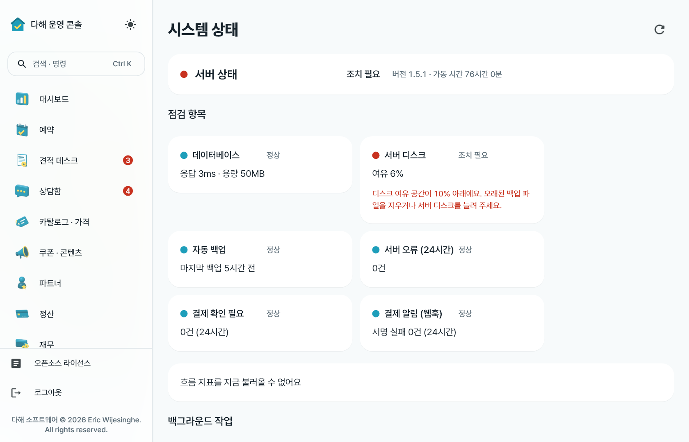

# 29. 자주 묻는 질문과 해결

**이 장에서 할 일:** 문제가 생겼을 때 증상으로 찾아서 해결해요. 항목마다 **누가** 하는지(사장님 / 개발자)와 **어디서** 하는지(콘솔 / 서버 / 회사 사이트)를 적었어요. 사장님이 할 수 있는 일부터 먼저 하고, 안 되면 개발자에게 넘겨요.

> **준비물**
>
> - 콘솔 관리자 계정과 휴대폰 인증 앱 (6장).
> - 개발자(설치 담당) 연락처.
> - 화면을 캡처하는 방법 (PC: `Windows 키 + Shift + S`, 휴대폰: 전원 + 소리 줄이기 버튼).

---

## 29.1 문제가 생기면 먼저 (2분)

1. 콘솔 왼쪽 메뉴 **[시스템 상태]** 를 열어요 (26장).
2. 빨강(**조치 필요**) 항목을 찾아요. 빨간 글씨 안내가 있으면 그대로 따라 해요.

3. 아래 29.3~29.9 에서 증상을 찾아요.
4. 모르겠으면 화면을 캡처해서 개발자에게 보내요. 콘솔이 안 열리면 개발자에게 "서버에서 `sudo dahae status` 와 `sudo dahae logs` 를 봐 주세요" 라고 부탁해요.

---

## 29.2 서버 화면 여는 법 (개발자가 부탁할 때만)

서버 명령은 보통 개발자가 쳐요. 개발자가 "서버 화면에서 이 명령을 쳐 주세요" 라고 부탁할 때만 사장님이 해요.

- **AWS 서버:** AWS 콘솔 **EC2 > 인스턴스** → 서버 선택 → **연결** → **세션 관리자(Session Manager)** 탭 → **연결** (5장 5.5).
- **다른 클라우드:** 서버 회사 화면의 **브라우저에서 SSH 연결** 같은 버튼 (7장).

검은 화면이 열리면:

1. 개발자가 알려 준 명령을 그대로 붙여넣어요. 명령 앞에는 항상 `sudo` 가 붙어요.
2. Enter 를 눌러요.
3. 나온 글자를 캡처해 개발자에게 보내요.

> **팁** `sudo dahae logs` 는 화면이 계속 움직여요. 고장이 아니라 기록을 계속 따라가는 중이에요. 멈추려면 `Ctrl + C` 를 눌러요.

`sudo dahae status` 결과 읽기:

| 화면 글자 | 뜻 |
|---|---|
| `✔ 앱 정상` | 서버 프로그램이 잘 돌아요 |
| `! 앱 응답 없음 — 'dahae logs' 로 확인하세요` | 서버 프로그램이 응답하지 않아요. 개발자 확인 필요 |
| `✔ HTTPS 정상: https://도메인/admin/` | 보안 인증서가 정상이에요 |
| `! HTTPS 인증서가 아직 없어요. …` | 도메인 연결(A 레코드)이 아직이에요 (29.3) |
| `! 외부 가동 확인이 없어요 — …` | 업타임 하트비트가 연결되지 않았어요 (17장) |
| `! 최근 외부 백업이 없어요 — …` | 외부 백업이 없거나 실패했어요 (17장, 27장) |
| `! 비밀 키 사본이 없어요 — …` | 비밀 키 사본을 아직 안 만들었어요 (27.4) |

---

## 29.3 사이트와 접속

### 사이트가 아예 안 열려요

- **누가:** 사장님이 1~2번, 개발자가 3번부터
- **어디서:** 브라우저, 서버 회사 화면, 서버

1. 휴대폰 데이터(와이파이 끄기)로도 열어 봐요. 다른 곳에서는 열리면 우리 쪽 인터넷 문제예요.
2. 서버 회사 화면(AWS 는 **EC2 > 인스턴스**)에서 서버가 **켜져 있는지** 봐요. 꺼져 있으면 켜고 1~2분 기다려요. 서버가 켜지면 서비스도 다시 올라와요.
3. 개발자가 `sudo dahae status` 를 확인해요. `✔ 앱 정상` 인데 안 열리면 인증서나 도메인 문제예요 (아래 "안전하지 않음").
4. 방금 업데이트한 뒤라면 개발자에게 알려요. 개발자가 이전 버전으로 되돌릴 수 있어요 (29.8).

### 브라우저에 "안전하지 않음" 이 나와요

- **누가:** 사장님(기다리기, DNS 확인), 개발자(서버 확인)
- **어디서:** 도메인 회사 화면(Cloudflare, 가비아 등), 서버

1. 설치한 지 얼마 안 됐다면 **10~30분 기다린 뒤** 다시 열어요. 도메인 연결이 퍼지는 데 시간이 걸려요.
2. 도메인 회사 화면에서 A 레코드가 **서버 공인 IP** 와 같은지 봐요 (5장).
3. Cloudflare 를 쓴다면 그 줄의 구름이 **회색 (DNS only)** 인지 봐요. 주황색이면 눌러서 회색으로 바꿔요.
4. 그래도 안 되면 개발자가 서버 방화벽에서 80, 443 이 열려 있는지 확인해요.

> **주의** 같은 오류가 계속 나도 서버를 여러 번 다시 시작하지 마세요. 인증서 발급 시도가 쌓여요. 한 번 고친 뒤에는 기다리세요.

> **팁** `www.도메인` 만 안 열리면 `www` A 레코드가 없어서 그래요. 본 주소는 영향이 없어요 (5장).

### 사이트에 "점검 중" 안내만 나오고, 앱은 "서버에 연결할 수 없어요" 라고 해요

- **누가:** 사장님(1~2번), 개발자(3번부터)
- **어디서:** 콘솔, 서버

1. 콘솔(`https://도메인/admin/`)이 열리는지 봐요.
2. 콘솔이 열리면 **[시스템 상태]** 의 **점검 모드** 가 켜져 있는지 봐요. 켜져 있으면 끄고 **[저장]** 을 눌러요 (26.7). 30초 뒤 앱을 완전히 닫았다가 다시 열어요.
3. 콘솔도 안 열리면 서버 프로그램이 멈춘 거예요. 개발자에게 알려요. 개발자가 `sudo dahae status` 와 `sudo dahae logs` 로 원인을 찾아요. 디스크가 꽉 찼거나, 최근 업데이트 때문일 수 있어요.

### 콘솔은 열리는데 화면마다 오류가 나요

1. 왼쪽 메뉴 맨 아래쪽의 **[로그아웃]** 을 누르고 다시 로그인해요.
2. 브라우저를 완전히 닫았다가 다시 열어요.
3. 그래도 같으면 **[시스템 상태]** 의 **데이터베이스** 카드를 봐요. 빨강이면 개발자에게 연락해요.

### 콘솔에서 바꾼 설정(색, 문구, 스위치)이 앱에 안 보여요

1. 30초쯤 기다린 뒤 앱을 완전히 닫았다가 다시 열어요. 서버는 30초 안에 바뀐 설정을 내보내고, 앱은 새로 열 때 읽어요.
2. 대표 색과 로고는 앱이 마지막 값을 기억해 두어서, 다음에 열 때 바뀔 수 있어요 (28장).

---

## 29.4 로그인과 계정

### 설치 코드가 맞지 않아요 (**설치 코드가 맞지 않아요**)

- **누가:** 사장님
- **어디서:** 처음 화면 (`https://도메인/admin/`)

1. 코드를 다시 봐요. 설치 코드는 `XXXX-XXXX-XXXX` 모양의 12자리예요.
2. 설치 코드에는 숫자 `0`, `1` 과 영문 `I`, `L`, `O` 가 들어가지 않아요. `0` 처럼 보이면 영문이 아닌지, `O` 처럼 보이면 숫자가 아닌지 다시 봐요. 헷갈리는 글자는 개발자에게 다시 물어요.
3. 개발자가 코드를 새로 만들었다면 예전 코드는 쓸 수 없어요. 새 코드를 받아요.

### 설치 코드 기간이 지났어요 (**설치 코드 유효 기간(7일)이 지났어요. …**)

- **누가:** 개발자
- **어디서:** 서버

1. 개발자에게 새 설치 코드를 달라고 해요.
2. 개발자가 서버에서 `sudo dahae setup-code --renew` 로 새 코드를 만들어 알려 줘요.
3. 새 코드로 사장님 계정을 만들어요 (6장).

> **팁** 설치 코드를 잃어버렸을 뿐이고 7일이 안 지났으면, 개발자가 `sudo dahae setup-code` 로 같은 코드를 다시 보여 줄 수 있어요. 사장님 계정을 만든 뒤에는 설치 코드를 더 쓰지 않아요.

### 2단계 인증 코드가 안 맞아요 (**코드가 맞지 않아요. 휴대폰 시간이 맞는지 확인하고 다시 입력하세요.**)

1. 휴대폰 **설정 > 날짜 및 시간** 에서 **자동 설정** 을 켜요. 휴대폰 시계가 몇십 초만 틀려도 코드가 안 맞아요.
2. 인증 앱에 **새로 나온** 6자리를 넣어요. 코드는 30초마다 바뀌어요.
3. 인증 앱에 다해 항목이 여러 개라면 지금 로그인하는 계정의 항목인지 확인해요.

### "시도가 너무 많아요. 몇 분 뒤에 다시 시도하세요." 가 나와요

- 틀린 비밀번호나 코드를 여러 번 넣어서 잠깐 잠겼어요. 15분쯤 기다린 뒤 다시 해요.
- 이 일은 **[시스템 상태]** 알림의 **계정 보안 이상(로그인 잠금 등)** 으로 사장님께 알려져요. 내가 한 일이 아니라면 29.9를 보세요.

### "로그인 시간이 지났어요. 비밀번호부터 다시 입력하세요." 가 나와요

비밀번호를 넣고 5분 안에 코드를 넣지 않으면 나와요. 처음부터 다시 로그인해요.

### "이 인증 번호는 이미 썼어요. …" 가 나와요

같은 6자리는 한 번만 쓸 수 있어요. 30초쯤 기다렸다가 인증 앱에 새로 나온 번호를 넣어요.

### 휴대폰을 잃어버렸어요 (인증 앱이 없어요)

- **누가:** 사장님 (복구 코드가 있으면), 개발자 (복구 코드도 없으면)
- **어디서:** 로그인 화면, 서버

**복구 코드가 있을 때:**

1. 로그인 화면에서 이메일과 비밀번호를 넣고 **[로그인]** 을 눌러요.
2. 코드 화면에서 **[복구 코드 사용]** 을 눌러요.
3. 종이에 적어 둔 복구 코드 10개 중 **아직 안 쓴 것 하나**를 넣어요. 복구 코드는 하나에 한 번만 써요.
4. 로그인되면 바로 **[내 계정]** → **[복구 코드 다시 만들기]** 로 새 복구 코드를 받아 종이에 적어요 (8장). 예전 코드는 못 쓰게 돼요.
5. 새 휴대폰의 인증 앱을 다시 등록하는 방법은 **확인 필요** 예요. 개발자와 함께 하세요.

**복구 코드도 없을 때:**

1. 개발자에게 연락해요.
2. 개발자가 서버에서 **한 시간짜리 초기화 코드**를 만들어요. 이 코드와 비밀번호로 2단계 인증을 다시 설정할 수 있어요.
3. 초기화 코드를 넣는 화면은 아직 콘솔에 없어서, 개발자가 도와줘야 해요 (**확인 필요**).

> **주의** 소유자의 인증 앱이 없으면 결제 카드 잠금 해제, 서버 업데이트 같은 소유자 기능을 쓸 수 없어요. 복구 코드는 꼭 종이에 적어 안전한 곳에 두세요 (32장).

### 직원이 비밀번호를 잊었어요

- **누가:** 관리자
- **어디서:** 콘솔 **[직원]**

1. 왼쪽 메뉴 **[직원]** 을 눌러요.
2. 그 직원 줄에서 **[비밀번호 재설정]** 을 눌러요.
3. 확인 창에서 계속해요. 그 직원은 모든 기기에서 로그아웃돼요.
4. **인증번호 전달 방법** 에서 **문자로 보내기** 또는 **직접 전달 (복사)** 를 골라요.
5. 직원은 받은 인증번호로 **24시간 안에** 새 비밀번호를 정해요. 인증번호는 한 번만 쓸 수 있어요.

자세한 내용은 20장에 있어요.

### 메뉴가 몇 개 안 보여요

**상담원** 계정에는 **[설정]**, **[직원]**, **[재무]**, **[운영 규칙]**, **[알림 문구]**, **[활동 기록]**, **[갱신 일정]**, **[내 계정]** 이 보이지 않아요. 관리자 계정으로 로그인하세요 (8장).

---

## 29.5 설정 카드

### "잠긴 카드예요. 소유자가 잠금을 풀어야 바꿀 수 있어요" 가 나와요

- **누가:** 소유자(사장님)
- **어디서:** 콘솔 **[설정]**

1. 소유자 계정으로 로그인해요.
2. 그 카드의 **[잠금 해제 (소유자 코드)]** 를 눌러요.
3. 인증 앱의 6자리를 넣어요.
4. 카드에 **○분 후 잠겨요** 가 보이면 5분 안에 고치고 **[저장]** 해요.
5. 다 했으면 **[잠그기]** 를 눌러요.

**소유자만 잠금을 풀 수 있어요** 가 보이면 지금 계정이 소유자가 아니에요. 자세한 내용은 9장.

### "인증 코드가 맞지 않아요. 앱에 지금 나온 코드를 입력해 주세요" / "잘못된 코드가 여러 번 입력됐어요. …"

1. 휴대폰 시간을 **자동 설정** 으로 맞춰요.
2. 인증 앱에 지금 나온 번호를 넣어요.
3. 여러 번 틀려 잠겼으면 몇 분 기다린 뒤 다시 해요.

### "키가 올바르지 않아요. 복사한 값을 다시 확인해 주세요"

1. 그 회사 사이트(카드의 **[사이트 열기]**)에서 키를 다시 복사해요.
2. 앞뒤에 빈칸이 들어가지 않게 붙여넣어요. 메모장에 먼저 붙여 확인하면 좋아요.
3. 테스트 키와 라이브(실거래) 키를 섞지 않았는지 봐요.
4. 카드가 잠겨 있으면 먼저 잠금을 풀고 (위), **[저장]** → **[연결 확인]** (결제 카드는 **[API 키 확인]**).

### "서비스에 연결할 수 없어요. 잠시 후 다시 시도해 주세요"

그 회사 서비스가 잠깐 응답하지 않는 거예요. 5~10분 뒤 다시 **[연결 확인]** 을 눌러요. 계속되면 개발자에게 알려요.

### "저장됨 · 앱에서 로그인해 확인하세요"

간편 로그인 카드처럼 서버에서 바로 시험할 수 없는 카드예요. 고객 앱에서 그 방법으로 직접 로그인해 봐요 (15장).

### 저장할 때 형식 오류가 나와요

| 화면 글자 | 고치는 법 |
|---|---|
| **상점 아이디는 store-로 시작해야 해요.** | PortOne 상점 아이디를 `store-` 부터 다시 복사 |
| **채널 키는 channel-key-로 시작해야 해요.** | PortOne 채널 키를 `channel-key-` 부터 다시 복사 |
| **V2 API Secret 형식이 맞지 않아요. 공백 없이 전체를 붙여넣어 주세요.** | 빈칸 없이 전체를 다시 붙여넣기 |
| **웹훅 시크릿은 whsec_로 시작해야 해요.** | `whsec_` 부터 다시 복사 |
| **시크릿 키는 test_sk_ 또는 live_sk_로 시작해야 해요.** | 토스 시크릿 키를 다시 복사 |
| **클라이언트 키는 test_ck_ 또는 live_ck_로 시작해야 해요.** | 토스 클라이언트 키를 다시 복사 |
| **보안 키는 0~9, a~f 글자 64개예요. 토스 개발자센터에서 그대로 복사해 붙여넣어 주세요.** | 토스 개발자센터에서 보안 키를 그대로 다시 복사 |
| **테스트 키와 라이브 키를 섞을 수 없어요. 같은 종류의 키를 넣어 주세요.** | 모두 `test_` 이거나 모두 `live_` 인 키로 맞추기 |
| **엔드포인트는 https://로 시작해야 해요.** | 외부 백업 주소 앞에 `https://` |
| **버킷 이름이 올바르지 않아요.** | 소문자, 숫자, `-`, `.` 만 써서 3~63자 |
| **리전 값이 올바르지 않아요.** | 예: R2 는 `auto` |
| **보관 기간 값이 범위를 벗어났어요.** | 1~3650 사이 숫자 |
| **서비스 계정 파일이 올바르지 않아요.** | Firebase 에서 받은 파일 내용을 그대로 다시 붙여넣기 |
| **필수 항목을 모두 입력해 주세요.** | 빈 칸 채우기 |
| **결제 수단을 하나 이상 켜 주세요. 모두 끄면 고객이 결제할 수 없어요.** | **결제 수단** 카드에서 하나 이상 켜기 |

---

## 29.6 결제, 환불, 지급

### 시스템 상태의 "결제 알림 (웹훅)" 이 노랑·빨강이에요 (서명 실패)

- **누가:** 소유자(사장님)
- **어디서:** 콘솔 **[설정]**, PortOne 또는 토스 화면

1. 결제사 화면에 넣은 웹훅 주소가 카드에 보이는 주소와 **글자 하나까지** 같은지 봐요.
   - PortOne: `https://도메인/v1/webhooks/portone`
   - 토스페이먼츠 결제: `https://도메인/v1/webhooks/tosspayments`
2. 결제사 화면에서 시크릿(보안 키)을 다시 복사해요.
3. 콘솔 **[설정]** 에서 그 카드의 잠금을 풀고 붙여넣은 뒤 **[저장]** 해요.
   - PortOne: **결제 (PortOne)** 카드의 웹훅 시크릿
   - 토스페이먼츠 결제: **결제 (토스페이먼츠)** 카드의 보안 키
4. 결제사 화면에 실패한 알림을 **다시 보내기** 기능이 있으면 눌러요. 서버는 같은 알림을 두 번 받아도 안전하게 처리해요.

> **팁** 이 카드는 PortOne 과 토스페이먼츠 결제 알림만 세요. 토스 지급대행 알림(`https://도메인/v1/webhooks/toss`, **파트너 지급** 카드의 보안 키)의 서명 실패는 이 카드에 나오지 않아요. 지급 결과가 늦으면 아래 "파트너 지급이 실패했어요" 를 보세요.

### 시스템 상태의 "결제 확인 필요" 가 빨강이에요 / 고객이 결제했는데 예약이 없대요

- **누가:** 사장님
- **어디서:** 콘솔, PortOne 또는 토스페이먼츠 관리자 화면

1. 3분쯤 기다려요. 서버가 1분마다 결제사와 맞춰 보고, 2분이 지난 결제 중 예약이 빠진 것을 찾아 예약을 만들어요.
2. 콘솔 **[예약]** 에서 고객 전화번호로 찾아봐요.
3. 그래도 없으면 결제사 관리자 화면에서 그 결제가 **결제 완료** 인지 봐요.
4. 결제 완료인데 예약이 없으면, 결제사 관리자 화면에서 그 결제를 **직접 환불**하고 고객에게 알려요.
5. 예약이 끝내 생기지 않았거나 직접 환불했다면, 결제 번호와 시각을 개발자에게 보내요.

### 시스템 상태의 "PortOne 테스트 채널 결제" 가 빨강이에요

- **누가:** 사장님
- **어디서:** 콘솔 **[설정]** → **결제 (PortOne)**, PortOne 관리자 화면

PortOne **테스트** 채널로 결제나 카드 저장이 들어왔어요. 실제 돈은 오가지 않았어요. 알림 휴대폰으로 **PortOne 테스트 채널로 결제가 들어왔어요** 문자도 가요.

1. 아직 테스트 채널 키로 시험 중이라면 (11장 11.9) 당연한 일이에요. 할 일은 없어요.
2. 운영 중이라면 **결제 (PortOne)** 카드를 잠금 해제하고, 저장된 채널 키가 모두 **라이브** 채널 키인지 확인해요 (11장 11.10).
3. PortOne 관리자 화면에서 이 상점의 테스트 채널을 삭제해요.
4. PortOne 의 테스트 결제 내역에서 그 결제를 찾아 고객과 예약을 다시 확인해요. 이 서버의 키가 아닌 테스트 채널로 들어온 결제는 거절돼서 예약되지 않았어요.

### 결제 카드의 연결 해제나 다시 저장이 거절돼요

| 화면 글자 | 뜻 | 할 일 |
|---|---|---|
| **이 결제사에 진행 중인 결제, 저장된 카드나 남은 환불이 있어 연결을 끊을 수 없어요. …** | 진행 중인 결제, 하루 안에 만료된 결제창, 저장된 카드, 진행 중인 정기 결제, 남은 환불이 아직 이 카드를 써요 | 카드를 그대로 둬요. 새 결제만 멈추려면 토스페이먼츠는 **사용** 을 끄고 (12장 12.10), PortOne 은 채널 키 칸을 지워요 (11장 11.12) |
| **이 결제사로 받은 결제 중 아직 환불할 수 있는 결제(결제 후 1년 이내)가 있어 연결을 끊을 수 없어요. …** | 지난 1년 안의 결제를 이 카드로 아직 환불할 수 있어요 | 마지막 결제 뒤 최소 1년은 카드를 그대로 둬요 |
| **이 결제사로 받은 결제, 저장된 카드나 남은 환불이 아직 지금 계정(PortOne 상점, 토스페이먼츠 MID)에 있어서 다른 계정으로 바꿀 수 없어요. …** | 쓰고 있는 카드에 **다른** PortOne 상점이나 토스 MID 의 키를 넣었어요 | 전에 쓰던 계정의 키를 다시 넣어요. **같은** 계정에서 새로 받은 키는 저장돼요. 새 계정으로 옮기려면 먼저 개발자와 상의해요 |

### 결제가 안 된다는 문의가 많아요

1. **[설정]** → **결제 (PortOne)** 카드 → **[API 키 확인]** (토스페이먼츠를 쓰면 **결제 (토스페이먼츠)** 카드의 **[API 키 확인]**).
2. **[시스템 상태]** → **기능 스위치** 의 **결제** 가 켜져 있는지, **점검 모드** 가 꺼져 있는지 봐요.
3. **[설정]** → **결제 수단** 카드에서 고객이 쓰려는 수단이 켜져 있는지 봐요 (10장).
4. **외부 서비스** 의 결제 줄에 오류 코드가 있으면 캡처해 개발자에게 보내요.

### 파트너 지급이 실패했어요

- **누가:** 사장님
- **어디서:** 콘솔 **[정산]** 의 **지급 내역** (21장)

1. 그 지급 건의 상태를 봐요: **요청됨**, **전송됨**, **지급 완료**, **실패**.
2. **전송됨** 이면 **[다시 시도] 를 누르지 마세요.** 이미 은행으로 갔을 수 있어요. 먼저 **[상태 확인]** 을 눌러요.
3. **직접 이체** 방식이면: 은행에서 보냈으면 **[이체 완료로 표시]**, 못 보냈으면 **[실패로 표시]** 를 누르고 사유를 적어요.
4. **토스 지급대행** 방식에서 결과를 모르면: 토스 상점관리자에서 송금이 안 된 것을 직접 확인한 뒤에만 **[송금되지 않았음을 확인]** → **토스 상점관리자에서 직접 확인했어요** 체크 → **[송금되지 않음으로 표시]** 를 눌러요. 그다음에 **[다시 시도]** 를 할 수 있어요.
5. 지급 버튼을 누를 때 인증 앱 코드를 물으면 6자리를 넣어요.

> **주의** 송금됐는지 확실하지 않을 때 **[송금되지 않음으로 표시]** 를 누르면 같은 돈이 두 번 나갈 수 있어요. 확실하지 않으면 개발자에게 먼저 물어요.

---

## 29.7 문자, 푸시, 간편 로그인

### 인증 문자나 예약 알림 문자가 안 가요

- **누가:** 사장님
- **어디서:** 콘솔 **[설정]**, Solapi 사이트

1. **[설정]** → **문자 · 알림톡 (Solapi)** 카드 → **[연결 확인]**.
2. Solapi 사이트에서 **잔액**이 남아 있는지 봐요.
3. Solapi 에서 **발신번호**가 승인됐는지, 알림톡 **템플릿**이 승인됐는지 봐요 (14장). 승인 전에는 문자가 나가지 않아요.
4. **[시스템 상태]** → **백그라운드 작업** 의 **알림 발송함** 에 **발송 실패 ○건 (재시도 끝)** 이 있으면, 그 문자는 다시 보낼 수 없어요. 고객에게 전화나 앱으로 알려요.
5. 연결 확인은 되는데 계속 실패하면 개발자에게 알려요.

### 앱 푸시 알림이 안 와요

1. **[시스템 상태]** → **외부 서비스** 의 **앱 푸시 알림 (Firebase)** 줄을 봐요.
2. **설정 안 됨** 이면 16장대로 카드를 채워요.
3. 빨강이면 16장의 카드에서 서비스 계정 파일을 다시 넣고 **[연결 확인]** 을 눌러요.
4. 아이폰에서만 안 오면 앱을 만들 때 넣는 Apple 푸시 키 문제일 수 있어요. 개발자에게 알려요.
5. 고객 휴대폰 설정에서 앱 알림이 꺼져 있지 않은지도 물어봐요.

### 카카오·네이버·구글·애플 로그인이 안 돼요

1. **[시스템 상태]** → **외부 서비스** 에서 그 로그인 줄의 오류 코드를 봐요.
2. **[설정]** 의 그 로그인 카드에서 키를 다시 확인하고 **[저장]** 해요 (15장).
3. 고객 앱에서 직접 그 방법으로 로그인해 봐요.
4. 안드로이드에서 카카오·구글 로그인만 안 되면, 스토어 앱 서명 지문이 카카오·구글 개발자 화면에 등록되지 않은 경우가 많아요. 개발자에게 알려요.
5. 네이버 로그인 뒤 앱으로 돌아오지 않으면 **앱 링크** 설정 문제예요 (15장). 개발자와 함께 확인해요.

---

## 29.8 서버, 디스크, 백업, 업데이트

### "서버 디스크" 가 노랑·빨강이에요 (디스크 부족)

- **누가:** 개발자
- **어디서:** 서버

1. 개발자에게 "서버 디스크가 부족하대요" 라고 알려요.
2. 개발자가 무엇이 공간을 쓰는지 확인하고 정리하거나, 서버 디스크를 늘려요.

> **주의** 서버의 `.env` 파일과 `keys-` 로 시작하는 파일, 외부 백업이 없는 백업 파일은 절대 지우면 안 돼요. 사장님이 서버에서 직접 파일을 지우지 마세요.

### "자동 백업" 이 노랑·빨강이에요

27장 27.2와 "자주 생기는 문제" 를 따라 해요.

### 업데이트 뒤에 화면이나 기능이 이상해요

- **누가:** 사장님(소유자 계정), 그다음 개발자
- **어디서:** 콘솔 **[시스템 상태]** → **서버 업데이트** → **복구**

1. 이상한 화면과 **[시스템 상태]** 의 **최근 서버 작업** 을 캡처해요.
2. **복구** 의 **[이전 버전으로 되돌리기]** 를 누르고 26장 (복구: 이전 버전으로 되돌리기) 을 따라 해요. 사장님 코드와 서버 승인 코드가 필요해요. 데이터는 지워지지 않아요.
3. 캡처와 무엇이 이상했는지를 개발자에게 보내요.
4. 되돌린 뒤에는 월요일 자동 업데이트가 더 새 버전이 나올 때까지 되돌린 버전을 지켜요. 개발자가 고친 버전이 나왔다고 하기 전에는 **[지금 업데이트]** 를 누르지 마세요. 떠나온 그 버전이 다시 들어가요.

### 최근 서버 작업에 "실패" 나 "실패해서 이전 버전으로 되돌렸어요" 가 보여요

- **실패해서 이전 버전으로 되돌렸어요**: 서비스는 이전 버전으로 잘 돌고 있어요. 급하지 않아요. 개발자에게 알려요.
- **실패**: 화면을 캡처해 개발자에게 보내요. 개발자가 서버 기록을 확인해요.

### 서버가 꺼졌는지 바로 알고 싶어요

서버는 자기가 꺼진 것을 스스로 알릴 수 없어요. **업타임 하트비트**를 연결하면 바깥 서비스가 지켜보다가 알려 줘요. **[설정]** 의 **업타임 하트비트** 카드가 **설정 필요** 라면 개발자에게 연결을 부탁해요 (17장).

---

## 29.9 보안 사고

### 비밀 키나 비밀번호가 밖으로 샜을 수 있어요

**신호:** 모르는 로그인, **계정 보안 이상(로그인 잠금 등)** 알림, 결제 알림 서명 실패가 갑자기 늘어남, 결제사에서 모르는 거래 알림.

**사장님이 바로 할 일 (순서대로):**

1. **[내 계정]** → **[모든 기기에서 로그아웃]** 을 눌러요. 인증 앱 코드를 넣어요.
2. **[내 계정]** → **[비밀번호 바꾸기]** 로 비밀번호를 바꿔요.
3. **[직원]** 에서 직원마다 **[비밀번호 재설정]** 을 해요. 그만둔 직원은 **[비활성화]** 해요.
4. 샜을 수 있는 키(결제, 문자, 푸시, 간편 로그인, 토스 보안 키, 외부 백업)는 각 회사 사이트에서 **새로 발급**하고, 옛 키는 그 사이트에서 **폐기**해요.
5. **[설정]** 의 각 카드에 새 키를 넣고 **[저장]** → **[연결 확인]** (결제 카드는 **[API 키 확인]**) 해요.
6. **[활동 기록]** 에서 최근 로그인과 설정 변경을 보고, 모르는 일이 있으면 캡처해요.
7. **반드시 개발자에게 연락**해요. 서버 안의 키(로그인 토큰 키, 데이터 키, 데이터베이스 비밀번호)는 사장님이 바꾸면 안 되고 개발자가 해야 해요. 키를 바꾼 뒤에는 비밀 키 사본도 새로 만들어요 (27.4).

> **주의** 서버의 `.env` 파일을 직접 고치지 마세요. 잘못 고치면 모든 연동이 멈추고 백업을 못 열 수 있어요.

### 고객이 탈퇴나 개인정보 열람·삭제를 요청해요

23장의 **[탈퇴·개인정보 요청]** 순서를 따라요. 파트너(기사님) 탈퇴와 자료 사본은 아직 콘솔에서 할 수 없어요. 개발자에게 보내요.

---

## 29.10 개발자에게 연락할 때 보낼 것

연락할 때 아래를 같이 보내면 빨리 해결돼요.

1. 언제부터 그랬는지 (날짜와 시각)
2. 무엇을 하다가 그랬는지
3. **[시스템 상태]** 화면 캡처 (빨간 항목이 보이게)
4. 오류 글자가 나온 화면 캡처
5. 결제 문제라면 결제 번호, 금액, 시각
6. 이미 해 본 것 (예: "연결 확인을 눌렀는데 키가 올바르지 않다고 나와요")

> **주의** 비밀번호, 키, 복구 코드는 채팅이나 이메일 본문에 절대 쓰지 마세요 (32장).

---

## 자주 생기는 문제

> **자주 생기는 문제**
>
> - **이 장에 없는 증상이에요** → 29.1부터 하고, 29.10의 내용을 개발자에게 보내세요.
> - **개발자가 "서버에서 명령을 쳐 주세요" 래요** → 29.2대로 서버 화면을 열고, 받은 명령을 그대로 붙여넣으세요.
> - **고친 것 같은데 시스템 상태가 그대로예요** → 오른쪽 위 **새로고침** 을 누르세요. 외부 서비스 줄은 그 서비스가 다음에 성공한 기록이 생겨야 초록으로 바뀌어요.
